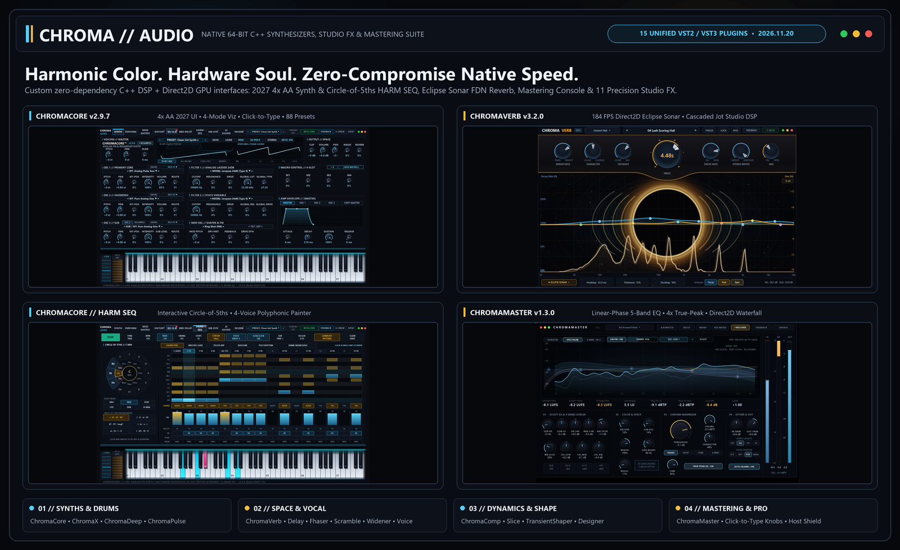
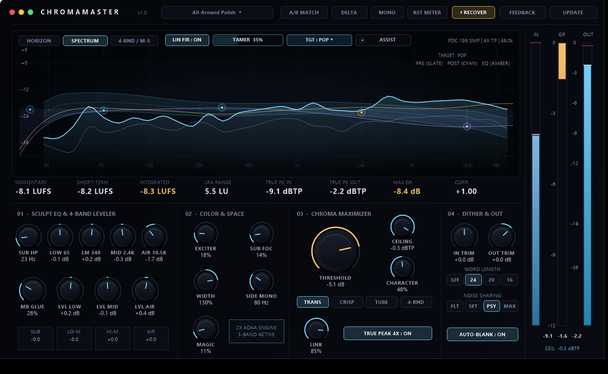
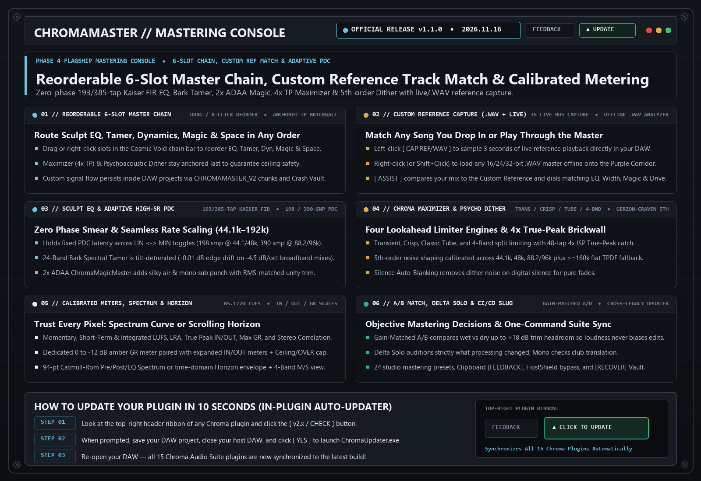
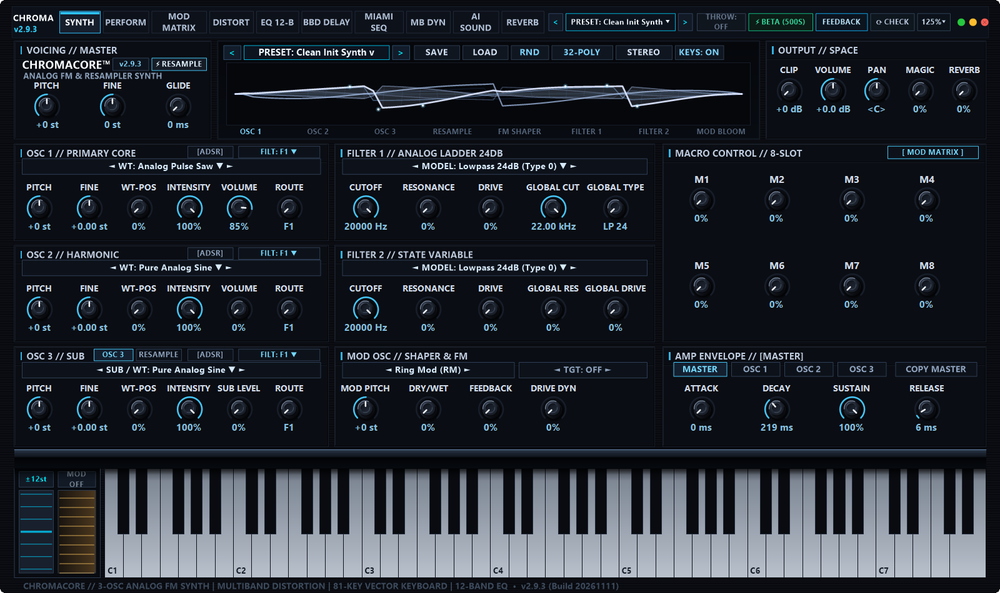
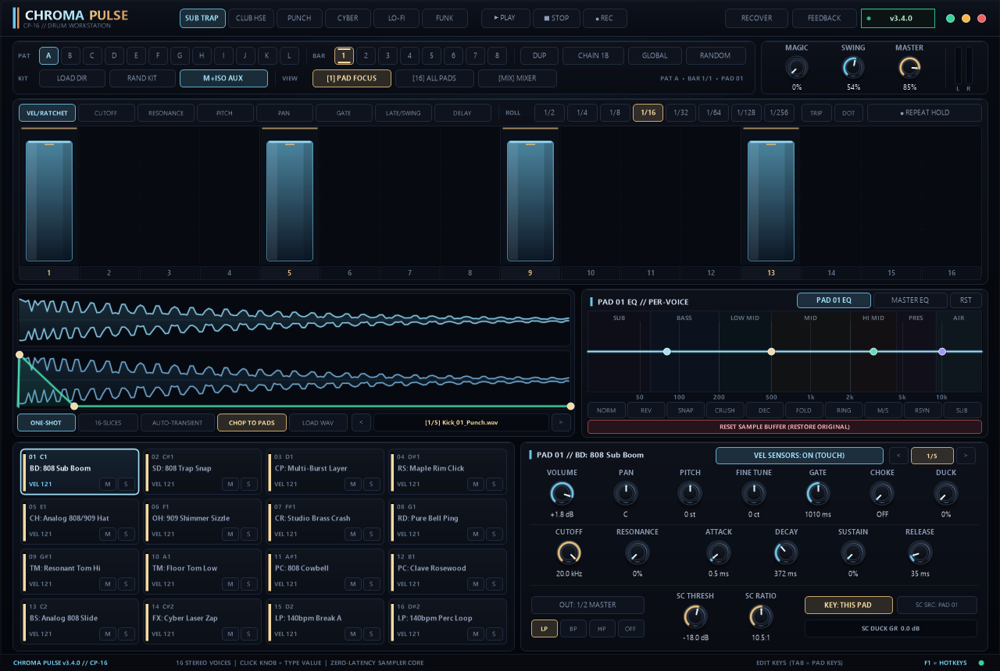
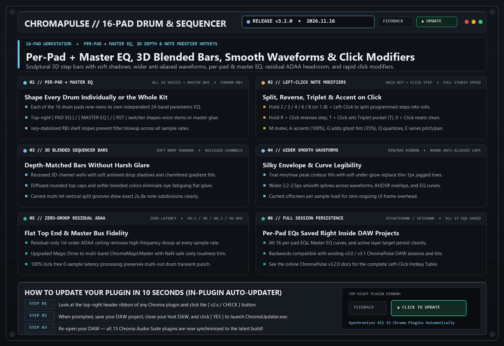
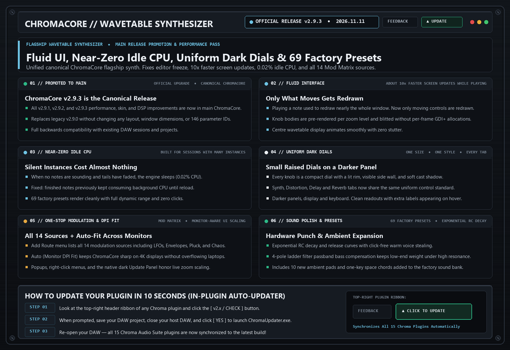
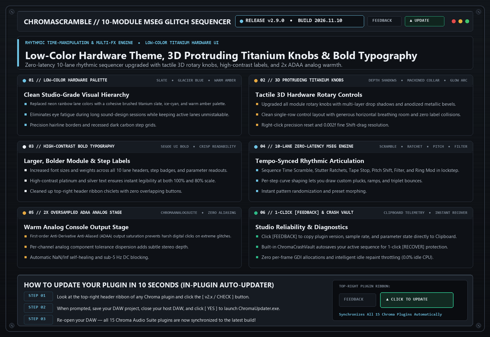

# Chroma Audio Suite — Official Release Hub, Version History & Audio Guide

**Harmonic Color. Hardware Soul. Native Speed.** — Pure native 64-bit C++ synthesizers and studio effects built for analog weight, sub-2 ms UI responsiveness, and near-zero idle CPU.

---

## ⚡ Suite-Wide Phase 2 Performance & Audio Polish (`2026-11-15`)

Every plugin across the suite now ships with **32-bit DIB offscreen caches**, **`ChromaFastText`** zero-allocation text rendering, **dirty-rect `GetUpdateRgn` / clip culling**, **`0.0/s` idle repaints** (`<5 ms` live UI frame time), and **tail-aware idle DSP bypass** (`<0.25%` idle CPU), verified bit-exact where applicable.

| Plugin | Idle DSP % | Playing DSP % | Post-Tail % | Live Paint (ms) | Idle Repaints/s | Key 2026-11-15 Update |
|---|---:|---:|---:|---:|---:|---|
| **ChromaCore** (`v2.9.3`) | `0.02%` | `5.48%` | `0.02%` | `1.77 ms` | `0.0/s` | Cached 3D chassis & keybed, batched display, `ChromaFastText` |
| **ChromaPulse** (`v3.2.0`) | `0.22%` | `2.88%` | `0.02%` | `1.98 ms` | `0.0/s` | Per-Pad + Master EQ, 3D blended bars, smooth waveforms, residual ADAA, left-click modifiers |
| **ChromaDeep** (`v2.9.0`) | `0.02%` | `23.18%` | `1.02%` | `0.86 ms` | `0.0/s` | Cached `AdditiveEngine` partial table + trig rotation (`diff=0`), DIB caches |
| **ChromaX** (`v2.9.0`) | `0.13%` | `4.47%` | `0.02%` | `3.05 ms` | `0.0/s` | 32-bit DIB, clip culling, eased meters, tail-aware idle bypass |
| **ChromaVerb** (`v2.9.1`) | `0.25%` | `2.11%` | `0.02%` | `4.73 ms` | `0.0/s` | 32-bit DIB, eased meters, clip culling, idle bypass |
| **ChromaDelay** (`v2.9.0`) | `0.13%` | `1.09%` | `0.02%` | `1.87 ms` | `0.0/s` | 32-bit DIB cache, `ChromaFastText`, dirty-rect clip, idle bypass |
| **ChromaComp** (`v2.9.0`) | `0.15%` | `1.32%` | `0.04%` | `4.83 ms` | `0.0/s` | 32-bit DIB & bkg cache, eased meters, clip culling, idle bypass |
| **ChromaTransientShaper** (`v2.9.0`) | `0.03%` | `0.17%` | `0.02%` | `4.21 ms` | `0.0/s` | DIB cache, `ChromaFastText`, dirty-rect clipping, idle bypass |
| **ChromaDesigner** (`v2.9.0`) | `0.03%` | `0.35%` | `0.02%` | `0.29 ms` | `0.0/s` | 32-bit DIB cache, `ChromaFastText`, dirty-rect clipping, idle bypass |
| **ChromaFhaser** (`v2.9.0`) | `0.16%` | `1.58%` | `0.02%` | `4.81 ms` | `0.0/s` | Fixed linear-RMS timer trap, DIB backbuffer, clip culling |
| **ChromaScramble** (`v2.9.0`) | `0.02%` | `1.51%` | `1.41%` | `0.00 ms` | `0.0/s` | 32-bit DIB curve cache, `GetUpdateRgn` culling, tail-aware bypass |
| **ChromaSlice** (`v2.9.0`) | `0.03%` | `0.85%` | `0.03%` | `3.52 ms` | `0.0/s` | DIB cache, `ChromaFastText`, dirty-rect clipping, idle bypass |
| **ChromaVoice** (`v3.2.1`) | `0.02%` | `4.97%` | `0.45%` | `1.96 ms` | `0.0/s` | 32-bit DIB layers, dirty-rect clip, 2-stage tail idle bypass |
| **ChromaWidener** (`v2.9.0`) | `0.09%` | `1.36%` | `0.02%` | `2.74 ms` | `0.0/s` | 32-bit DIB cache, `ChromaFastText`, dirty-rect clipping, idle bypass |
| **ChromaMaster** (`v1.0.0`) | `—` | `—` | `—` | `16ms/60fps` | `0.0/s` | Whole-song mastering console: 193-tap Kaiser LIN FIR, 24-band Bark Tamer, 2x ADAA Magic, 4x TP Limiter, Psycho Dither |

---

## 🗂️ Browse Plugins by Category (Release Notes & Plain-English DSP Guides)

### 📁 [Synthesizers](docs/01_Synthesizers/README.md)
| Plugin | Latest Build | UI Screen | Description | Release Notes & Guide |
|---|---|---|---|---|
| **[ChromaCore](docs/01_Synthesizers/chromacore/README.md)** | `v2.9.4` | [Screen](docs/assets/ChromaCore_Screen.png) | 32-Voice Hybrid Analog / Wavetable / Resampling Workstation Synth | [Overview & Glossary](docs/01_Synthesizers/chromacore/README.md) ([`v2.9.4`](docs/01_Synthesizers/chromacore/v2.9.4_2026-11-17.md) • [`v2.9.3`](docs/01_Synthesizers/chromacore/v2.9.3_2026-11-11.md) • [`v2.9.2`](docs/01_Synthesizers/chromacore/v2.9.2_2026-11-11.md)) |
| **[ChromaX](docs/01_Synthesizers/chromax/README.md)** | `v2.9.0` | [Screen](docs/assets/ChromaX_Screen.png) | Flagship Synthesizer with 3D Keycaps & LED Jewels | [Overview & Glossary](docs/01_Synthesizers/chromax/README.md) ([`v2.9.0`](docs/01_Synthesizers/chromax/v2.9.0_2026-11-05.md) • [`v2.8.0`](docs/01_Synthesizers/chromax/v2.8.0_2026-10-21.md)) |
| **[ChromaPulse](docs/01_Synthesizers/chromapulse/README.md)** | `v3.2.1` | [Screen](docs/assets/ChromaPulse_Screen.png) | 16-Pad Drum & Step-Sequenced Ratchet Rhythm Workstation | [Overview & Glossary](docs/01_Synthesizers/chromapulse/README.md) ([`v3.2.1`](docs/01_Synthesizers/chromapulse/v3.2.1_2026-11-17.md) • [`v3.2.0`](docs/01_Synthesizers/chromapulse/v3.2.0_2026-11-16.md) • [`v3.1.0`](docs/01_Synthesizers/chromapulse/v3.1.0_2026-11-15.md)) |
| **[ChromaDeep](docs/01_Synthesizers/chromadeep/README.md)** | `v2.9.0` | [Screen](docs/assets/ChromaDeep_Screen.png) | 7-Tab Modular Delay & Sub-Bass Synthesizer | [Overview & Glossary](docs/01_Synthesizers/chromadeep/README.md) ([`v2.9.0`](docs/01_Synthesizers/chromadeep/v2.9.0_2026-11-05.md) • [`v2.8.0`](docs/01_Synthesizers/chromadeep/v2.8.0_2026-10-21.md)) |

### 📁 [Reverb & Delay](docs/02_Reverb_and_Delay/README.md)
| Plugin | Latest Build | UI Screen | Description | Release Notes & Guide |
|---|---|---|---|---|
| **[ChromaVerb](docs/02_Reverb_and_Delay/chromaverb/README.md)** | `v2.9.3` | [Screen](docs/assets/ChromaVerb_Screen.png) | Studio Algorithmic Multi-Room FDN Reverb & Shimmer | [Overview & Glossary](docs/02_Reverb_and_Delay/chromaverb/README.md) ([`v2.9.3`](docs/02_Reverb_and_Delay/chromaverb/v2.9.3_2026-11-17.md) • [`v2.9.2`](docs/02_Reverb_and_Delay/chromaverb/v2.9.2_2026-11-17.md) • [`v2.9.1`](docs/02_Reverb_and_Delay/chromaverb/v2.9.1_2026-11-05.md)) |
| **[ChromaDelay](docs/02_Reverb_and_Delay/chromadelay/README.md)** | `v2.9.0` | [Screen](docs/assets/ChromaDelay_Screen.png) | Bouncing Stereo Ping-Pong Tape & BBD Delay | [Overview & Glossary](docs/02_Reverb_and_Delay/chromadelay/README.md) ([`v2.9.0`](docs/02_Reverb_and_Delay/chromadelay/v2.9.0_2026-11-05.md) • [`v2.8.0`](docs/02_Reverb_and_Delay/chromadelay/v2.8.0_2026-10-21.md)) |

### 📁 [Dynamics & Saturation](docs/03_Dynamics_and_Transient/README.md)
| Plugin | Latest Build | UI Screen | Description | Release Notes & Guide |
|---|---|---|---|---|
| **[ChromaComp](docs/03_Dynamics_and_Transient/chromacomp/README.md)** | `v2.9.2` | [Screen](docs/assets/ChromaComp_Screen.png) | Analog VCA / Opto Bus & Mastering Compressor with 24-Band EQ | [Overview & Glossary](docs/03_Dynamics_and_Transient/chromacomp/README.md) ([`v2.9.2`](docs/03_Dynamics_and_Transient/chromacomp/v2.9.2_2026-11-17.md) • [`v2.9.1`](docs/03_Dynamics_and_Transient/chromacomp/v2.9.1_2026-11-17.md) • [`v2.9.0`](docs/03_Dynamics_and_Transient/chromacomp/v2.9.0_2026-11-05.md)) |
| **[ChromaTransientShaper](docs/03_Dynamics_and_Transient/chromatransientshaper/README.md)** | `v2.9.0` | [Screen](docs/assets/ChromaTransientShaper_Screen.png) | Differential Envelope Transient Designer | [Overview & Glossary](docs/03_Dynamics_and_Transient/chromatransientshaper/README.md) ([`v2.9.0`](docs/03_Dynamics_and_Transient/chromatransientshaper/v2.9.0_2026-11-05.md) • [`v2.8.0`](docs/03_Dynamics_and_Transient/chromatransientshaper/v2.8.0_2026-10-21.md)) |
| **[ChromaDesigner](docs/03_Dynamics_and_Transient/chromadesigner/README.md)** | `v2.9.0` | [Screen](docs/assets/ChromaDesigner_Screen.png) | Dual 500-Series Modular Analog Saturation & Tone Rack | [Overview & Glossary](docs/03_Dynamics_and_Transient/chromadesigner/README.md) ([`v2.9.0`](docs/03_Dynamics_and_Transient/chromadesigner/v2.9.0_2026-11-05.md) • [`v2.8.0`](docs/03_Dynamics_and_Transient/chromadesigner/v2.8.0_2026-10-21.md)) |

### 📁 [Modulation & Rhythm](docs/04_Modulation_and_Rhythm/README.md)
| Plugin | Latest Build | UI Screen | Description | Release Notes & Guide |
|---|---|---|---|---|
| **[ChromaFhaser](docs/04_Modulation_and_Rhythm/chromafhaser/README.md)** | `v2.9.2` | [Screen](docs/assets/ChromaFhaser_Screen.png) | 40-Stage Dual Harmonic Phase Processor | [Overview & Glossary](docs/04_Modulation_and_Rhythm/chromafhaser/README.md) ([`v2.9.2`](docs/04_Modulation_and_Rhythm/chromafhaser/v2.9.2_2026-11-17.md) • [`v2.9.1`](docs/04_Modulation_and_Rhythm/chromafhaser/v2.9.1_2026-11-17.md) • [`v2.9.0`](docs/04_Modulation_and_Rhythm/chromafhaser/v2.9.0_2026-11-05.md)) |
| **[ChromaScramble](docs/04_Modulation_and_Rhythm/chromascramble/README.md)** | `v2.9.0` | [Screen](docs/assets/ChromaScramble_Screen.png) | 10-Module MSEG Rhythmic Glitch & Multi-FX Sequencer | [Overview & Glossary](docs/04_Modulation_and_Rhythm/chromascramble/README.md) ([`v2.9.0`](docs/04_Modulation_and_Rhythm/chromascramble/v2.9.0_2026-11-10.md) • [`v2.8.0`](docs/04_Modulation_and_Rhythm/chromascramble/v2.8.0_2026-10-21.md)) |
| **[ChromaSlice](docs/04_Modulation_and_Rhythm/chromaslice/README.md)** | `v2.9.0` | [Screen](docs/assets/ChromaSlice_Screen.png) | Rhythmic Chopper, Transient Gate & Noise Suppressor | [Overview & Glossary](docs/04_Modulation_and_Rhythm/chromaslice/README.md) ([`v2.9.0`](docs/04_Modulation_and_Rhythm/chromaslice/v2.9.0_2026-11-05.md) • [`v2.8.0`](docs/04_Modulation_and_Rhythm/chromaslice/v2.8.0_2026-10-21.md)) |

### 📁 [Vocal & Stereo Field](docs/05_Vocal_and_Stereo_Imaging/README.md)
| Plugin | Latest Build | UI Screen | Description | Release Notes & Guide |
|---|---|---|---|---|
| **[ChromaVoice](docs/05_Vocal_and_Stereo_Imaging/chromavoice/README.md)** | `v3.2.1` | [Screen](docs/assets/ChromaVoice_Screen.png) | WARP Granular Vocal Pitch, Formant & Harmony Processor | [Overview & Glossary](docs/05_Vocal_and_Stereo_Imaging/chromavoice/README.md) ([`v3.2.1`](docs/05_Vocal_and_Stereo_Imaging/chromavoice/v3.2.1_2026-11-05.md) • [`v3.2.0`](docs/05_Vocal_and_Stereo_Imaging/chromavoice/v3.2.0_2026-10-22.md)) |
| **[ChromaWidener](docs/05_Vocal_and_Stereo_Imaging/chromawidener/README.md)** | `v2.9.1` | [Screen](docs/assets/ChromaWidener_Screen.png) | Phase-Safe Multiband Spatializer & Stereo Widener | [Overview & Glossary](docs/05_Vocal_and_Stereo_Imaging/chromawidener/README.md) ([`v2.9.1`](docs/05_Vocal_and_Stereo_Imaging/chromawidener/v2.9.1_2026-11-17.md) • [`v2.9.0`](docs/05_Vocal_and_Stereo_Imaging/chromawidener/v2.9.0_2026-11-05.md) • [`v2.8.0`](docs/05_Vocal_and_Stereo_Imaging/chromawidener/v2.8.0_2026-10-21.md)) |

### 📁 [Mastering](docs/06_Mastering/README.md)
| Plugin | Latest Build | UI Screen | Description | Release Notes & Guide |
|---|---|---|---|---|
| **[ChromaMaster](docs/06_Mastering/chromamaster/README.md)** | `v1.1.2` | [Screen](docs/assets/ChromaMaster_Screen.png) | Whole-Song Mastering Workstation (Reorderable 6-Slot Chain, Custom Ref Match, Lin-Phase EQ, Bark Tamer & 4x TP) | [Overview & Glossary](docs/06_Mastering/chromamaster/README.md) ([`v1.1.2`](docs/06_Mastering/chromamaster/v1.1.2_2026-11-17.md) • [`v1.1.1`](docs/06_Mastering/chromamaster/v1.1.1_2026-11-17.md) • [`v1.1.0`](docs/06_Mastering/chromamaster/v1.1.0_2026-11-16.md)) |

---

## ⚡ How to Update Any Plugin (Takes 10 Seconds)
1. Look at the **top-right header bar** inside any Chroma plugin and click the **`[ v2.8.x / CHECK ]`** update button.
2. Save your project, close your DAW, and click **`[ YES ]`** to launch `ChromaUpdater.exe`.
3. Re-open your DAW — all 15 plugins are now synchronized to the latest release!

## 🛠️ How to Send a Bug Report or Feedback in 1 Click
1. Click the **`[ FEEDBACK ]`** button in the top-right header bar of the plugin.
2. The plugin automatically captures your exact knob/patch state, EQ curve, and a UI screenshot, and **copies a formatted summary directly to your Clipboard**.
3. Simply press **`Ctrl+V`** in Discord to send us your exact state, or click **`[ YES ]`** in the prompt to open a pre-filled [GitHub Bug Report](https://github.com/haidood/chroma-release/issues/new)!

&copy; 2026 Chroma Audio LLC. All rights reserved.
