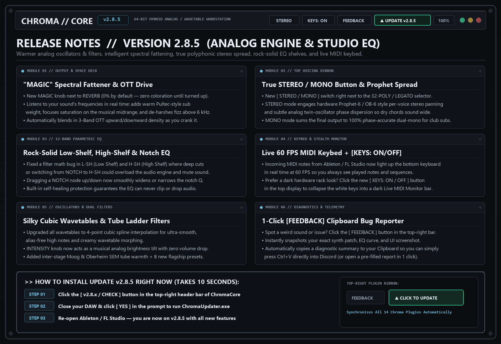

# Chroma Audio Suite — Official Release Hub, Version History & Audio Guide

Welcome to the official **Chroma Audio Suite** release repository, version archive, and plain-English audio guide.

---

## 🗂️ Browse Plugins by Category (Release Notes & Plain-English DSP Guides)

### 📁 [Synthesizers](docs/01_Synthesizers/README.md)
| Plugin | Latest Build | Description | Release Notes & Guide |
|---|---|---|---|
| **[ChromaCore & ChromaCorePro](docs/01_Synthesizers/chromacore/README.md)** | `v2.8.5` | 32-Voice Hybrid Analog / Wavetable / FM Workstation Synth | [Overview & Glossary](docs/01_Synthesizers/chromacore/README.md) ([`v2.8.5`](docs/01_Synthesizers/chromacore/v2.8.5_2026-11-05.md) • [`v2.8.4`](docs/01_Synthesizers/chromacore/v2.8.4_2026-11-04.md) • [`v2.8.3`](docs/01_Synthesizers/chromacore/v2.8.3_2026-11-03.md)) |
| **[ChromaX](docs/01_Synthesizers/chromax/README.md)** | `v2.9.0` | Flagship Synthesizer with 3D Keycaps & LED Jewels | [Overview & Glossary](docs/01_Synthesizers/chromax/README.md) ([`v2.9.0`](docs/01_Synthesizers/chromax/v2.9.0_2026-11-05.md) • [`v2.8.0`](docs/01_Synthesizers/chromax/v2.8.0_2026-10-21.md)) |
| **[ChromaPulse](docs/01_Synthesizers/chromapulse/README.md)** | `v2.9.0` | Step-Sequenced Ratchet Rhythm Synthesizer | [Overview & Glossary](docs/01_Synthesizers/chromapulse/README.md) ([`v2.9.0`](docs/01_Synthesizers/chromapulse/v2.9.0_2026-11-05.md) • [`v2.8.0`](docs/01_Synthesizers/chromapulse/v2.8.0_2026-10-21.md)) |
| **[ChromaDeep](docs/01_Synthesizers/chromadeep/README.md)** | `v2.9.0` | 7-Tab Modular Delay & Sub-Bass Synthesizer | [Overview & Glossary](docs/01_Synthesizers/chromadeep/README.md) ([`v2.9.0`](docs/01_Synthesizers/chromadeep/v2.9.0_2026-11-05.md) • [`v2.8.0`](docs/01_Synthesizers/chromadeep/v2.8.0_2026-10-21.md)) |

### 📁 [Reverb & Delay](docs/02_Reverb_and_Delay/README.md)
| Plugin | Latest Build | Description | Release Notes & Guide |
|---|---|---|---|
| **[ChromaVerb](docs/02_Reverb_and_Delay/chromaverb/README.md)** | `v2.9.1` | Studio Algorithmic Multi-Room FDN Reverb & Shimmer | [Overview & Glossary](docs/02_Reverb_and_Delay/chromaverb/README.md) ([`v2.9.1`](docs/02_Reverb_and_Delay/chromaverb/v2.9.1_2026-11-05.md) • [`v2.9.0`](docs/02_Reverb_and_Delay/chromaverb/v2.9.0_2026-10-22.md)) |
| **[ChromaDelay](docs/02_Reverb_and_Delay/chromadelay/README.md)** | `v2.9.0` | Bouncing Stereo Ping-Pong Tape & BBD Delay | [Overview & Glossary](docs/02_Reverb_and_Delay/chromadelay/README.md) ([`v2.9.0`](docs/02_Reverb_and_Delay/chromadelay/v2.9.0_2026-11-05.md) • [`v2.8.0`](docs/02_Reverb_and_Delay/chromadelay/v2.8.0_2026-10-21.md)) |

### 📁 [Dynamics & Saturation](docs/03_Dynamics_and_Transient/README.md)
| Plugin | Latest Build | Description | Release Notes & Guide |
|---|---|---|---|
| **[ChromaComp](docs/03_Dynamics_and_Transient/chromacomp/README.md)** | `v2.9.0` | Analog VCA / Opto Bus & Mastering Compressor with 24-Band EQ | [Overview & Glossary](docs/03_Dynamics_and_Transient/chromacomp/README.md) ([`v2.9.0`](docs/03_Dynamics_and_Transient/chromacomp/v2.9.0_2026-11-05.md) • [`v2.8.0`](docs/03_Dynamics_and_Transient/chromacomp/v2.8.0_2026-10-21.md)) |
| **[ChromaTransientShaper](docs/03_Dynamics_and_Transient/chromatransientshaper/README.md)** | `v2.9.0` | Differential Envelope Transient Designer | [Overview & Glossary](docs/03_Dynamics_and_Transient/chromatransientshaper/README.md) ([`v2.9.0`](docs/03_Dynamics_and_Transient/chromatransientshaper/v2.9.0_2026-11-05.md) • [`v2.8.0`](docs/03_Dynamics_and_Transient/chromatransientshaper/v2.8.0_2026-10-21.md)) |
| **[ChromaDesigner](docs/03_Dynamics_and_Transient/chromadesigner/README.md)** | `v2.9.0` | Dual 500-Series Modular Analog Saturation & Tone Rack | [Overview & Glossary](docs/03_Dynamics_and_Transient/chromadesigner/README.md) ([`v2.9.0`](docs/03_Dynamics_and_Transient/chromadesigner/v2.9.0_2026-11-05.md) • [`v2.8.0`](docs/03_Dynamics_and_Transient/chromadesigner/v2.8.0_2026-10-21.md)) |

### 📁 [Modulation & Rhythm](docs/04_Modulation_and_Rhythm/README.md)
| Plugin | Latest Build | Description | Release Notes & Guide |
|---|---|---|---|
| **[ChromaFhaser](docs/04_Modulation_and_Rhythm/chromafhaser/README.md)** | `v2.9.0` | 40-Stage Dual Harmonic Phase Processor | [Overview & Glossary](docs/04_Modulation_and_Rhythm/chromafhaser/README.md) ([`v2.9.0`](docs/04_Modulation_and_Rhythm/chromafhaser/v2.9.0_2026-11-05.md) • [`v2.8.0`](docs/04_Modulation_and_Rhythm/chromafhaser/v2.8.0_2026-10-21.md)) |
| **[ChromaScramble](docs/04_Modulation_and_Rhythm/chromascramble/README.md)** | `v2.9.0` | 10-Module MSEG Rhythmic Glitch & Multi-FX Sequencer | [Overview & Glossary](docs/04_Modulation_and_Rhythm/chromascramble/README.md) ([`v2.9.0`](docs/04_Modulation_and_Rhythm/chromascramble/v2.9.0_2026-11-05.md) • [`v2.8.0`](docs/04_Modulation_and_Rhythm/chromascramble/v2.8.0_2026-10-21.md)) |
| **[ChromaSlice](docs/04_Modulation_and_Rhythm/chromaslice/README.md)** | `v2.9.0` | Rhythmic Chopper, Transient Gate & Noise Suppressor | [Overview & Glossary](docs/04_Modulation_and_Rhythm/chromaslice/README.md) ([`v2.9.0`](docs/04_Modulation_and_Rhythm/chromaslice/v2.9.0_2026-11-05.md) • [`v2.8.0`](docs/04_Modulation_and_Rhythm/chromaslice/v2.8.0_2026-10-21.md)) |

### 📁 [Vocal & Stereo Field](docs/05_Vocal_and_Stereo_Imaging/README.md)
| Plugin | Latest Build | Description | Release Notes & Guide |
|---|---|---|---|
| **[ChromaVoice](docs/05_Vocal_and_Stereo_Imaging/chromavoice/README.md)** | `v3.2.1` | WARP Granular Vocal Pitch, Formant & Harmony Processor | [Overview & Glossary](docs/05_Vocal_and_Stereo_Imaging/chromavoice/README.md) ([`v3.2.1`](docs/05_Vocal_and_Stereo_Imaging/chromavoice/v3.2.1_2026-11-05.md) • [`v3.2.0`](docs/05_Vocal_and_Stereo_Imaging/chromavoice/v3.2.0_2026-10-22.md)) |
| **[ChromaWidener](docs/05_Vocal_and_Stereo_Imaging/chromawidener/README.md)** | `v2.9.0` | Phase-Safe Multiband Spatializer & Stereo Widener | [Overview & Glossary](docs/05_Vocal_and_Stereo_Imaging/chromawidener/README.md) ([`v2.9.0`](docs/05_Vocal_and_Stereo_Imaging/chromawidener/v2.9.0_2026-11-05.md) • [`v2.8.0`](docs/05_Vocal_and_Stereo_Imaging/chromawidener/v2.8.0_2026-10-21.md)) |

---

## ⚡ How to Update Any Plugin (Takes 10 Seconds)
1. Look at the **top-right header bar** inside any Chroma plugin and click the **`[ v2.8.x / CHECK ]`** update button.
2. Save your project, close your DAW, and click **`[ YES ]`** to launch `ChromaUpdater.exe`.
3. Re-open your DAW — all 14 plugins are now synchronized to the latest release!

## 🛠️ How to Send a Bug Report or Feedback in 1 Click
1. Click the **`[ FEEDBACK ]`** button in the top-right header bar of the plugin.
2. The plugin automatically captures your exact knob/patch state, EQ curve, and a UI screenshot, and **copies a formatted summary directly to your Clipboard**.
3. Simply press **`Ctrl+V`** in Discord to send us your exact state, or click **`[ YES ]`** in the prompt to open a pre-filled [GitHub Bug Report](https://github.com/haidood/chroma-release/issues/new)!

&copy; 2026 Chroma Audio LLC. All rights reserved.
