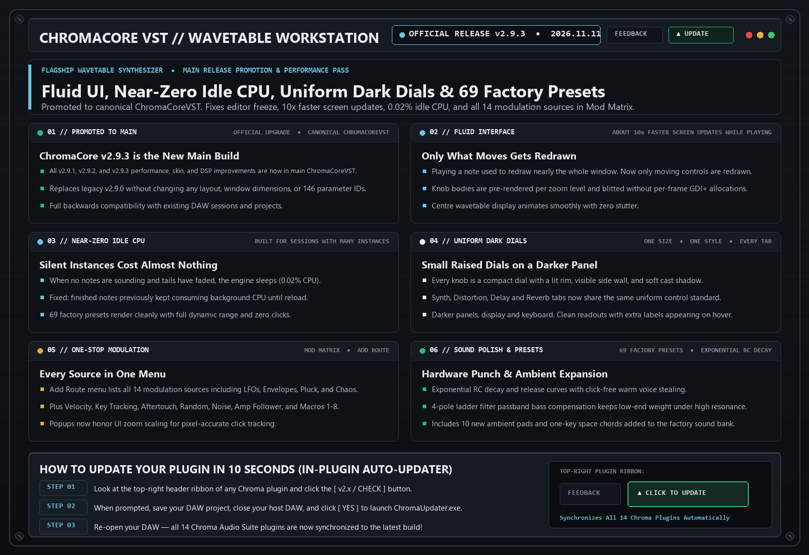

# ChromaCore VST (`v2.9.3`)

> **32-Voice Hybrid Analog / Wavetable / Resampling Workstation Synth**  
> Our unified flagship 4-oscillator synthesizer combining Osc 1-3 cubic wavetables, Osc 4 Internal Live Resampler & Time-Stretch engine, a 14-source Right-Click Modulation Matrix, Living Organic Wavetable Interference Visualizer, dual 4-pole ladder and state-variable filters, 8-style FM/Mod oscillator, 16-step Performer & Sequencer, 3-band multiband distortion, 12-band studio EQ, Upward/Downward Multiband Dynamics, and Magic Fattener.

---

## 📚 Tech-to-Music Translator (How It Actually Works in Plain English)

### 🔹 Internal Synth Resampling & Time-Stretching (Osc 4)
Producers often bounce a synth chord or bassline to audio just so they can time-stretch it, freeze grains, or layer it back underneath itself. Osc 4 ('RESAMPLE') builds that workflow directly inside ChromaCore: click [BOUNCE MIX] or [REC LIVE] to capture your active Osc 1-3 + Filter patch into a high-resolution internal stereo buffer or 64-frame wavetable, freeing up Osc 1-3 to stack even more layers on top!

### 🔹 4-Point Catmull-Rom Cubic Wavetable Interpolation
Think of a digital waveform like a connect-the-dots drawing. Basic synths draw straight lines between the dots, which creates sharp corners that sound like harsh, metallic 'digital fizz' on high notes. Cubic interpolation bends a smooth, natural curve through 4 dots at a time—making digital wavetables sound as smooth and liquid as analog tape.

### 🔹 Spectral-Adaptive 'MAGIC' Drive & Multiband Upward Piggyback
Traditional distortion boosts every frequency equally, turning chords into muddy fuzz. The MAGIC knob listens to your sound split into 3 frequency zones (Sub Bass, Musical Mids, and High Air). It gives your sub bass a tight resonant low-end punch, focuses warm tube saturation right where the human ear loves it (the midrange), and gently tames harsh treble above 6 kHz—while sneaking in upward multiband compression so quiet details jump forward.

### 🔹 Analog Polyphonic Stereo Spread & VCO Drift
On vintage analog polysynths, every voice lives on its own physical circuit board with slightly different capacitors and resistors. In STEREO mode, ChromaCore places each note of your chord at a slightly different stereo pan position and gives the left and right speakers microscopic phase differences—so a dry chord immediately sounds wide and 3D even with zero reverb or chorus.

### 🔹 Biquad Filter Poles & The 'Unit Circle' (EQ Stability)
Digital EQ filters work by feeding a tiny bit of the output sound back into the input to boost or cut specific frequencies. Mathematically, if the feedback number crosses '1.0' (leaving the 'unit circle'), the filter acts like a microphone held right up to a speaker—instantly screaming to infinity and muting your DAW. We locked every EQ shelf inside a mathematical safety cage so it can never overload.

### 🔹 One-Key Chords (Oscillators Tuned to Chord Tones)
Normally every oscillator plays the note you press. In the Space Chord presets, the second and third oscillators are tuned a few notes higher, to the other notes of a chord. Press one key and you hear the whole chord; play a simple one-finger melody and the chord follows it around.

### 🔹 Click-Free Voice Stealing (Warm Re-Trigger)
A synth can only play so many notes at once. When you play one more, it has to 'steal' a voice that is already sounding. If that voice's volume jumps suddenly, you hear a tiny tick, like a needle skipping. ChromaCore now lets the new note pick up from exactly the volume the old one had, so fast arpeggios and big chords stay perfectly smooth.

### 🔹 Exponential RC Envelope Curves
In analog synths, the volume envelope is a capacitor draining through a resistor: it drops fast at first, then slows down as it empties. That shape is why hardware plucks and basses sound punchy up front with a long natural tail. A straight-line fade sounds flat by comparison. ChromaCore's Decay and Release now follow the capacitor curve.

### 🔹 Analog Voice-Card Tolerance (Component Dispersion)
No two resistors or capacitors are exactly alike, so every voice in a hardware polysynth is tuned, filtered and timed very slightly differently. Those tiny differences are what keep a big chord from sounding like one sterile block. ChromaCore gives each voice its own small, fixed offsets in pitch, envelope timing and filter brightness.

### 🔹 Inter-Stage 4-Pole Ladder & 2-Pole State-Variable Tube Saturation
A classic 24dB 4-pole filter is built like a ladder with 4 rungs (stages). Instead of just distorting the sound before or after the filter, ChromaCore gently saturates the signal between every single rung of the ladder—giving you that thick, creamy, non-whistling analog resonance.

---

## 🗂️ Version & Patch History

- **[`v2.9.3` (2026-11-11) — Official Main Release: Performance Pass, 10x Faster Screen Updates, Near-Zero Idle CPU & Dark Dial Skin](./v2.9.3_2026-11-11.md)**
  - **Promoted to Main Release (Canonical ChromaCoreVST)**: All v2.9.1, v2.9.2, and v2.9.3 performance, skin, and DSP improvements are now compiled into the canonical ChromaCoreVST binary (69 factory programs), replacing v2.9.0 with full session backwards compatibility.
  - **Editor Freeze Fixed (replaces v2.9.2)**: v2.9.2 could freeze the plugin window shortly after a key on the on-screen keyboard was released. The knob drawing that caused it has been removed. If you installed v2.9.2, replace it with this build.
  - **Fluid Interface**: Playing a note used to redraw nearly the whole window. Now only the centre display, pressed keys and moving knobs are redrawn, and knob bodies are drawn once and reused. Screen updates while playing are roughly ten times faster.
  - **Near-Zero Idle CPU**: When no notes are sounding and effect tails have faded, the engine sleeps until the next note, so silent instances in a large session cost almost nothing.
  - **Voice CPU Leak Fixed**: Finished notes kept using CPU in the background until the plugin was reloaded. Voices now switch off when their sound has ended.
  - **Uniform Dark Dials**: Every knob on the Synth, Distortion, Delay and Reverb tabs is the same compact raised dial with a lit rim, visible side wall and soft cast shadow, on darker panels. Value boxes are gone and secondary labels appear on hover.
  - **One-Stop Modulation**: The Mod Matrix **Add Route** menu now lists every source: LFO 1 and 2, envelopes, pluck, velocity, key tracking, aftertouch, random, chaos, noise, amp follower, the Performer, Macros 1-8 and the mod wheel.
  - **Menus Open Where You Click**: Popup menus were offset at 80% and 125% zoom. Fixed.
  - **Same Sound, Layout and Parameters**: Factory presets render identically to v2.9.2. Same window size, same control positions, same 146 parameter IDs.

- **[`v2.9.2` (2026-11-11) — Fable Build: Raised 3D Titanium Knobs, Module Plates & 10 Ambient Pad / Space Chord Presets](./v2.9.2_2026-11-11.md)**
  - **Raised 3D Titanium Knobs**: Every knob now has a domed cap with an off-centre highlight and specular hotspot, a knurled skirt with lit and shaded edges, a soft cast shadow, and a recessed finger dish. All lighting follows one upper-left light source.
  - **Recessed Knob Wells**: The well around each knob has a shadowed upper wall and a light-catching lower lip, so controls read as set into the chassis.
  - **Raised Module Plates**: Panel headers gain a gloss band and a machined groove; panels gain a lit left edge and shaded bottom and right edges. Static pens and brushes only, so no extra per-frame allocations.
  - **6 New Chill Ambient Pads**: *Slow Tide Pad*, *Glass Horizon Pad*, *Velvet Drift Pad*, *Cloud Choir Pad*, *Deep Field Drone Pad*, *Morning Haze Pad*.
  - **4 New One-Key Space Chords**: *Orbit Minor Chord*, *Station Major 7 Chord*, *Nebula Sus Chord*, *Starlight Pluck Chord*. Osc 2 and Osc 3 are tuned to chord tones so a single key plays the whole voicing.
  - **No Layout or Parameter Changes**: Same window size, same control positions, same 146 parameter IDs. New presets are appended to the end of the factory list (69 programs), so existing program numbers are unchanged.
  - **Side-by-Side `ChromaCoreVST_Fable` Build**: Replaces the v2.9.1 Fable binary and includes all of its engine upgrades. The v2.9.0 `ChromaCoreVST.dll` stays untouched.

- **[`v2.9.1` (2026-11-10) — Fable Build: Click-Free Voice Stealing, Analog Voice-Card Dispersion, Cubic Osc 4 Readout & Titanium Micro-Polish](./v2.9.1_2026-11-10.md)**
  - **Side-by-Side `ChromaCoreVST_Fable` Build**: Ships as `ChromaCoreVST_Fable.dll` / `.vst3` so the v2.9.0 binary stays installed and untouched. Same window size, same knob positions, same 146 parameter IDs and presets.
  - **4-Point Cubic Hermite Readout on Osc 4**: All four resampler engines (*TIME STRETCH*, *WT RESAMPLE*, *GRAIN FREEZE*, *REV PING-PONG*) now read the captured audio with cubic interpolation instead of straight-line or whole-sample reads, removing grain and treble loss on pitched layers.
  - **Sub-Sample Accurate Mod Osc Sync Pulse**: In `SYNC` mode the sync pulse is split across the two samples around the exact wrap instant, removing the timing jitter that aliased on high notes while keeping the v2.9.0 sync tone.
  - **Per-Voice Analog Component Dispersion**: Each voice has a fixed tolerance: slow thermal pitch wander (about 1.4 cents) plus static trim, 2% decay/release timing variance, and a 1.5% filter cutoff spread that follows whichever voices are sounding.
  - **4-Pole Ladder Bass Compensation**: Resonance feedback is saturated inside the loop and the passband is level-compensated, so high resonance no longer thins the sub-bass. Cutoff pre-warp clamped below Nyquist.
  - **Click-Free Voice Stealing**: A stolen voice starts its new attack from its current level and keeps oscillator phase, eliminating the tick on fast arpeggios and dense chords.
  - **Exponential RC Decay & Release**: Decay and Release now follow a capacitor-discharge curve for punchier plucks and smoother tails.
  - **Titanium Knob & Keybed Micro-Polish**: 1px overhead glint on every knob cap, ClearType icy-slate value readouts, and a two-layer contact shadow where the front panel overhangs the keys. All new brushes and pens are static (zero per-frame allocations).

- **[`v2.9.0` (2026-11-10) — Osc 4 Internal Synth Resampler, 14-Source Right-Click Mod Matrix, Organic Interference Display & 3D Titanium UI](./v2.9.0_2026-11-10.md)**
  - **New Osc 4 (`RESAMPLE`) Internal Synth Resampler**: Capture your active Osc 1-3 + Dual Filter patch via **`[BOUNCE MIX]`** (instant offline render) or **`[REC LIVE]`** (real-time post-synth capture), then manipulate it with 4 playback engines: *TIME STRETCH*, *WT RESAMPLE* (64-frame wavetable extraction), *GRAIN FREEZE*, and *REV PING-PONG*.
  - **Universal Right-Click Modulation Matrix (14 Sources)**: Right-click **any rotary knob** on the synth to assign modulation, toggle Bipolar/Unipolar depth, or clear links across 14 modulation sources (*LFO 1*, *LFO 2*, *ENV 1–3*, *NOTE*, *VEL*, *MODW*, *AT*, *RAND*, *ALT*, *CHAOS*, *S&H*, *MACRO*).
  - **Fixed `MOD OSC` Target Routing**: Fixed parameter normalization on the Mod Osc Target selector so FM, Ring Mod, and Phase Mod route cleanly to *Osc 1*, *Osc 2*, *Osc 1+2*, *Osc 3*, *Filter 1/2*, *Vol*, *Pan*, or *Pitch*.
  - **Living Organic Wavetable & Modulation Interference Visualizer**: Top display now renders real-time harmonic interference and modulation bloom between active oscillators in cool arctic ice-blue, slate, indigo, and pearl filaments.
  - **Raised 3D Synth Deck & Recessed Keybed Overhang**: Raised all three module rows so bottom knobs sit cleanly inside the chassis, adding a 3D machined titanium overhang lip (`y=576..586`), recessed shadow trench, and 16px cast shadow onto the piano keys.
  - **Unified `ChromaCoreVST` Consolidation**: Merged `ChromaCorePro` into `ChromaCoreVST.dll` so clicking Update on any legacy instance seamlessly upgrades to the single flagship synth.

- **[`v2.8.5` (2026-11-05) — Studio EQ Shelf Fix, Live 60 FPS MIDI Keybed, [KEYS] Stealth Mode & Clipboard Feedback](./v2.8.5_2026-11-05.md)**
  - **Fixed 12-Band Parametric EQ (`L-SH`, `H-SH`, and `NOTCH`)**: Fixed a coefficient sign bug in Low-Shelf (`L-SH`) and High-Shelf (`H-SH`) filters where deep cuts or switching a band from `NOTCH` to `H-SH` could push filter feedback past 100% and mute the host audio engine.
  - **Vertical Notch Width Dragging**: Dragging a `NOTCH` node up or down on the EQ display now smoothly widens or narrows the notch `Q` (just like `HP` and `LP` cut filters) instead of storing hidden gain values.
  - **Self-Healing Audio Engine Protection**: Added automatic `NaN` / `Infinity` circuit-breakers inside every EQ biquad and the Master Analog Console output stage so extreme settings can never drop audio.
  - **Real-Time 60 FPS MIDI Keybed Highlighting**: Incoming MIDI notes played from your DAW or MIDI controller now light up the bottom 81-key keyboard in real time at 60 FPS.
  - **New `[ KEYS: ON / OFF ]` Stealth Switch**: Added a toggle button right next to `[ STEREO ]` in the top display. Turning `KEYS: OFF` collapses the bright white piano keys into a dark carbon-black **Live MIDI Monitor** bar.
  - **1-Click `[ FEEDBACK ]` Clipboard Bug Reporter**: Clicking `[ FEEDBACK ]` in the top-right bar captures your exact synth patch, EQ curve, and UI screenshot, and **copies a formatted diagnostic block straight to your Windows Clipboard** so you can press `Ctrl+V` directly in Discord or open a pre-filled GitHub report.

- **[`v2.8.4` (2026-11-04) — 'MAGIC' Spectral Fattener Knob, True Stereo/Mono Mode, Cubic Wavetables & Tube Filters](./v2.8.4_2026-11-04.md)**
  - **New `MAGIC` (Fatten) Knob**: Added next to `REVERB` in the `OUTPUT // SPACE` deck (`0%` by default). Combines 3-band spectral-adaptive saturation (sub weight, dynamic midrange warmth, silk air de-harsher) with automatic 3-Band upward/downward multiband density.
  - **New `[ STEREO ]` / `[ MONO ]` Header Switch**: Added right next to `32-POLY / LEGATO`. `STEREO` enables analog-modeled polyphonic voice pan spread and twin-VCO phase dispersion; `MONO` forces 100% phase-locked dual-mono output.
  - **4-Point Cubic Wavetable Interpolation**: Upgraded wavetable lookup from linear to 4-point Catmull-Rom cubic splines, eliminating high-note digital harshness.
  - **Unity-Gain `INTENSITY` Brightness Tilt**: Turning `INTENSITY` down now darkens harmonics like a warm analog lowpass roll-off without losing volume; turning it up adds subtle triode tube bloom.
  - **Inter-Stage Analog Filter Saturation**: Upgraded Filter 1 & Filter 2 with zero-DC asymmetric tube warmth and inter-stage ladder saturation.

- **[`v2.8.3` (2026-11-03) — Scream/Acid Filter Self-Oscillation Fix & 8 New Flagship Presets](./v2.8.3_2026-11-03.md)**
  - **Fixed Filter 1 'Scream Overdrive' & 'Acid Diode' Whistle**: Added dynamic input-envelope damping to the filter resonance feedback loop (`ChromaDualFilter`) so high-resonance patches decay to dead silence the moment you release a key instead of ringing at 1038 Hz.
  - **8 New Production Presets (Presets 56–63)**: Added *Silk Tape Keys*, *Sub Zero Bass*, *Cyberpunk Reese*, *Velvet Chords*, *Pluck Horizon*, *Neuro Bassline*, *Glass Bell Pad*, and *Analog Poly Brass*.

- **[`v2.8.2` (2026-10-23) — 8-Style Universal Modulation Oscillator Overhaul & Dual Filter Routing Fix](./v2.8.2_2026-10-23.md)**
  - **8 Modulation Oscillator Styles**: Upgraded the `MOD OSC // SHAPER & FM` deck with 8 distinct synthesis modes: *RingMod*, *PhaseFM*, *WTMorph*, *ExpoFM*, *HardSync*, *Wavefolder*, *DriveScream*, and *Tremolo*.
  - **10 Modulation Targets**: Route the Mod Osc to *Osc 1*, *Osc 2*, *Osc 1+2*, *Osc 3*, *Filter 1*, *Filter 2*, *Filter 1+2*, *Volume*, *Pan*, or *Pitch*.
  - **Filter 2 Parallel Routing Fix**: Fixed a bug where oscillators routed to Filter 2 (`F2`) were attenuated when `FilterMix` was at default.

- **[`v2.8.0` (2026-10-10) — 12-Band Studio EQ, Persistent Double-Buffering & Zero-CPU Idle Throttling](./v2.8.0_2026-10-10.md)**
  - **12-Band Dynamic Studio EQ**: Full parametric EQ with 7 acoustic mixing zone backdrops, mousewheel `Q` control, and real-time spectrum analyzer.
  - **Zero-Allocation 60 FPS GUI**: Persistent GDI+ backbuffer cache and intelligent idle repaint throttling (`0.0%` CPU when stopped in your DAW).
  - **Universal Update Shield & Crash Vault**: Built-in 1-click updater and automatic session crash recovery.

---

## 🛠️ Known Issues & Bug Reporting

- v2.9.2 (Fable build) could freeze the plugin window shortly after a key on the on-screen keyboard was released. Fixed in v2.9.3; please replace v2.9.2.
- v2.9.3 is promoted to the canonical ChromaCoreVST main release (`ChromaCoreVST.dll` / `.vst3`). The side-by-side `ChromaCoreVST_Fable.dll` remains available during the transition.
- v2.9.1 Decay and Release use an exponential curve, so patches with long Decay/Release times feel snappier than in v2.9.0.
- Legacy ChromaCorePro instances automatically merge into ChromaCoreVST.dll upon clicking Update.

**Found a bug or weird preset behavior?**  
Click the **`[ FEEDBACK ]`** button in the top-right header of the plugin! It automatically snapshots your patch, EQ curve, and screenshot, copies a diagnostic summary to your Clipboard (`Ctrl+V` ready for Discord), or opens a pre-filled [GitHub Bug Report](https://github.com/haidood/chroma-release/issues/new).
