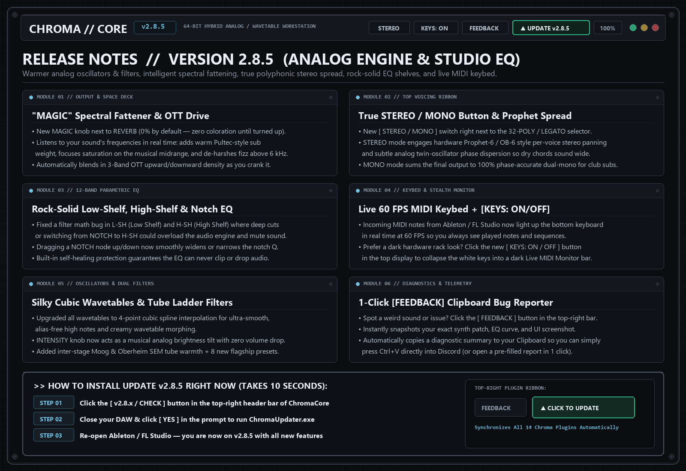

# ChromaCore VST `v2.8.5` — Release Notes (2026-11-05)

**[⬅ Back to ChromaCore VST Overview & Glossary](./README.md)**

## Studio EQ Shelf Fix, Live 60 FPS MIDI Keybed, [KEYS] Stealth Mode & Clipboard Feedback

### What Changed & Why It Matters Musically

- **Fixed 12-Band Parametric EQ (`L-SH`, `H-SH`, and `NOTCH`)**: Fixed a coefficient sign bug in Low-Shelf (`L-SH`) and High-Shelf (`H-SH`) filters where deep cuts or switching a band from `NOTCH` to `H-SH` could push filter feedback past 100% and mute the host audio engine.
- **Vertical Notch Width Dragging**: Dragging a `NOTCH` node up or down on the EQ display now smoothly widens or narrows the notch `Q` (just like `HP` and `LP` cut filters) instead of storing hidden gain values.
- **Self-Healing Audio Engine Protection**: Added automatic `NaN` / `Infinity` circuit-breakers inside every EQ biquad and the Master Analog Console output stage so extreme settings can never drop audio.
- **Real-Time 60 FPS MIDI Keybed Highlighting**: Incoming MIDI notes played from your DAW or MIDI controller now light up the bottom 81-key keyboard in real time at 60 FPS.
- **New `[ KEYS: ON / OFF ]` Stealth Switch**: Added a toggle button right next to `[ STEREO ]` in the top display. Turning `KEYS: OFF` collapses the bright white piano keys into a dark carbon-black **Live MIDI Monitor** bar.
- **1-Click `[ FEEDBACK ]` Clipboard Bug Reporter**: Clicking `[ FEEDBACK ]` in the top-right bar captures your exact synth patch, EQ curve, and UI screenshot, and **copies a formatted diagnostic block straight to your Windows Clipboard** so you can press `Ctrl+V` directly in Discord or open a pre-filled GitHub report.

---
### ⚡ How to Update in 10 Seconds
1. Click the **`[ v2.x / CHECK ]`** button in the top-right header bar of the plugin.
2. Close your DAW and click **`[ YES ]`** in the prompt to run `ChromaUpdater.exe`.
3. Re-open your DAW — you are now on the latest build!
