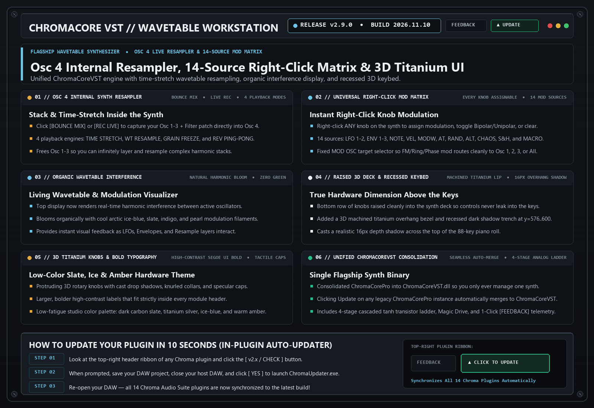

# ChromaCore VST `v2.9.0` — Release Notes (2026-11-10)

**[⬅ Back to ChromaCore VST Overview & Glossary](./README.md)**

## Osc 4 Internal Synth Resampler, 14-Source Right-Click Mod Matrix, Organic Interference Display & 3D Titanium UI

### What Changed & Why It Matters Musically

- **New Osc 4 (`RESAMPLE`) Internal Synth Resampler**: Capture your active Osc 1-3 + Dual Filter patch via **`[BOUNCE MIX]`** (instant offline render) or **`[REC LIVE]`** (real-time post-synth capture), then manipulate it with 4 playback engines: *TIME STRETCH*, *WT RESAMPLE* (64-frame wavetable extraction), *GRAIN FREEZE*, and *REV PING-PONG*.
- **Universal Right-Click Modulation Matrix (14 Sources)**: Right-click **any rotary knob** on the synth to assign modulation, toggle Bipolar/Unipolar depth, or clear links across 14 modulation sources (*LFO 1*, *LFO 2*, *ENV 1–3*, *NOTE*, *VEL*, *MODW*, *AT*, *RAND*, *ALT*, *CHAOS*, *S&H*, *MACRO*).
- **Fixed `MOD OSC` Target Routing**: Fixed parameter normalization on the Mod Osc Target selector so FM, Ring Mod, and Phase Mod route cleanly to *Osc 1*, *Osc 2*, *Osc 1+2*, *Osc 3*, *Filter 1/2*, *Vol*, *Pan*, or *Pitch*.
- **Living Organic Wavetable & Modulation Interference Visualizer**: Top display now renders real-time harmonic interference and modulation bloom between active oscillators in cool arctic ice-blue, slate, indigo, and pearl filaments.
- **Raised 3D Synth Deck & Recessed Keybed Overhang**: Raised all three module rows so bottom knobs sit cleanly inside the chassis, adding a 3D machined titanium overhang lip (`y=576..586`), recessed shadow trench, and 16px cast shadow onto the piano keys.
- **Unified `ChromaCoreVST` Consolidation**: Merged `ChromaCorePro` into `ChromaCoreVST.dll` so clicking Update on any legacy instance seamlessly upgrades to the single flagship synth.

---
### ⚡ How to Update in 10 Seconds
1. Click the **`[ v2.x / CHECK ]`** button in the top-right header bar of the plugin.
2. Close your DAW and click **`[ YES ]`** in the prompt to run `ChromaUpdater.exe`.
3. Re-open your DAW — you are now on the latest build!
