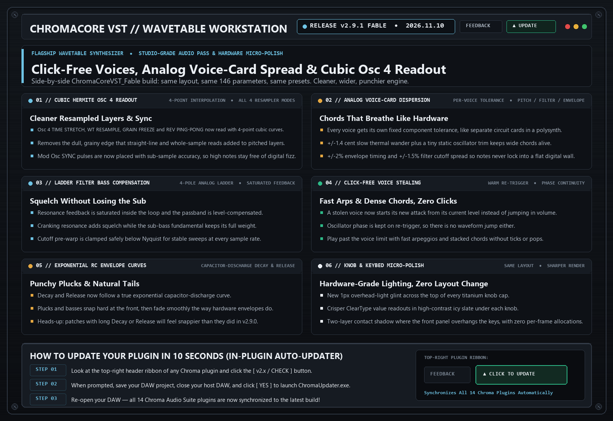

# ChromaCore VST `v2.9.1` — Release Notes (2026-11-10)

**[⬅ Back to ChromaCore VST Overview & Glossary](./README.md)**

## Fable Build: Click-Free Voice Stealing, Analog Voice-Card Dispersion, Cubic Osc 4 Readout & Titanium Micro-Polish

### What Changed & Why It Matters Musically

- **Side-by-Side `ChromaCoreVST_Fable` Build**: Ships as `ChromaCoreVST_Fable.dll` / `.vst3` so the v2.9.0 binary stays installed and untouched. Same window size, same knob positions, same 146 parameter IDs and presets.
- **4-Point Cubic Hermite Readout on Osc 4**: All four resampler engines (*TIME STRETCH*, *WT RESAMPLE*, *GRAIN FREEZE*, *REV PING-PONG*) now read the captured audio with cubic interpolation instead of straight-line or whole-sample reads, removing grain and treble loss on pitched layers.
- **Sub-Sample Accurate Mod Osc Sync Pulse**: In `SYNC` mode the sync pulse is split across the two samples around the exact wrap instant, removing the timing jitter that aliased on high notes while keeping the v2.9.0 sync tone.
- **Per-Voice Analog Component Dispersion**: Each voice has a fixed tolerance: slow thermal pitch wander (about 1.4 cents) plus static trim, 2% decay/release timing variance, and a 1.5% filter cutoff spread that follows whichever voices are sounding.
- **4-Pole Ladder Bass Compensation**: Resonance feedback is saturated inside the loop and the passband is level-compensated, so high resonance no longer thins the sub-bass. Cutoff pre-warp clamped below Nyquist.
- **Click-Free Voice Stealing**: A stolen voice starts its new attack from its current level and keeps oscillator phase, eliminating the tick on fast arpeggios and dense chords.
- **Exponential RC Decay & Release**: Decay and Release now follow a capacitor-discharge curve for punchier plucks and smoother tails.
- **Titanium Knob & Keybed Micro-Polish**: 1px overhead glint on every knob cap, ClearType icy-slate value readouts, and a two-layer contact shadow where the front panel overhangs the keys. All new brushes and pens are static (zero per-frame allocations).

---
### ⚡ How to Update in 10 Seconds
1. Click the **`[ v2.x / CHECK ]`** button in the top-right header bar of the plugin.
2. Close your DAW and click **`[ YES ]`** in the prompt to run `ChromaUpdater.exe`.
3. Re-open your DAW — you are now on the latest build!
