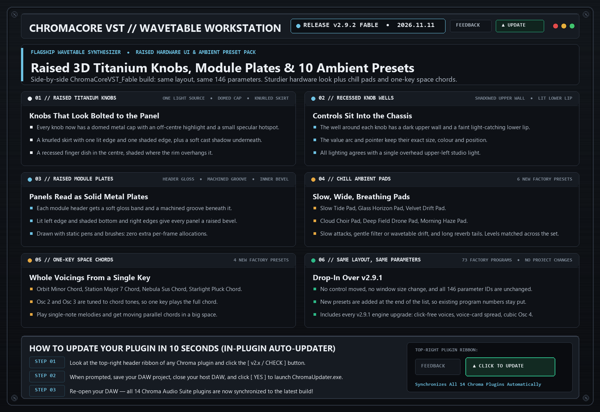

# ChromaCore VST `v2.9.2` — Release Notes (2026-11-11)

**[⬅ Back to ChromaCore VST Overview & Glossary](./README.md)**

## Fable Build: Raised 3D Titanium Knobs, Module Plates & 10 Ambient Pad / Space Chord Presets

### What Changed & Why It Matters Musically

- **Raised 3D Titanium Knobs**: Every knob now has a domed cap with an off-centre highlight and specular hotspot, a knurled skirt with lit and shaded edges, a soft cast shadow, and a recessed finger dish. All lighting follows one upper-left light source.
- **Recessed Knob Wells**: The well around each knob has a shadowed upper wall and a light-catching lower lip, so controls read as set into the chassis.
- **Raised Module Plates**: Panel headers gain a gloss band and a machined groove; panels gain a lit left edge and shaded bottom and right edges. Static pens and brushes only, so no extra per-frame allocations.
- **6 New Chill Ambient Pads**: *Slow Tide Pad*, *Glass Horizon Pad*, *Velvet Drift Pad*, *Cloud Choir Pad*, *Deep Field Drone Pad*, *Morning Haze Pad*.
- **4 New One-Key Space Chords**: *Orbit Minor Chord*, *Station Major 7 Chord*, *Nebula Sus Chord*, *Starlight Pluck Chord*. Osc 2 and Osc 3 are tuned to chord tones so a single key plays the whole voicing.
- **No Layout or Parameter Changes**: Same window size, same control positions, same 146 parameter IDs. New presets are appended to the end of the factory list (73 programs), so existing program numbers are unchanged.
- **Side-by-Side `ChromaCoreVST_Fable` Build**: Replaces the v2.9.1 Fable binary and includes all of its engine upgrades. The v2.9.0 `ChromaCoreVST.dll` stays untouched.

---
### ⚡ How to Update in 10 Seconds
1. Click the **`[ v2.x / CHECK ]`** button in the top-right header bar of the plugin.
2. Close your DAW and click **`[ YES ]`** in the prompt to run `ChromaUpdater.exe`.
3. Re-open your DAW — you are now on the latest build!
