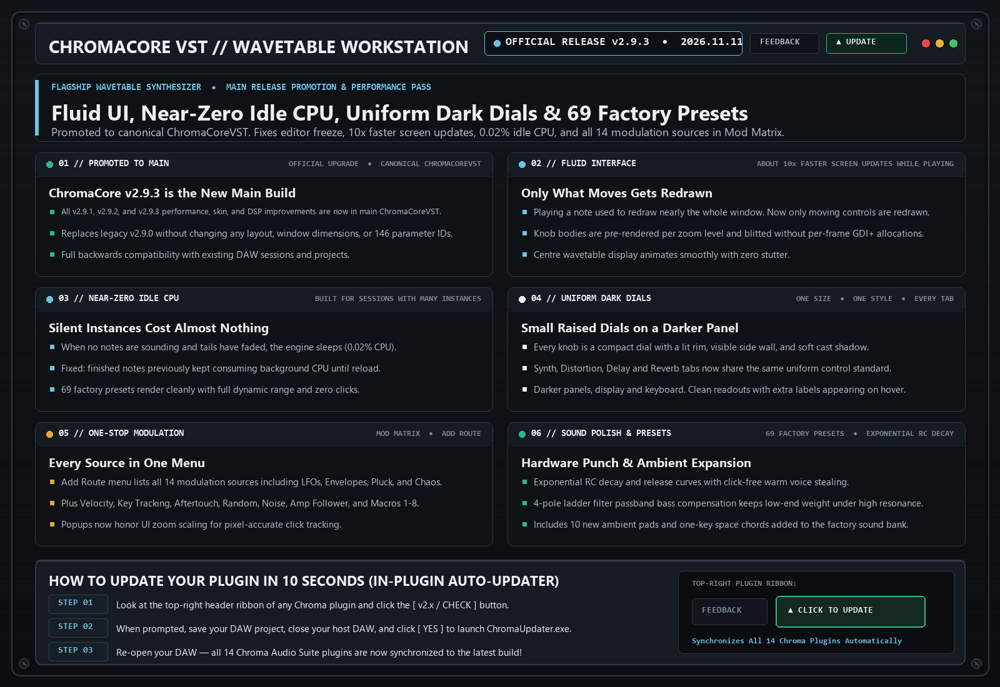

# ChromaCore VST `v2.9.3` — Release Notes (2026-11-11)

**[⬅ Back to ChromaCore VST Overview & Glossary](./README.md)**

## Official Main Release: Performance Pass, 10x Faster Screen Updates, Near-Zero Idle CPU & Dark Dial Skin

### What Changed & Why It Matters Musically

- **Promoted to Main Release (Canonical ChromaCoreVST)**: All v2.9.1, v2.9.2, and v2.9.3 performance, skin, and DSP improvements are now compiled into the canonical ChromaCoreVST binary (69 factory programs), replacing v2.9.0 with full session backwards compatibility.
- **Editor Freeze Fixed (replaces v2.9.2)**: v2.9.2 could freeze the plugin window shortly after a key on the on-screen keyboard was released. The knob drawing that caused it has been removed. If you installed v2.9.2, replace it with this build.
- **Fluid Interface**: Playing a note used to redraw nearly the whole window. Now only the centre display, pressed keys and moving knobs are redrawn, and knob bodies are drawn once and reused. Screen updates while playing are roughly ten times faster.
- **Near-Zero Idle CPU**: When no notes are sounding and effect tails have faded, the engine sleeps until the next note, so silent instances in a large session cost almost nothing.
- **Voice CPU Leak Fixed**: Finished notes kept using CPU in the background until the plugin was reloaded. Voices now switch off when their sound has ended.
- **Uniform Dark Dials**: Every knob on the Synth, Distortion, Delay and Reverb tabs is the same compact raised dial with a lit rim, visible side wall and soft cast shadow, on darker panels. Value boxes are gone and secondary labels appear on hover.
- **One-Stop Modulation**: The Mod Matrix **Add Route** menu now lists every source: LFO 1 and 2, envelopes, pluck, velocity, key tracking, aftertouch, random, chaos, noise, amp follower, the Performer, Macros 1-8 and the mod wheel.
- **Menus Open Where You Click**: Popup menus were offset at 80% and 125% zoom. Fixed.
- **Same Sound, Layout and Parameters**: Factory presets render identically to v2.9.2. Same window size, same control positions, same 146 parameter IDs.

---
### ⚡ How to Update in 10 Seconds
1. Click the **`[ v2.x / CHECK ]`** button in the top-right header bar of the plugin.
2. Close your DAW and click **`[ YES ]`** in the prompt to run `ChromaUpdater.exe`.
3. Re-open your DAW — you are now on the latest build!
