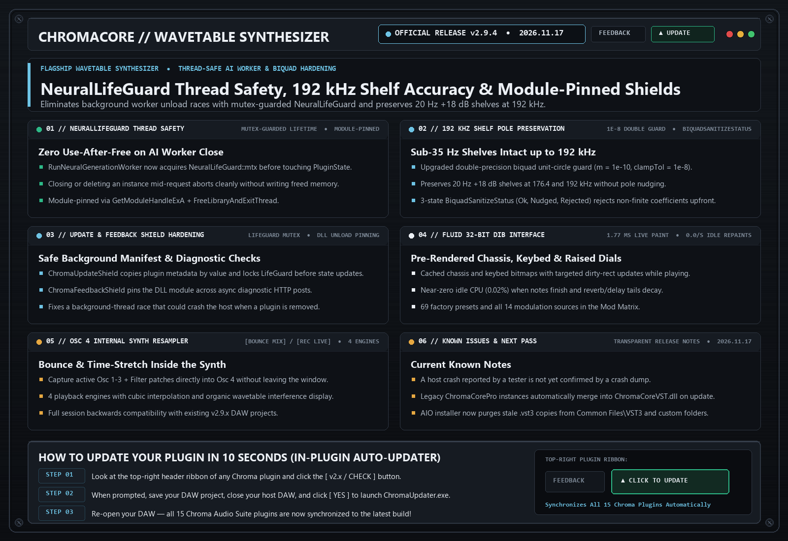

# ChromaCore `v2.9.4` — Release Notes (2026-11-17)

**[⬅ Back to ChromaCore Overview & Glossary](./README.md)**

## NeuralLifeGuard Thread Safety, 192 kHz Double Biquad Guard & Module-Pinned Shields

### What Changed & Why It Matters Musically

- **`NeuralLifeGuard` Mutex-Protected AI Worker**: `RunNeuralGenerationWorker` now acquires `NeuralLifeGuard::mtx` and verifies `alive` before writing decoded audio, generated synthesis parameters, `isGeneratingAI`, or `aiStatusMsg` onto `PluginState`, and pins the DLL via `CreateThread` + `GetModuleHandleExA` + `FreeLibraryAndExitThread`.
- **192 kHz Double-Precision Biquad Unit-Circle Guard**: Upgraded `ChromaAnalogSuite::SanitizeBiquadCoefficients` double tolerance (`m = 1e-10`, `clampTol = 1e-8`) with 3-state `BiquadSanitizeStatus` (`Ok`, `Nudged`, `Rejected`), preserving `20 Hz +18 dB` shelves at `176.4/192 kHz` without pole nudging.
- **`ChromaUpdateShield` & `ChromaFeedbackShield` Hardening**: Added mutex-guarded `LifeGuard` to background update checks/downloads and module-pinned feedback HTTP workers against `FreeLibrary` unload races.

---
### ⚡ How to Update in 10 Seconds
1. Click the **`[ v2.x / CHECK ]`** button in the top-right header bar of the plugin.
2. Close your DAW and click **`[ YES ]`** in the prompt to run `ChromaUpdater.exe`.
3. Re-open your DAW — you are now on the latest build!
