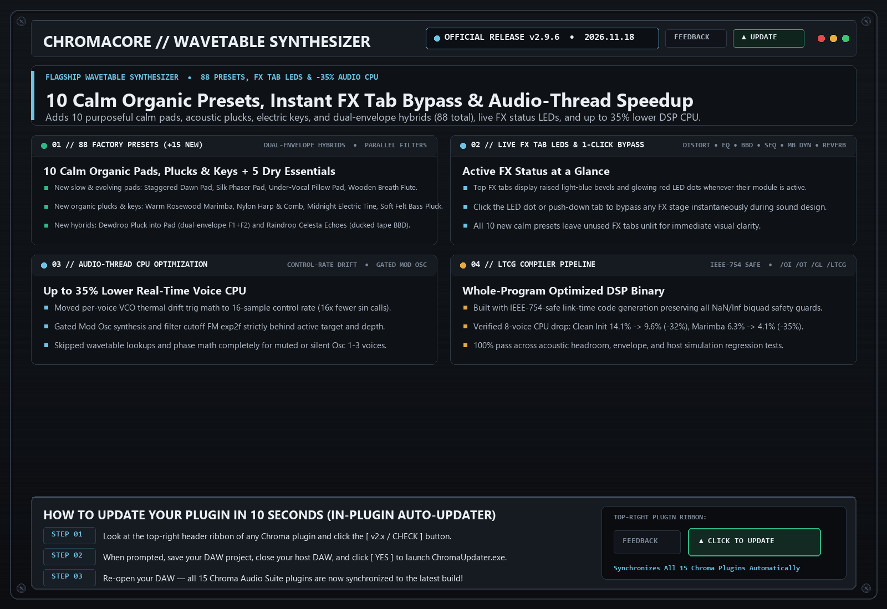

# ChromaCore `v2.9.6` — Release Notes (2026-11-18)

**[⬅ Back to ChromaCore Overview & Glossary](./README.md)**

## 10 Calm Organic Pads/Plucks/Hybrids (88 Presets), Live FX Tab LEDs & -35% Audio CPU

### What Changed & Why It Matters Musically

- **88 Factory Presets (+15 New Calm, Dry & Organic Patches)**: Added 10 purpose-built calm presets exploiting independent per-oscillator envelopes, parallel dual filters (`LP12`, `HP12`, `Allpass`, `Comb+`), soft Phase FM, and ducked 15 IPS tape BBD echoes (`Staggered Dawn Pad`, `Silk Phaser Pad`, `Under-Vocal Pillow Pad`, `Wooden Breath Flute`, `Warm Rosewood Marimba`, `Nylon Harp & Comb`, `Midnight Electric Tine`, `Soft Felt Bass Pluck`, `Dewdrop Pluck into Pad`, and `Raindrop Celesta Echoes`) alongside 5 clean dry essentials.
- **Top FX Tab Active LEDs & 1-Click Bypass**: `DISTORT`, `EQ 12-B`, `BBD DELAY`, `MIAMI SEQ`, `MB DYN`, and `REVERB` tabs now illuminate with a raised light-blue bevel and glowing red LED dot when active and support instant push-down/dot bypass.
- **Audio-Thread CPU Overhaul (Up to -35% CPU) + LTCG**: Moved per-voice VCO thermal drift `std::sin()` to 16-sample control rate, gated Mod Osc `sin`/`exp2f` behind active target and depth, skipped wavetable lookups for muted/silent Osc 1–3, and enabled IEEE-754-safe `/Oi /Ot /GL /LTCG` compilation (`Clean Init`: `14.1% -> 9.6%`, `Marimba`: `6.3% -> 4.1%` on 8-voice 48 kHz chords).

---
### ⚡ How to Update in 10 Seconds
1. Click the **`[ v2.x / CHECK ]`** button in the top-right header bar of the plugin.
2. Close your DAW and click **`[ YES ]`** in the prompt to run `ChromaUpdater.exe`.
3. Re-open your DAW — you are now on the latest build!
