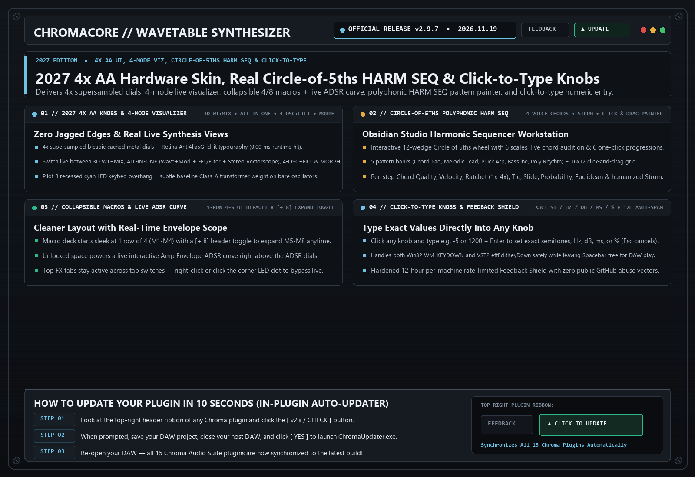

# ChromaCore `v2.9.7` — Release Notes (2026-11-19)

**[⬅ Back to ChromaCore Overview & Glossary](./README.md)**

## 2027 4x AA Hardware Skin, 4-Mode Real Visualizer, Collapsible Macros + ADSR, Circle-of-5ths HARM SEQ & Click-to-Type Knobs

### What Changed & Why It Matters Musically

- **2027 4x Supersampled Anti-Aliased Knobs & Retina Typography**: Dial sprites are pre-rendered at 4x resolution and bicubic-downsampled (0.00 ms runtime hit) with machined socket collars, soft dual-layer LED arcs, and `AntiAliasGridFit` labels (eliminating dark-theme color fringing while activating `ChromaFastText` caching).
- **4-Mode Real Interactive Top-Center Visualizer**: Switch live via the bottom mode pills (`3D WT+MIX`, `ALL-IN-ONE`, `4-OSC+FILT`, `MORPH`) or by clicking the viewport. Displays real phase-locked wavetable combinations, live Filter 1 cutoff/resonance curves, harmonic FFT, modulation trails, and a lock-free stereo width vectorscope with zero fake animation.
- **Collapsible Macro Deck (`4-SLOT` Default + `[ + 8 ]`) & Live ADSR Curve**: Macro Control starts compact at 1 row of 4 (`M1–M4`) with a `[ + 8 ]` / `[ - 4 ]` header toggle, unlocking a real-time interactive **Amp Envelope ADSR Curve Visualizer** directly above the Attack/Decay/Sustain/Release knobs.
- **Real Obsidian Studio `HARM SEQ` (Circle-of-5ths Polyphonic Sequencer & Pattern Painter)**: Replaces the neon Miami tab with an interactive 12-wedge Circle of 5ths wheel (6 scales, live chord audition, 6 one-click progressions), 5 pattern mode banks (`CHORD PAD`, `MELODIC LEAD`, `PLUCK ARP`, `BASSLINE`, `POLY RHYTHM`), a 16x12 click-and-drag pattern painter, 4-voice polyphonic chords with humanized strum, Chord Quality, Velocity sculpting, Ratchet (`1x–4x`), Tie, Slide, Probability, and Euclidean generation.
- **Pilot B Recessed Cyan LED Keybed & Persistent FX Tab Workflow**: Deep recessed metallic keybed overhang with subtle cyan LED accent bar; top FX tabs now persist activation cleanly across tab switches, with **Right-Click** or **Corner LED Dot** instant bypass from any tab.
- **Click-to-Type Keyboard Numeric Entry on Every Knob**: Click any knob to select it, type an integer or decimal (e.g. `5`, `-5`, `1200`, `75`) and press `Enter` to jump straight to exact semitones, Hz, dB, ms, or `%` (`Esc` cancels; Spacebar stays free for DAW transport).
- **Bare Oscillator Class-A Weight & 12h Rate-Limited Feedback Shield**: Enabled subtle baseline transformer core flux and even-harmonic body at 0 dB unity gain (zero extra CPU) so bare oscillators carry full analog weight, plus hardened 12-hour per-machine rate-limited `[FEEDBACK]` telemetry.

### ⌨️ Hotkey & Gesture Quick Reference

| Key / Gesture | Action | Description |
|---|---|---|
| `Click Knob -> Type Number + Enter` | **Exact Numeric Value Entry** | Click any knob (e.g. OSC 1 Pitch or Filter 1 Cutoff), type '-5', '5', '1200', or '75', and press Enter to set exact st / Hz / dB / ms / % (Esc cancels). |
| `Right-Click Top FX Tab / Click LED Dot` | **Instant Workflow FX Bypass** | Toggle DISTORT, EQ 12-B, BBD DELAY, HARM SEQ, MB DYN, or REVERB ON/OFF from any tab without losing your Synth view. |
| `Click Visualizer Mode Pill / Viewport` | **Switch 4 Live Synth Views** | Cycle between 3D WT+MIX (Pilot A), ALL-IN-ONE (Wave+Mod + FFT/Filter + Stereo), 4-OSC+FILT (2x2 Mini-Oscs + Filter), and PHASE MORPH. |
| `Click [ + 8 ] / [ - 4 ] on Macro Card` | **Expand / Collapse Macro Deck** | Toggle between compact 4-Macro + Live ADSR Curve view and full 8-Macro (M1–M8) deck. |
| `HARM SEQ: Click & Drag 16x12 Grid` | **Draw Patterns & Chords Live** | Click and drag smoothly across steps to paint scale-locked melodies, arps, basslines, or 4-voice strummed chord pads. |
| `HARM SEQ: Click Circle-of-5ths Wedge` | **Set Key & Audition Chord** | Click any Major (outer) or Minor (inner) wedge to switch key, illuminate its diatonic neighborhood, and audition the tonic chord. |
| `Right-Click Any Knob` | **14-Source Mod Matrix Link** | Bind LFO 1/2, Envelopes, Velocity, Note, Mod Wheel, Chaos, Random, Performer, or Macros directly to any dial. |

---
### ⚡ How to Update in 10 Seconds
1. Click the **`[ v2.x / CHECK ]`** button in the top-right header bar of the plugin.
2. Close your DAW and click **`[ YES ]`** in the prompt to run `ChromaUpdater.exe`.
3. Re-open your DAW — you are now on the latest build!
