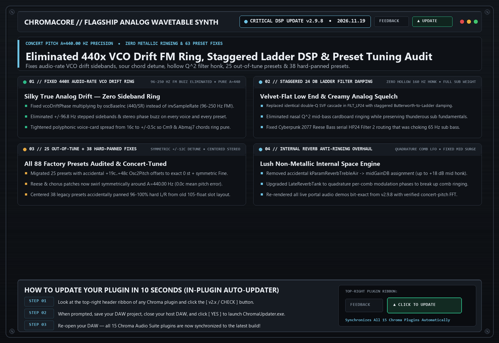

# ChromaCore `v2.9.8` — Release Notes (2026-11-19)

**[⬅ Back to ChromaCore Overview & Glossary](./README.md)**

## Concert-Pitch A=440.00 Hz Precision, Eliminated 440x Audio-Rate VCO Drift Ringing, Staggered Ladder DSP & 63 Factory Preset Fixes

### What Changed & Why It Matters Musically

- **Eliminated Critical 440x Audio-Rate VCO Thermal Drift FM Bug**: Fixed `vcoDriftPhase` multiplying by `oscBaseInc` (`440.0 / sampleRate`) instead of `invSampleRate`, which had been vibrating every voice's drift and Osc 1 stereo phase twin at `96.8–250.8 Hz` audio rate stepped every 16 samples. VCO thermal drift now glides smoothly at `0.18–0.46 Hz` (`±0.45 cents`) with zero metallic FM sidebands.
- **Pure Concert-Pitch Polyphonic Chords (`A = 440.00 Hz`)**: Tightened hardcoded polyphonic voice-card dispersion from `±5.4 cents` (`16.4 cents` peak-to-peak chord spread) down to a genuine hardware-precision `±0.25–0.75 cents`, keeping complex jazz/dark chords (`Cm9`, `Abmaj7`, `Fm9`) crystal pure in tune.
- **Staggered 4-Pole Ladder Filter Damping (`FILT_LP24`)**: Replaced identical cascaded double-Q SVF damping (`R^2` nasal honk around `150–200 Hz`) with staggered Butterworth-to-Ladder pole damping (`R1 / R2`), eliminating hollow cardboard low-mid ringing while preserving full sub-bass weight and creamy high-resonance squelch.
- **25 Out-of-Tune + 38 Hard-Panned Factory Presets Fixed (`88/88` Audited)**: Migrated 25 legacy presets that accidentally placed fine chorus/Reese detune (`0.501–0.505`) on `kParamOsc2Pitch` (`+10c` to `+48c` sharp!) to exact `0 st` coarse pitch + symmetric concert-pitch-centered `Osc1Fine / Osc2Fine` (`±4c` to `±12c`), centered 38 legacy presets accidentally panned 96–100% hard L/R from the old 105-float layout, and fixed `Cyberpunk 2077 Reese Bass` serial `HP24` Filter 2 routing that was choking `65 Hz` sub bass.
- **Internal Reverb Anti-Ringing Polish**: Removed the accidental `kParamReverbTrebleAir -> midGainDB` assignment (up to `+18 dB` mid honk) and upgraded `LateReverbTank` to quadrature per-comb LFO phases to eliminate static comb ringing.

---
### ⚡ How to Update in 10 Seconds
1. Click the **`[ v2.x / CHECK ]`** button in the top-right header bar of the plugin.
2. Close your DAW and click **`[ YES ]`** in the prompt to run `ChromaUpdater.exe`.
3. Re-open your DAW — you are now on the latest build!
