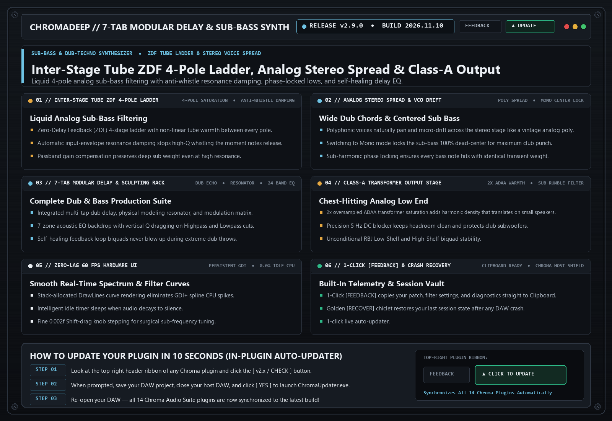

# ChromaDeep (`v2.9.0`)

> **7-Tab Modular Delay & Sub-Bass Synthesizer**  
> Deep sub-bass, physical resonator, and dub-techno chord synthesizer with a 7-tab modular delay and dual ZDF filter sculpting rack.

---

## 📚 Tech-to-Music Translator (How It Actually Works in Plain English)

### 🔹 Zero-Delay Feedback (ZDF) 4-Pole Ladder with Inter-Stage Tube Warmth
Standard digital filters have a 1-sample delay in their resonance loop that makes high resonance sound pinched and plastic. Zero-Delay Feedback solves the analog circuit instantaneously, and v2.9.0 adds tube saturation between all 4 ladder poles plus automatic resonance damping when notes stop—giving you liquid analog sweeps with zero post-note whistling.

### 🔹 Sub-Harmonic Phase Locking
Low bass waves are huge and slow. If a synth starts a bass note at a random point in the wave cycle every time you hit a key, some notes punch hard and others sound weak. Phase locking ensures every single bass hit starts at the exact same millisecond.

---

## 🗂️ Version & Patch History

- **[`v2.9.0` (2026-11-05) — ZDF Tube Ladder Saturation, Analog Stereo Voice Spread & Class-A Transformer Output](./v2.9.0_2026-11-05.md)**
  - **Inter-Stage Tube ZDF 4-Pole Ladder & Anti-Whistle Damping**: Added per-stage tube saturation and input-envelope resonance damping to both stereo ZDF filters.
  - **Analog Per-Voice Stereo Spread & VCO Drift**: Single-voice unison patches now spread naturally across the stereo field in polyphonic mode while keeping Mono mode 100% centered.
  - **Class-A AnalogConsoleStage & Jury-Clamped Delay EQ**: Self-healing transformer output stage and rock-solid feedback EQ stability.

- **[`v2.8.0` (2026-10-21) — 7-Zone Mixing Backdrop, Highpass/Lowpass Vertical Q Drag & Auto-Updater Shield](./v2.8.0_2026-10-21.md)**
  - **7 Acoustic Mixing Zones**: Full parametric EQ with vertical `Q` resonance dragging on Highpass and Lowpass filters.
  - **Zero-Allocation 60 FPS Paint Loop**: Eliminated GDI heap allocations for zero DAW lag.

---

## 🛠️ Known Issues & Bug Reporting

- None currently open in v2.9.0.

**Found a bug or weird preset behavior?**  
Click the **`[ FEEDBACK ]`** button in the top-right header of the plugin! It automatically snapshots your patch, EQ curve, and screenshot, copies a diagnostic summary to your Clipboard (`Ctrl+V` ready for Discord), or opens a pre-filled [GitHub Bug Report](https://github.com/haidood/chroma-release/issues/new).
