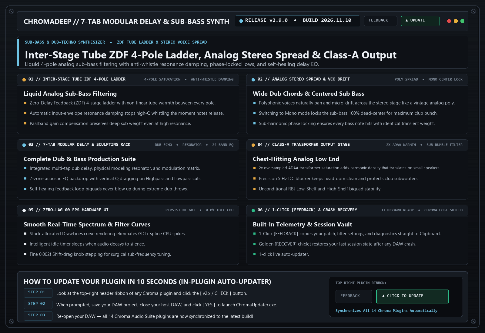

# ChromaDeep `v2.9.0` — Release Notes (2026-11-05)

**[⬅ Back to ChromaDeep Overview & Glossary](./README.md)**

## ZDF Tube Ladder Saturation, Analog Stereo Voice Spread & Class-A Transformer Output

### What Changed & Why It Matters Musically

- **Inter-Stage Tube ZDF 4-Pole Ladder & Anti-Whistle Damping**: Added per-stage tube saturation and input-envelope resonance damping to both stereo ZDF filters.
- **Analog Per-Voice Stereo Spread & VCO Drift**: Single-voice unison patches now spread naturally across the stereo field in polyphonic mode while keeping Mono mode 100% centered.
- **Class-A AnalogConsoleStage & Jury-Clamped Delay EQ**: Self-healing transformer output stage and rock-solid feedback EQ stability.

---
### ⚡ How to Update in 10 Seconds
1. Click the **`[ v2.x / CHECK ]`** button in the top-right header bar of the plugin.
2. Close your DAW and click **`[ YES ]`** in the prompt to run `ChromaUpdater.exe`.
3. Re-open your DAW — you are now on the latest build!
