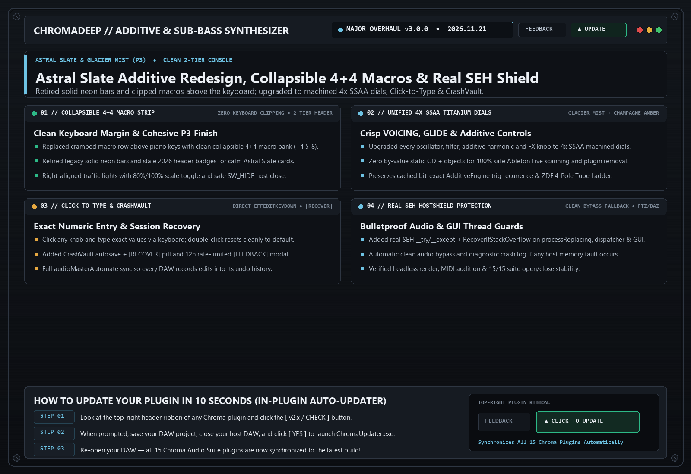

# ChromaDeep `v3.0.0` — Release Notes (2026-11-21)

**[⬅ Back to ChromaDeep Overview & Glossary](./README.md)**

## Astral Slate & Glacier Mist (P3) Redesign, Collapsible 4+4 Macros & Real SEH HostShield

### What Changed & Why It Matters Musically

- **Clean 2-Tier Astral Slate Console**: Retired legacy neon bars and stale 2026 header text in favor of calm midnight obsidian cards, 4x SSAA machined titanium dials, and clean `VOICING` / `GLIDE` readouts.
- **Collapsible 4+4 Macro Bank (`+4 5-8`)**: Eliminated macro clipping right above the piano keyboard while keeping all 8 performance macros 1 click away.
- **Real SEH HostShield, Click-to-Type & CrashVault**: Added SEH `__try/__except` + stack overflow recovery, direct keyboard numeric entry, CrashVault `[RECOVER]`, `[FEEDBACK]` shield, and safe `SW_HIDE` host close.

---
### ⚡ How to Update in 10 Seconds
1. Click the **`[ v2.x / CHECK ]`** button in the top-right header bar of the plugin.
2. Close your DAW and click **`[ YES ]`** in the prompt to run `ChromaUpdater.exe`.
3. Re-open your DAW — you are now on the latest build!
