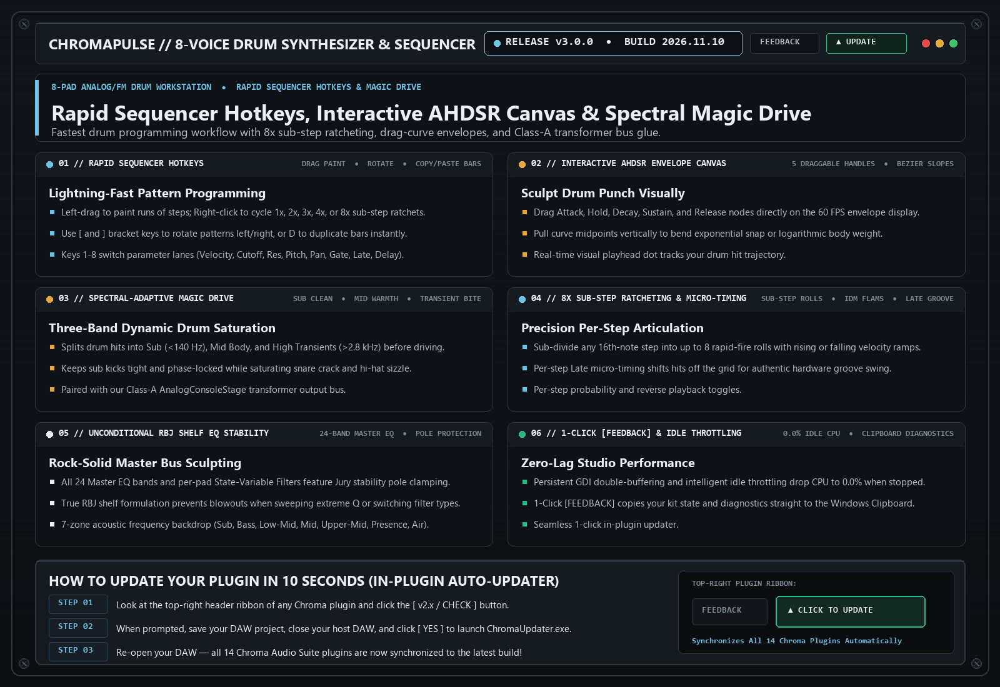

# ChromaPulse (`v3.0.0`)

> **Step-Sequenced Ratchet Rhythm Synthesizer**  
> Precision rhythmic drum & bassline synthesizer built for modern electronic production, ratcheting arpeggios, and tempo-synced filter movement.

---

## 📚 Tech-to-Music Translator (How It Actually Works in Plain English)

### 🔹 Class-A Drum Bus Transformer Saturation
Drums have super fast spikes (transients) that can clip digital converters before they even sound loud. Passing the master drum bus through a modeled Class-A analog transformer gently hugs those microsecond drum spikes and adds warm low-end weight—giving kicks and snares instant record-ready punch.

### 🔹 Sub-Step Ratcheting
Instead of playing just one note per 16th-note step, ratcheting rapidly subdivides a single step into 2, 3, or 4 mini-strikes—creating signature rolling electronic and modern techno synth fills.

---

## 🗂️ Version & Patch History

- **[`v3.0.0` (2026-11-06) — Hardware UI Preview, Rapid Sequencer Hotkeys, Magic Drive & Envelope Drawing](./v3.0.0_2026-11-06.md)**
  - **Spectral-Adaptive Magic Drive Master Stage**: Added master bus Magic Drive (derived from ChromaCore) with intelligent sub-bass mono-tightening, 320 Hz boxy-mud scoop, sweet-spot focus excitation, and silk-air shimmer.
  - **Interactive AHDSR Multi-Segment Envelope Canvas**: Directly drag Attack, Decay, and Sustain nodes on the waveform display for immediate visual and sonic shaping of drum hits.
  - **Duo-Tone Gunmetal & Matte Hardware UI**: Upgraded aesthetics to brushed gunmetal and matte obsidian with amber LED indicators and native 60 FPS UI preview capture.
  - **Full Keyboard & Mouse Hotkey Engine**: Rapid studio workflow for sequencing, ratcheting, muting, shifting, and duplicating drum patterns.

  **⌨️ Sequencer Hotkeys & Gestures:**

  | Key / Gesture | Action | Description |
  |---|---|---|
  | `Ctrl + Left Click` | **Cycle Step Ratchets** | Cycles sub-divisions (1x -> 2x -> 3x -> 4x -> 5x -> 6x -> 7x -> 8x -> 1x) with active numerical and dot indicators on the step. |
  | `Alt + Left Click` | **Reverse Step** | Toggles reverse sample playback badge (◀) for that individual step. |
  | `Shift + Left Click` | **Mute / Unmute Step** | Mutes or un-mutes the step without clearing or overwriting velocity data. |
  | `Left Click + Drag (Bars)` | **Draw Velocities** | Freehand draw velocity / parameter curves across all 16 steps smoothly. |
  | `Left Click + Drag (Nodes)` | **Shape Envelope** | Click and drag interactive Attack, Decay, and Sustain handles directly on the waveform display. |
  | `[ / ] (Bracket Keys)` | **Rotate Pattern Left / Right** | Nudges the entire 16-step sequence earlier or later in time on the active pad. |
  | `Ctrl + C / Ctrl + V` | **Copy / Paste Bar Pattern** | Copies active 16-step bar data to memory and pastes it into any other pad or bar page. |
  | `D` | **Duplicate Bar** | Duplicates current bar pattern into the next empty bar page for rapid pattern building. |
  | `R` | **Quick Reverse Toggle** | Toggles reverse playback state for the step under cursor. |
  | `M` | **Quick Mute Toggle** | Toggles mute state for the step under cursor. |
  | `Delete / Backspace` | **Clear Pattern** | Clears all 16 steps on the selected pad. |
  | `Spacebar` | **Transport Play / Stop** | Starts or stops sequencer audition playback. |
  | `1 through 8` | **Switch Parameter Mode** | Switches sequencer lane to Velocity (1), Cutoff (2), Res (3), Pitch (4), Pan (5), Gate (6), Late (7), or Delay (8). |

- **[`v2.9.0` (2026-11-05) — Class-A Transformer Drum Bus Stage, Jury-Stabilized 24-Band EQ & Clipboard [FEEDBACK]](./v2.9.0_2026-11-05.md)**
  - **Class-A AnalogConsoleStage Drum Bus Output**: Replaced hard tanh clipping on the master bus with discrete transformer saturation, 5 Hz sub-rumble DC blocking, and automatic `NaN`/`Inf` self-healing.
  - **Jury-Stabilized 24-Band Master EQ & SVF Protection**: Added pole-stability clamping across all 24 Master EQ bands and per-pad State-Variable Filters.
  - **Upgraded 1-Click Clipboard [FEEDBACK] Shield**: Automatically copies diagnostic reports to your Windows Clipboard (`Ctrl+V` ready for Discord).

- **[`v2.8.0` (2026-10-21) — 7-Zone Acoustic EQ Backdrop, Stack-Allocated Spectrum & 0.002f Fine Stepping](./v2.8.0_2026-10-21.md)**
  - **7-Zone Studio Mixing Backdrop**: Visual frequency guide (Sub, Bass, Low-Mid, Mid, Upper-Mid, Presence, Air).
  - **Zero-Lag Spectrum & EQ Rendering**: Stack-allocated `DrawLines` curve rendering with cut-filter vertical `Q` dragging.
  - **Universal Auto-Updater Shield**: 1-click in-plugin updates.

---

## 🛠️ Known Issues & Bug Reporting

- None currently open in v3.0.0.

**Found a bug or weird preset behavior?**  
Click the **`[ FEEDBACK ]`** button in the top-right header of the plugin! It automatically snapshots your patch, EQ curve, and screenshot, copies a diagnostic summary to your Clipboard (`Ctrl+V` ready for Discord), or opens a pre-filled [GitHub Bug Report](https://github.com/haidood/chroma-release/issues/new).
