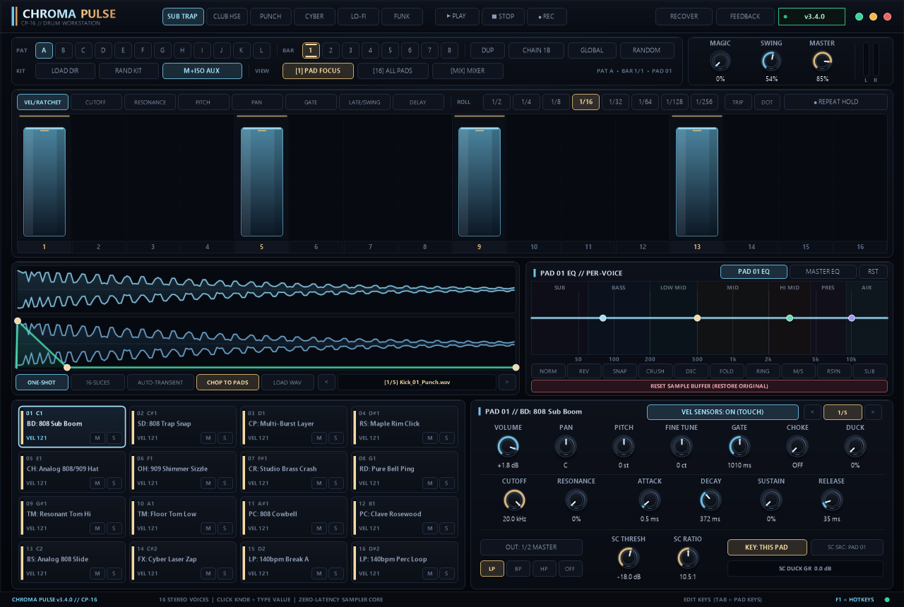
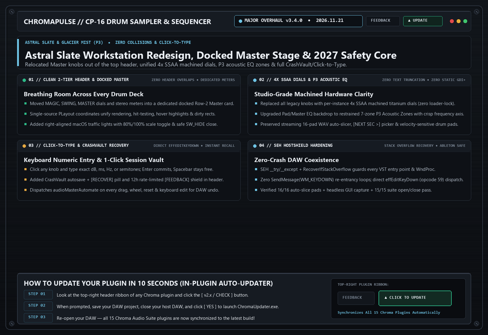

# ChromaPulse (`v3.4.0`)

> **16-Pad Drum & Step-Sequenced Ratchet Rhythm Workstation**  
> Precision 16-pad drum & rhythm workstation with Per-Pad & Master Parametric EQ, 3D depth-blended step bars, wider smooth ribbon waveforms, residual ADAA headroom, and rapid held-key + Left-Click sequencer note modifiers.

### 🎛️ Plugin Interface (`v3.4.0`)

---

## 📚 Tech-to-Music Translator (How It Actually Works in Plain English)

### 🔹 Residual-Only ADAA Soft-Clip Ceiling & ChromaMagicMaster
Traditional oversampled clippers can roll off delicate cymbal air even when you aren't clipping. Residual-only ADAA only anti-aliases the nonlinear distortion over the ceiling while leaving the linear path dead flat at 44.1, 48, 88.2, 96, and 192 kHz—preserving crisp transient snap with zero added latency.

### 🔹 Per-Pad 24-Band Parametric EQ + Master Bus EQ
Carving rumble out of your hi-hat shouldn't thin out your 808 kick. Each of the 16 pads now carries its own 24-band parametric EQ straight into isolated DAW stem outputs, paired with a switchable Master EQ for final kit glue.

### 🔹 Left-Click Sequencer Note Modifiers (Split, Reverse, Triplet)
Instead of opening sub-menus for trap hi-hat rolls or reverse snares, hold a key (`2`, `3`, `4`, `6`, `8`, `R`, `T`, `M`, `A`, `G`) and Left-Click any step to split, flip backwards, pocket into triplet timing, accent, or ghost it on the fly.

### 🔹 Capacitor-Discharge Exponential AHDSR & 32-Sample Retrigger Crossfade
Analog drum machines decay like a draining capacitor—fast punch up front followed by a smooth natural tail—whereas rapid machine-gun drum rolls on a single voice can click if the previous hit is chopped mid-cycle. ChromaPulse pairs exponential RC decay/release slopes with a 32-sample onset crossfade so rolls and finger-drumming stay dead smooth.

---

## 🗂️ Version & Patch History

- **[`v3.4.0` (2026-11-21) — Astral Slate & Glacier Mist (P3) Workstation Redesign, Docked Master Stage & Click-to-Type](./v3.4.0_2026-11-21.md)**
  - **Clean 2-Tier Header & Dedicated Docked Master Card**: Relocated `MAGIC`, `SWING`, `MASTER` dials and stereo peak meters out of the crowded top ribbon into a dedicated Row-2 Master card with zero overlapping controls.
  - **Unified 4x SSAA Machined Dials & P3 Acoustic Zones EQ**: Upgraded every Pad Inspector dial, unified all coordinates via `PLayout`, eliminated EQ zone text truncation, and preserved the smart streaming 16-pad WAV auto-slicer.
  - **Click-to-Type, CrashVault & SEH HostShield**: Direct `effEditKeyDown` numeric knob entry (Spacebar stays free), CrashVault `[RECOVER]` autosave, `[FEEDBACK]` shield, 80%/100% scale toggle, and safe `SW_HIDE` host close.

- **[`v3.3.0` (2026-11-18) — Streaming 16-Pad WAV Auto-Slicer with Click-Free Fades & Section Cycling](./v3.3.0_2026-11-18.md)**
  - **Streaming 16-Pad Auto-Slicer (`LoadAndAutoSliceWav`)**: Drop any breakbeat or full song WAV to stream and auto-slice the loudest 16-second window cleanly across all 16 pads.
  - **2 ms Anti-Click Fades & Automatic Choke Group 1**: Every slice receives smooth 2 ms onset/tail fades and automatic Choke Group 1 assignment so chops play cleanly right away.
  - **`[NEXT SEC >]` Section Cycle Control**: Jump straight to the next 16-second window of a long WAV file without interrupting playback.

- **[`v3.2.1` (2026-11-17) — Lock-Free Sample Swap Handshake, Strict [-0.985] ADAA Ceiling & S=1.0 Shelf Invariance](./v3.2.1_2026-11-17.md)**
  - **Lock-Free Live Sample Swap Handshake**: Added symmetric `seq_cst` `std::atomic<int> audioBusy` counter around `ProcessReplacing` and `effProcessEvents` (with SEH reset), `std::mutex sampleWriteMutex` acquired before `ScopedSampleLock` (`200 ms` timeout), and atomic `sampleGen` mismatch voice cutoff—verified across 4,000 C++ and 1,200 live DLL swaps against 92,622 audio blocks with zero faults.
  - **Strict `[-0.985, 0.985]` Residual ADAA Ceiling**: Updated `SoftClipCeilingADAA` so step, hot-kit, and `15 kHz +3 dBFS` signals never exceed `0.985`, paired with `~5 ms` `-std::expm1f` zipper smoothers (`< 1e-6f` snap) on master volume, pad volume, and pad pan.
  - **`TriggerPadFromGui` & Slice Safety Guards**: Unified `TriggerPadFromGui` across all 6 GUI pad click sites and `LoadAdjacentSampleInFolder`, and added `.empty()`, `min`, and zero-length slice guards for reverse playback.
  - **Fixed `S = 1.0` Shelf Slope & Finite Notch Readout**: Enforced fixed `S = 1.0` shelf Q-invariance across wheel/HUD/ring UI and floored `EvalMagnitudeDb` numerator/denominator at `1e-12` (`-64.57 dB` finite Notch readout).

- **[`v3.2.0` (2026-11-16) — Per-Pad & Master EQ, 3D Blended Bars, Smooth Waveforms & Left-Click Note Modifiers](./v3.2.0_2026-11-16.md)**
  - **Per-Pad 24-Band Parametric EQ + Master EQ**: Added independent 24-band parametric EQ on every one of the 16 drum voices (feeding both Master mix & isolated 32-channel stem outputs) alongside the global Master EQ, switched cleanly via top-right **`[ PAD XX EQ ]` / `[ MASTER EQ ]` / `[ RST ]`** chiclets and persisted inside DAW project chunks.
  - **3D Blended Sequencer Bars & Softened Luminance**: Upgraded left-to-right sequencer step bars, All-Pads velocity pills, and Mixer faders with recessed 3D channel wells, soft multi-layer drop shadows, brushed vertical gradients, carved split grooves, and eye-friendly diffused top caps.
  - **Wider, Smoother Anti-Aliased Waveforms & Curves**: Rebuilt the dual waveform slice display with true min/max contour ribbon fills, soft outer glow traces, and wider `2.2–2.5 px` smooth curves across waveforms, AHDSR envelopes, and EQ response splines.
  - **Residual-Only ADAA Audio Fidelity**: Replaced the ceiling clipper with zero-latency residual-only 1st-order ADAA (`0.000 dB` flat linear top end across all sample rates) and upgraded Magic Drive to `ChromaMagicMaster` with NaN-safe RMS loudness trim and true Jury-stabilized RBJ shelf slopes.
  - **Full Held-Key + Left-Click Note Modulation Workflow**: Hold modifier keys while Left-Clicking any programmed sequencer step to instantaneously split notes (`2..8`), reverse (`R`), shift into triplet pocket (`T`), accent (`A`), ghost (`G`), mute (`M`), quantize (`Q`), vary pitch/pan (`E`), or reset (`0`).

  **⌨️ Sequencer Hotkeys & Gestures:**

  | Key / Gesture | Action | Description |
  |---|---|---|
  | `2 + Left Click` | **Split Note 2x** | Subdivides the clicked sequencer step into 2 fast 32nd-note hits (displays `2x` + carved bar groove). |
  | `3 + Left Click` | **Split Note 3x (Triplet)** | Subdivides the clicked step into a 3-hit triplet roll (`3x`) across the step duration. |
  | `4 + Left Click` | **Split Note 4x** | Subdivides the clicked step into a 4-hit 64th-note burst (`4x`). |
  | `6 + Left Click` | **Split Note 6x (Sextuplet)** | Subdivides the clicked step into a 6-hit sextuplet roll (`6x`). |
  | `8 + Left Click` | **Split Note 8x** | Subdivides the clicked step into a rapid 8-hit 128th-note roll (`8x`). |
  | `5 / 7 + Left Click` | **Odd Tuplet Splits (5x / 7x)** | Subdivides the clicked step into 5 or 7 evenly spaced odd-tuplet strikes. |
  | `1 + Left Click` | **Reset Split to 1x** | Returns a subdivided step to a single clean hit (`1x`) without clearing velocity or reverse. |
  | `0 + Left Click` | **Reset All Step Modifiers** | Resets splits (`1x`), Reverse, Triplet pocket, micro-timing, and step mute back to default. |
  | `R + Left Click (or Alt + Click)` | **Toggle Reverse (◀)** | Flips the sample backwards on that individual step (`◀` rose badge); arms empty steps if clicked. |
  | `T + Left Click` | **Toggle Triplet Pocket (T)** | Shifts single hits into a 16th-triplet groove pocket (+1/3 step) or compresses ratchets into triplet spacing (`T` / `3xT` badge). |
  | `M + Left Click (or Shift + Click)` | **Toggle Step Mute** | Mutes or unmutes the step non-destructively while keeping its velocity and split edits intact. |
  | `A + Left Click` | **Accent Toggle (100% / 72%)** | Snaps the clicked step to full `100%` accent velocity (or toggles back to `72%`). |
  | `G + Left Click` | **Ghost Note (35%)** | Sets the clicked step to a subtle `35%` ghost-note hit (ideal for snares & percussive hats). |
  | `Q + Left Click` | **Quantize Step Timing** | Clears per-step micro-late offset and triplet pocket shift back onto the hard grid. |
  | `E + Left Click` | **Humanize Pitch & Pan** | Applies organic micro-variation to step pitch (`-6..+6 st`) and stereo pan placement. |
  | `Ctrl + Left Click` | **Cycle Splits (1x..8x)** | Steps sequentially through subdivisions `1x -> 2x -> 3x -> 4x -> 5x -> 6x -> 7x -> 8x -> 1x`. |
  | `Scroll Wheel (Over Step)` | **Step Split Count ±** | Scroll up/down directly over any step column to double or halve repeat subdivisions. |
  | `[ / ] / Ctrl+Z / Ctrl+C / Ctrl+V` | **Shift, Undo, Copy & Paste Bar** | Rotate the 16-step pattern left/right, undo edits, or copy/paste entire bar pages across pads. |

- **[`v3.1.0` (2026-11-15) — Sub-ms Pad Strike Response, 2x ADAA Master Ceiling, Exp AHDSR & Phase 2 Engine](./v3.1.0_2026-11-15.md)**
  - **Promoted to Unified Main Release**: Merged all `ChromaPulse v3.1.0` upgrades directly into canonical `ChromaPulse.dll` / `.vst3` (retired separate `_Fable` side-by-side binary) and cleaned top-ribbon badge/knob clearances.
  - **Sub-Millisecond Visual Pad Strike (`TriggerPadVisualAndUpdate`)**: Both pad clicks and 4x4 keyboard drum triggers snap pad glow immediately (`vel * 0.80f`) with tight per-pad `InvalidateRect` + `UpdateWindow`, alongside section and pad `g.IsVisible` culls in `PaintPulseGUI` (`1.98 ms` live paint, `0.0/s` idle repaints).
  - **2x Oversampled ADAA Master Soft-Clip Ceiling (`0.985f`)**: Replaced hard master clipping with first-order anti-derivative anti-aliased soft-clipping, eliminating `peak=1.200` / multi-hundred-clip overloads down to `clip=0` (`peak=0.827`) across all 6 factory kits.
  - **Exponential RC AHDSR & 32-Sample Retrigger Crossfade**: Switched AHDSR decay/release stages to exponential capacitor discharge (`exp(-4.6/samples)`), added 32-sample smooth retrigger crossfades in `DrumVoice`, and added 4-sample onset micro-tapers to kick/snare transients.
  - **50-Block Idle Audio Bypass & 32-Bit DIB UI**: Drops silent post-tail DSP load to `0.02%` (`0.22%` idle) with zero-allocation `ChromaFastText` rendering.
  - **Expanded Keyboard Production Workflow**: Added `Tab` audition/edit mode switch, 4x4 keyboard pads (`Z..V`, `A..F`, `Q..R`), `F` step flip, `I` reverse, `N` note gate, `Delete` clear, and `H` / `?` / `Shift+F1` help overlay.

- **[`v3.0.0` (2026-11-06) — Hardware UI Preview, Rapid Sequencer Hotkeys, Magic Drive & Envelope Drawing](./v3.0.0_2026-11-06.md)**
  - **Spectral-Adaptive Magic Drive Master Stage**: Added master bus Magic Drive (derived from ChromaCore) with intelligent sub-bass mono-tightening, 320 Hz boxy-mud scoop, sweet-spot focus excitation, and silk-air shimmer.
  - **Interactive AHDSR Multi-Segment Envelope Canvas**: Directly drag Attack, Decay, and Sustain nodes on the waveform display for immediate visual and sonic shaping of drum hits.
  - **Duo-Tone Gunmetal & Matte Hardware UI**: Upgraded aesthetics to brushed gunmetal and matte obsidian with amber LED indicators and native 60 FPS UI preview capture.
  - **Full Keyboard & Mouse Hotkey Engine**: Rapid studio workflow for sequencing, ratcheting, muting, shifting, and duplicating drum patterns.

  **⌨️ Sequencer Hotkeys & Gestures:**

  | Key / Gesture | Action | Description |
  |---|---|---|
  | `Ctrl + Left Click` | **Cycle Step Ratchets** | Cycles sub-divisions (1x -> 2x -> 3x -> 4x -> 5x -> 6x -> 7x -> 8x -> 1x) with active numerical and dot indicators on the step. |
  | `Alt + Left Click` | **Reverse Step** | Toggles reverse sample playback badge (◀) for that individual step. |
  | `Shift + Left Click` | **Mute / Unmute Step** | Mutes or un-mutes the step without clearing or overwriting velocity data. |
  | `Left Click + Drag (Bars)` | **Draw Velocities** | Freehand draw velocity / parameter curves across all 16 steps smoothly. |
  | `Left Click + Drag (Nodes)` | **Shape Envelope** | Click and drag interactive Attack, Decay, and Sustain handles directly on the waveform display. |
  | `[ / ] (Bracket Keys)` | **Rotate Pattern Left / Right** | Nudges the entire 16-step sequence earlier or later in time on the active pad. |
  | `Ctrl + C / Ctrl + V` | **Copy / Paste Bar Pattern** | Copies active 16-step bar data to memory and pastes it into any other pad or bar page. |
  | `D` | **Duplicate Bar** | Duplicates current bar pattern into the next empty bar page for rapid pattern building. |
  | `R` | **Quick Reverse Toggle** | Toggles reverse playback state for the step under cursor. |
  | `M` | **Quick Mute Toggle** | Toggles mute state for the step under cursor. |
  | `Delete / Backspace` | **Clear Pattern** | Clears all 16 steps on the selected pad. |
  | `Spacebar` | **Transport Play / Stop** | Starts or stops sequencer audition playback. |
  | `1 through 8` | **Switch Parameter Mode** | Switches sequencer lane to Velocity (1), Cutoff (2), Res (3), Pitch (4), Pan (5), Gate (6), Late (7), or Delay (8). |

- **[`v2.9.0` (2026-11-05) — Class-A Transformer Drum Bus Stage, Jury-Stabilized 24-Band EQ & Clipboard [FEEDBACK]](./v2.9.0_2026-11-05.md)**
  - **Class-A AnalogConsoleStage Drum Bus Output**: Replaced hard tanh clipping on the master bus with discrete transformer saturation, 5 Hz sub-rumble DC blocking, and automatic `NaN`/`Inf` self-healing.
  - **Jury-Stabilized 24-Band Master EQ & SVF Protection**: Added pole-stability clamping across all 24 Master EQ bands and per-pad State-Variable Filters.
  - **Upgraded 1-Click Clipboard [FEEDBACK] Shield**: Automatically copies diagnostic reports to your Windows Clipboard (`Ctrl+V` ready for Discord).

- **[`v2.8.0` (2026-10-21) — 7-Zone Acoustic EQ Backdrop, Stack-Allocated Spectrum & 0.002f Fine Stepping](./v2.8.0_2026-10-21.md)**
  - **7-Zone Studio Mixing Backdrop**: Visual frequency guide (Sub, Bass, Low-Mid, Mid, Upper-Mid, Presence, Air).
  - **Zero-Lag Spectrum & EQ Rendering**: Stack-allocated `DrawLines` curve rendering with cut-filter vertical `Q` dragging.
  - **Universal Auto-Updater Shield**: 1-click in-plugin updates.

---

## 🛠️ Known Issues & Bug Reporting

- A host crash reported by a tester is not yet confirmed by a crash dump.

**Found a bug or weird preset behavior?**  
Click the **`[ FEEDBACK ]`** button in the top-right header of the plugin! It automatically snapshots your patch, EQ curve, and screenshot, copies a diagnostic summary to your Clipboard (`Ctrl+V` ready for Discord), or opens a pre-filled [GitHub Bug Report](https://github.com/haidood/chroma-release/issues/new).
