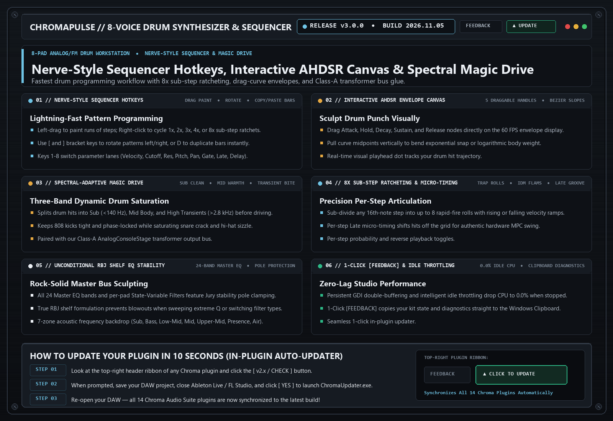

# ChromaPulse `v3.0.0` — Release Notes (2026-11-06)

**[⬅ Back to ChromaPulse Overview & Glossary](./README.md)**

## Hardware UI Preview, Nerve-Style Sequencer Hotkeys, Magic Drive & Envelope Drawing

### What Changed & Why It Matters Musically

- **Spectral-Adaptive Magic Drive Master Stage**: Added master bus Magic Drive (derived from ChromaCore) with intelligent sub-bass mono-tightening, 320 Hz boxy-mud scoop, sweet-spot focus excitation, and silk-air shimmer.
- **Interactive AHDSR Multi-Segment Envelope Canvas**: Directly drag Attack, Decay, and Sustain nodes on the waveform display for immediate visual and sonic shaping of drum hits.
- **Duo-Tone Gunmetal & Matte Hardware UI**: Upgraded aesthetics to brushed gunmetal and matte obsidian with amber LED indicators and native 60 FPS UI preview capture.
- **Full Keyboard & Mouse Hotkey Engine**: Nerve-inspired rapid workflow for sequencing, ratcheting, muting, shifting, and duplicating drum patterns.

### ⌨️ Hotkey & Gesture Quick Reference

| Key / Gesture | Action | Description |
|---|---|---|
| `Ctrl + Left Click` | **Cycle Step Ratchets** | Cycles sub-divisions (1x -> 2x -> 3x -> 4x -> 5x -> 6x -> 7x -> 8x -> 1x) with active numerical and dot indicators on the step. |
| `Alt + Left Click` | **Reverse Step** | Toggles reverse sample playback badge (◀) for that individual step. |
| `Shift + Left Click` | **Mute / Unmute Step** | Mutes or un-mutes the step without clearing or overwriting velocity data. |
| `Left Click + Drag (Bars)` | **Draw Velocities** | Freehand draw velocity / parameter curves across all 16 steps smoothly. |
| `Left Click + Drag (Nodes)` | **Shape Envelope** | Click and drag interactive Attack, Decay, and Sustain handles directly on the waveform display. |
| `[ / ] (Bracket Keys)` | **Rotate Pattern Left / Right** | Nudges the entire 16-step sequence earlier or later in time on the active pad. |
| `Ctrl + C / Ctrl + V` | **Copy / Paste Bar Pattern** | Copies active 16-step bar data to memory and pastes it into any other pad or bar page. |
| `D` | **Duplicate Bar** | Duplicates current bar pattern into the next empty bar page for rapid pattern building. |
| `R` | **Quick Reverse Toggle** | Toggles reverse playback state for the step under cursor. |
| `M` | **Quick Mute Toggle** | Toggles mute state for the step under cursor. |
| `Delete / Backspace` | **Clear Pattern** | Clears all 16 steps on the selected pad. |
| `Spacebar` | **Transport Play / Stop** | Starts or stops sequencer audition playback. |
| `1 through 8` | **Switch Parameter Mode** | Switches sequencer lane to Velocity (1), Cutoff (2), Res (3), Pitch (4), Pan (5), Gate (6), Late (7), or Delay (8). |

---
### ⚡ How to Update in 10 Seconds
1. Click the **`[ v2.8.x / CHECK ]`** button in the top-right header bar of the plugin.
2. Close your DAW and click **`[ YES ]`** in the prompt to run `ChromaUpdater.exe`.
3. Re-open Ableton Live / FL Studio — you are now on the latest build!
