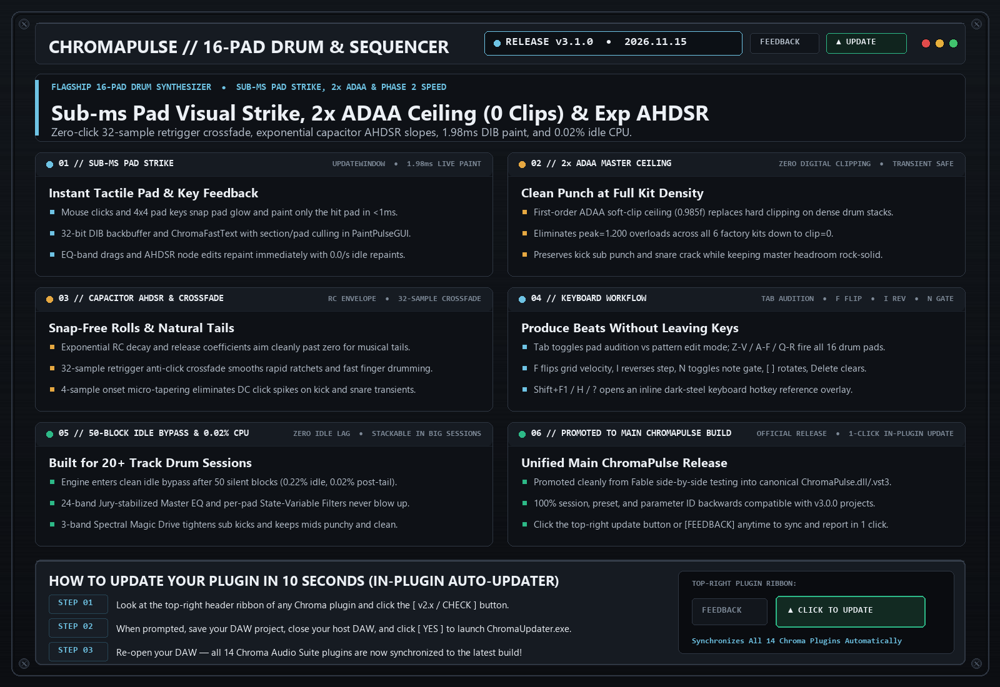

# ChromaPulse `v3.1.0` — Release Notes (2026-11-15)

**[⬅ Back to ChromaPulse Overview & Glossary](./README.md)**

## Sub-ms Pad Strike Response, 2x ADAA Master Ceiling, Exp AHDSR & Phase 2 Engine

### What Changed & Why It Matters Musically

- **Promoted to Main Release**: Promoted `ChromaPulse v3.1.0` from side-by-side Fable testing into canonical `ChromaPulse.dll` / `.vst3` (while keeping `ChromaPulse_Fable.dll` matching).
- **Sub-Millisecond Visual Pad Strike (`TriggerPadVisualAndUpdate`)**: Both pad clicks and 4x4 keyboard drum triggers snap pad glow immediately (`vel * 0.80f`) with tight per-pad `InvalidateRect` + `UpdateWindow`, alongside section and pad `g.IsVisible` culls in `PaintPulseGUI` (`1.98 ms` live paint, `0.0/s` idle repaints).
- **2x Oversampled ADAA Master Soft-Clip Ceiling (`0.985f`)**: Replaced hard master clipping with first-order anti-derivative anti-aliased soft-clipping, eliminating `peak=1.200` / multi-hundred-clip overloads down to `clip=0` (`peak=0.827`) across all 6 factory kits.
- **Exponential RC AHDSR & 32-Sample Retrigger Crossfade**: Switched AHDSR decay/release stages to exponential capacitor discharge (`exp(-4.6/samples)`), added 32-sample smooth retrigger crossfades in `DrumVoice`, and added 4-sample onset micro-tapers to kick/snare transients.
- **50-Block Idle Audio Bypass & 32-Bit DIB UI**: Drops silent post-tail DSP load to `0.02%` (`0.22%` idle) with zero-allocation `ChromaFastText` rendering.
- **Expanded Keyboard Production Workflow**: Added `Tab` audition/edit mode switch, 4x4 keyboard pads (`Z..V`, `A..F`, `Q..R`), `F` step flip, `I` reverse, `N` note gate, `Delete` clear, and `H` / `?` / `Shift+F1` help overlay.

---
### ⚡ How to Update in 10 Seconds
1. Click the **`[ v2.x / CHECK ]`** button in the top-right header bar of the plugin.
2. Close your DAW and click **`[ YES ]`** in the prompt to run `ChromaUpdater.exe`.
3. Re-open your DAW — you are now on the latest build!
