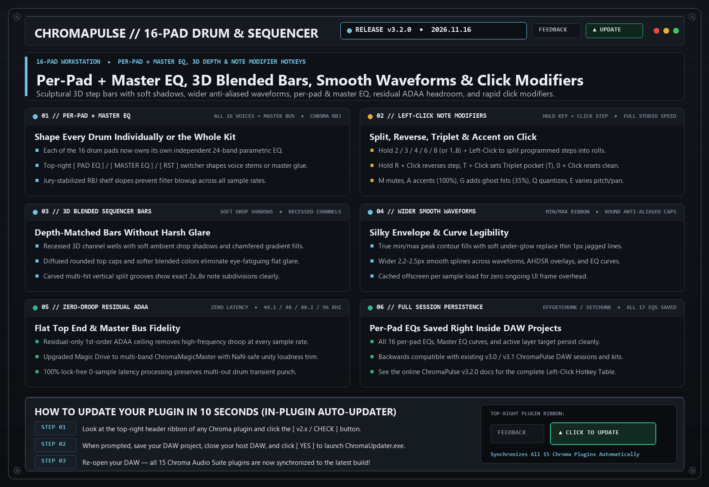

# ChromaPulse `v3.2.0` — Release Notes (2026-11-16)

**[⬅ Back to ChromaPulse Overview & Glossary](./README.md)**

## Per-Pad & Master EQ, 3D Blended Bars, Smooth Waveforms & Left-Click Note Modifiers

### What Changed & Why It Matters Musically

- **Per-Pad 24-Band Parametric EQ + Master EQ**: Added independent 24-band parametric EQ on every one of the 16 drum voices (feeding both Master mix & isolated 32-channel stem outputs) alongside the global Master EQ, switched cleanly via top-right **`[ PAD XX EQ ]` / `[ MASTER EQ ]` / `[ RST ]`** chiclets and persisted inside DAW project chunks.
- **3D Blended Sequencer Bars & Softened Luminance**: Upgraded left-to-right sequencer step bars, All-Pads velocity pills, and Mixer faders with recessed 3D channel wells, soft multi-layer drop shadows, brushed vertical gradients, carved split grooves, and eye-friendly diffused top caps.
- **Wider, Smoother Anti-Aliased Waveforms & Curves**: Rebuilt the dual waveform slice display with true min/max contour ribbon fills, soft outer glow traces, and wider `2.2–2.5 px` smooth curves across waveforms, AHDSR envelopes, and EQ response splines.
- **Residual-Only ADAA Audio Fidelity**: Replaced the ceiling clipper with zero-latency residual-only 1st-order ADAA (`0.000 dB` flat linear top end across all sample rates) and upgraded Magic Drive to `ChromaMagicMaster` with NaN-safe RMS loudness trim and true Jury-stabilized RBJ shelf slopes.
- **Full Held-Key + Left-Click Note Modulation Workflow**: Hold modifier keys while Left-Clicking any programmed sequencer step to instantaneously split notes (`2..8`), reverse (`R`), shift into triplet pocket (`T`), accent (`A`), ghost (`G`), mute (`M`), quantize (`Q`), vary pitch/pan (`E`), or reset (`0`).

### ⌨️ Hotkey & Gesture Quick Reference

| Key / Gesture | Action | Description |
|---|---|---|
| `2 + Left Click` | **Split Note 2x** | Subdivides the clicked sequencer step into 2 fast 32nd-note hits (displays `2x` + carved bar groove). |
| `3 + Left Click` | **Split Note 3x (Triplet)** | Subdivides the clicked step into a 3-hit triplet roll (`3x`) across the step duration. |
| `4 + Left Click` | **Split Note 4x** | Subdivides the clicked step into a 4-hit 64th-note burst (`4x`). |
| `6 + Left Click` | **Split Note 6x (Sextuplet)** | Subdivides the clicked step into a 6-hit sextuplet roll (`6x`). |
| `8 + Left Click` | **Split Note 8x** | Subdivides the clicked step into a rapid 8-hit 128th-note roll (`8x`). |
| `5 / 7 + Left Click` | **Odd Tuplet Splits (5x / 7x)** | Subdivides the clicked step into 5 or 7 evenly spaced odd-tuplet strikes. |
| `1 + Left Click` | **Reset Split to 1x** | Returns a subdivided step to a single clean hit (`1x`) without clearing velocity or reverse. |
| `0 + Left Click` | **Reset All Step Modifiers** | Resets splits (`1x`), Reverse, Triplet pocket, micro-timing, and step mute back to default. |
| `R + Left Click (or Alt + Click)` | **Toggle Reverse (◀)** | Flips the sample backwards on that individual step (`◀` rose badge); arms empty steps if clicked. |
| `T + Left Click` | **Toggle Triplet Pocket (T)** | Shifts single hits into a 16th-triplet groove pocket (+1/3 step) or compresses ratchets into triplet spacing (`T` / `3xT` badge). |
| `M + Left Click (or Shift + Click)` | **Toggle Step Mute** | Mutes or unmutes the step non-destructively while keeping its velocity and split edits intact. |
| `A + Left Click` | **Accent Toggle (100% / 72%)** | Snaps the clicked step to full `100%` accent velocity (or toggles back to `72%`). |
| `G + Left Click` | **Ghost Note (35%)** | Sets the clicked step to a subtle `35%` ghost-note hit (ideal for snares & percussive hats). |
| `Q + Left Click` | **Quantize Step Timing** | Clears per-step micro-late offset and triplet pocket shift back onto the hard grid. |
| `E + Left Click` | **Humanize Pitch & Pan** | Applies organic micro-variation to step pitch (`-6..+6 st`) and stereo pan placement. |
| `Ctrl + Left Click` | **Cycle Splits (1x..8x)** | Steps sequentially through subdivisions `1x -> 2x -> 3x -> 4x -> 5x -> 6x -> 7x -> 8x -> 1x`. |
| `Scroll Wheel (Over Step)` | **Step Split Count ±** | Scroll up/down directly over any step column to double or halve repeat subdivisions. |
| `[ / ] / Ctrl+Z / Ctrl+C / Ctrl+V` | **Shift, Undo, Copy & Paste Bar** | Rotate the 16-step pattern left/right, undo edits, or copy/paste entire bar pages across pads. |

---
### ⚡ How to Update in 10 Seconds
1. Click the **`[ v2.x / CHECK ]`** button in the top-right header bar of the plugin.
2. Close your DAW and click **`[ YES ]`** in the prompt to run `ChromaUpdater.exe`.
3. Re-open your DAW — you are now on the latest build!
