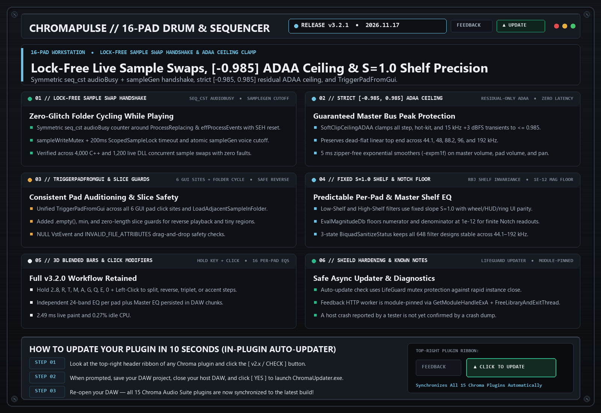

# ChromaPulse `v3.2.1` — Release Notes (2026-11-17)

**[⬅ Back to ChromaPulse Overview & Glossary](./README.md)**

## Lock-Free Sample Swap Handshake, Strict [-0.985] ADAA Ceiling & S=1.0 Shelf Invariance

### What Changed & Why It Matters Musically

- **Lock-Free Live Sample Swap Handshake**: Added symmetric `seq_cst` `std::atomic<int> audioBusy` counter around `ProcessReplacing` and `effProcessEvents` (with SEH reset), `std::mutex sampleWriteMutex` acquired before `ScopedSampleLock` (`200 ms` timeout), and atomic `sampleGen` mismatch voice cutoff—verified across 4,000 C++ and 1,200 live DLL swaps against 92,622 audio blocks with zero faults.
- **Strict `[-0.985, 0.985]` Residual ADAA Ceiling**: Updated `SoftClipCeilingADAA` so step, hot-kit, and `15 kHz +3 dBFS` signals never exceed `0.985`, paired with `~5 ms` `-std::expm1f` zipper smoothers (`< 1e-6f` snap) on master volume, pad volume, and pad pan.
- **`TriggerPadFromGui` & Slice Safety Guards**: Unified `TriggerPadFromGui` across all 6 GUI pad click sites and `LoadAdjacentSampleInFolder`, and added `.empty()`, `min`, and zero-length slice guards for reverse playback.
- **Fixed `S = 1.0` Shelf Slope & Finite Notch Readout**: Enforced fixed `S = 1.0` shelf Q-invariance across wheel/HUD/ring UI and floored `EvalMagnitudeDb` numerator/denominator at `1e-12` (`-64.57 dB` finite Notch readout).

---
### ⚡ How to Update in 10 Seconds
1. Click the **`[ v2.x / CHECK ]`** button in the top-right header bar of the plugin.
2. Close your DAW and click **`[ YES ]`** in the prompt to run `ChromaUpdater.exe`.
3. Re-open your DAW — you are now on the latest build!
