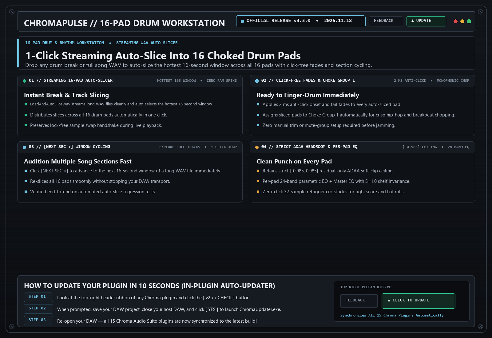

# ChromaPulse `v3.3.0` — Release Notes (2026-11-18)

**[⬅ Back to ChromaPulse Overview & Glossary](./README.md)**

## Streaming 16-Pad WAV Auto-Slicer with Click-Free Fades & Section Cycling

### What Changed & Why It Matters Musically

- **Streaming 16-Pad Auto-Slicer (`LoadAndAutoSliceWav`)**: Drop any breakbeat or full song WAV to stream and auto-slice the loudest 16-second window cleanly across all 16 pads.
- **2 ms Anti-Click Fades & Automatic Choke Group 1**: Every slice receives smooth 2 ms onset/tail fades and automatic Choke Group 1 assignment so chops play cleanly right away.
- **`[NEXT SEC >]` Section Cycle Control**: Jump straight to the next 16-second window of a long WAV file without interrupting playback.

---
### ⚡ How to Update in 10 Seconds
1. Click the **`[ v2.x / CHECK ]`** button in the top-right header bar of the plugin.
2. Close your DAW and click **`[ YES ]`** in the prompt to run `ChromaUpdater.exe`.
3. Re-open your DAW — you are now on the latest build!
