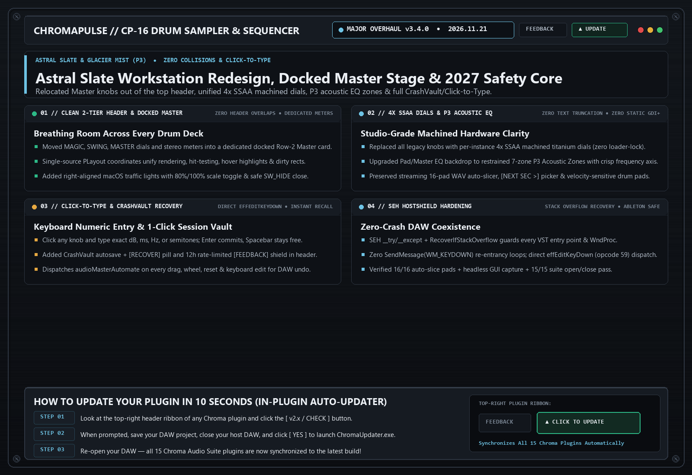

# ChromaPulse `v3.4.0` — Release Notes (2026-11-21)

**[⬅ Back to ChromaPulse Overview & Glossary](./README.md)**

## Astral Slate & Glacier Mist (P3) Workstation Redesign, Docked Master Stage & Click-to-Type

### What Changed & Why It Matters Musically

- **Clean 2-Tier Header & Dedicated Docked Master Card**: Relocated `MAGIC`, `SWING`, `MASTER` dials and stereo peak meters out of the crowded top ribbon into a dedicated Row-2 Master card with zero overlapping controls.
- **Unified 4x SSAA Machined Dials & P3 Acoustic Zones EQ**: Upgraded every Pad Inspector dial, unified all coordinates via `PLayout`, eliminated EQ zone text truncation, and preserved the smart streaming 16-pad WAV auto-slicer.
- **Click-to-Type, CrashVault & SEH HostShield**: Direct `effEditKeyDown` numeric knob entry (Spacebar stays free), CrashVault `[RECOVER]` autosave, `[FEEDBACK]` shield, 80%/100% scale toggle, and safe `SW_HIDE` host close.

### ⌨️ Hotkey & Gesture Quick Reference

| Key / Gesture | Action | Description |
|---|---|---|
| `F1` | **Toggle Hotkey Quick-Help Overlay** | Opens or dismisses the built-in ChromaPulse hotkey & pad-play cheat sheet right inside the plugin (`Esc` closes). |
| `Tab` | **Toggle 4x4 Keyboard Pad Play Mode** | Switches the 4x4 block (`1-4 / Q-R / A-F / Z-V`) between playing Pads 1–16 live (`Shift` = 45% soft velocity) and step modifier mode. |
| `2 / 3 / 4 / 5 / 6 / 7 / 8 + Left Click` | **Subdivide / Ratchet Step** | Splits any clicked sequencer step into 2x..8x rolls (`3x`/`6x` triplet/sextuplet, `5x`/`7x` odd tuplets). `1 + Click` resets to `1x`; `0 + Click` resets all step modifiers. |
| `R / T / M / A / G + Left Click` | **Reverse / Triplet / Mute / Accent / Ghost** | `R` (or `Alt+Click`) Reverse, `T` Triplet pocket, `M` (or `Shift+Click`) Mute step, `A` Accent (`100%/72%`), `G` Ghost (`35%`). |
| `Q / E + Left Click` | **Quantize / Micro-Timing Nudge** | `Q + Click` quantizes step timing back to the grid; `E + Click` adds subtle humanized pitch/pan/pocket variation. |
| `X (over step)  |  Up / Down  |  PgUp / PgDn / Home` | **Quick Navigation & Step Toggle** | `X` toggles the hovered step; `Up/Down` switches active pad; `PgUp/PgDn/Home` cycles 4 bar pages. |
| `[ / ]  |  Ctrl+Z  |  Ctrl+C / Ctrl+V  |  D  |  Spacebar` | **Pattern Editing & Transport** | Rotate bar left/right (`[ / ]`), Undo (`Ctrl+Z`), Copy/Paste bar (`Ctrl+C/V`), Duplicate (`D`), Clear (`Del/Bksp`), Audition (`Spacebar`). |
| `Click Knob -> Type Number + Enter` | **Exact Numeric Value Entry** | Type exact dB, ms, Hz, or % values directly into selected Pad Inspector or Master knobs (`Esc` cancels). |

---
### ⚡ How to Update in 10 Seconds
1. Click the **`[ v2.x / CHECK ]`** button in the top-right header bar of the plugin.
2. Close your DAW and click **`[ YES ]`** in the prompt to run `ChromaUpdater.exe`.
3. Re-open your DAW — you are now on the latest build!
