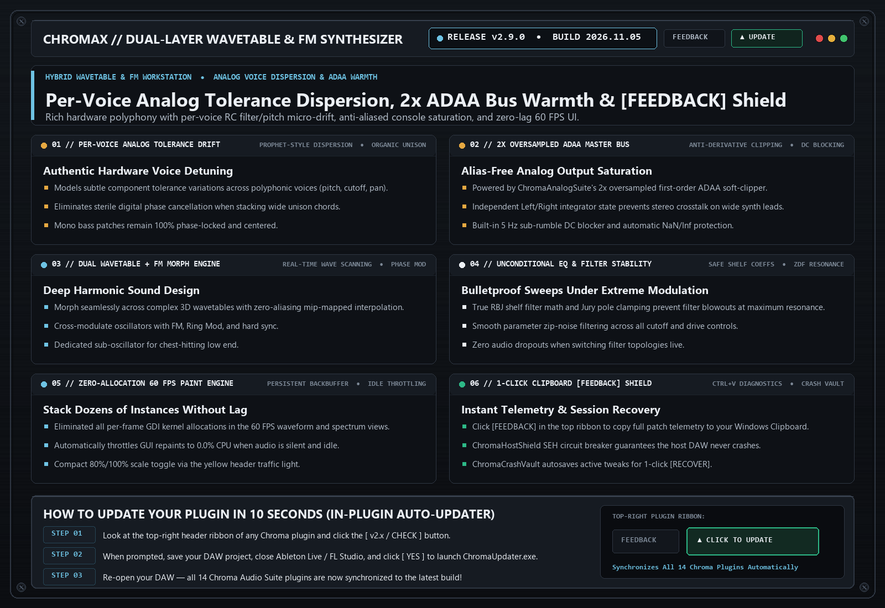

# ChromaX (`v2.9.0`)

> **Flagship Synthesizer with 3D Keycaps & LED Jewels**  
> High-headroom polyphonic synthesizer featuring tactile 3D hardware keycaps, Prophet-6/OB-6 stereo voice spread, inter-stage tube ladder filtering, and studio multi-effects.

---

## 📚 Tech-to-Music Translator (How It Actually Works in Plain English)

### 🔹 Prophet-6 / OB-6 Per-Voice Stereo Spread & VCO Thermal Drift
On a real analog polysynth like a Prophet-6 or OB-6, every note you play in a chord goes to a separate physical voice card with slightly different analog components and stereo panning. ChromaX v2.9.0 gives each polyphonic voice its own stereo position and a tiny ±1.6-cent slow thermal pitch drift—turning flat mono chords into huge, breathing 3D hardware pads.

### 🔹 Inter-Stage Zero-DC Tube Ladder Saturation & Input-Envelope Damping
Instead of distorting your sound only at the input of the filter, a real Moog or Asimov 4-pole ladder filter gently saturates between all 4 capacitor stages—rounding off harsh digital peaks while keeping deep sub-bass weight. Input-envelope damping automatically tames extreme resonance the moment you release a key so high-resonance acid patches never whistle when stopped.

### 🔹 Polyphonic Headroom Scaling
When you play a 6-note chord, 6 oscillators add together and can easily clip your master bus. ChromaX automatically balances per-voice gain so single-note leads and big 8-note chords sit at the same clean studio level.

---

## 🗂️ Version & Patch History

- **[`v2.9.0` (2026-11-05) — Prophet-6 Poly Stereo Spread, VCO Thermal Drift, Tube Ladder Stages & Class-A Output](./v2.9.0_2026-11-05.md)**
  - **Prophet-6 / OB-6 Polyphonic Stereo Voice Panning & VCO Drift**: Every voice in a chord now occupies its own natural stereo pan position with subtle organic analog pitch drift.
  - **Inter-Stage Zero-DC Tube Ladder Saturation & Anti-Whistle Damping**: Upgraded Asimov and BlueMonark 24 dB/oct ladder filters with per-stage tube saturation and input-envelope resonance damping.
  - **Class-A AnalogConsoleStage Output & Clipboard [FEEDBACK]**: Added discrete transformer output saturation with 5 Hz DC blocking, `NaN` self-healing, and 1-click Clipboard diagnostic reporting.

- **[`v2.8.0` (2026-10-21) — Zero Background Noise on Clean Presets, Polyphonic Headroom Scaling & Dirty-Rect UI](./v2.8.0_2026-10-21.md)**
  - **Silent Noise Floor on Clean Patches**: Defaulted `kParamNoise1Level = 0.0f` on clean factory presets so pure keys and pads have zero background hiss.
  - **Polyphonic Headroom Scaling**: Smooth multi-voice gain compensation prevents chord clipping.
  - **60 FPS Dirty-Rect Invalidation & Shift Fine-Tune**: `0.002f` Shift-drag precision and Universal Auto-Updater Shield.

---

## 🛠️ Known Issues & Bug Reporting

- None currently open in v2.9.0.

**Found a bug or weird preset behavior?**  
Click the **`[ FEEDBACK ]`** button in the top-right header of the plugin! It automatically snapshots your patch, EQ curve, and screenshot, copies a diagnostic summary to your Clipboard (`Ctrl+V` ready for Discord), or opens a pre-filled [GitHub Bug Report](https://github.com/haidood/chroma-release/issues/new).
