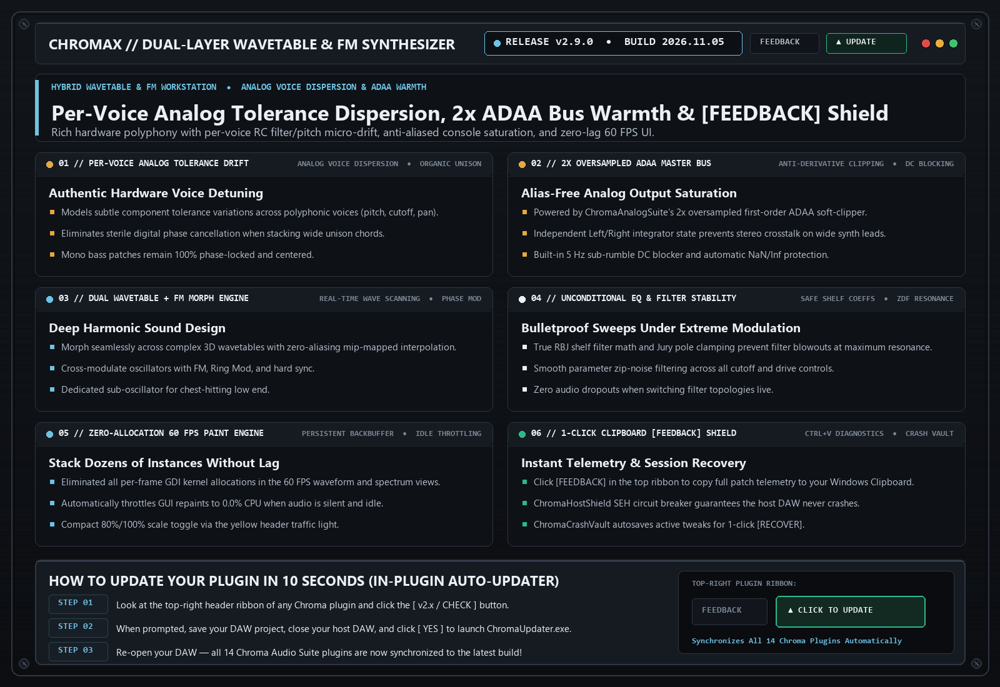

# ChromaX `v2.9.0` — Release Notes (2026-11-05)

**[⬅ Back to ChromaX Overview & Glossary](./README.md)**

## Analog Poly Stereo Spread, VCO Thermal Drift, Tube Ladder Stages & Class-A Output

### What Changed & Why It Matters Musically

- **Analog Polyphonic Stereo Voice Panning & VCO Drift**: Every voice in a chord now occupies its own natural stereo pan position with subtle organic analog pitch drift.
- **Inter-Stage Zero-DC Tube Ladder Saturation & Anti-Whistle Damping**: Upgraded Chroma 24 dB/oct transistor and diode ladder filters with per-stage tube saturation and input-envelope resonance damping.
- **Class-A AnalogConsoleStage Output & Clipboard [FEEDBACK]**: Added discrete transformer output saturation with 5 Hz DC blocking, `NaN` self-healing, and 1-click Clipboard diagnostic reporting.

---
### ⚡ How to Update in 10 Seconds
1. Click the **`[ v2.x / CHECK ]`** button in the top-right header bar of the plugin.
2. Close your DAW and click **`[ YES ]`** in the prompt to run `ChromaUpdater.exe`.
3. Re-open your DAW — you are now on the latest build!
