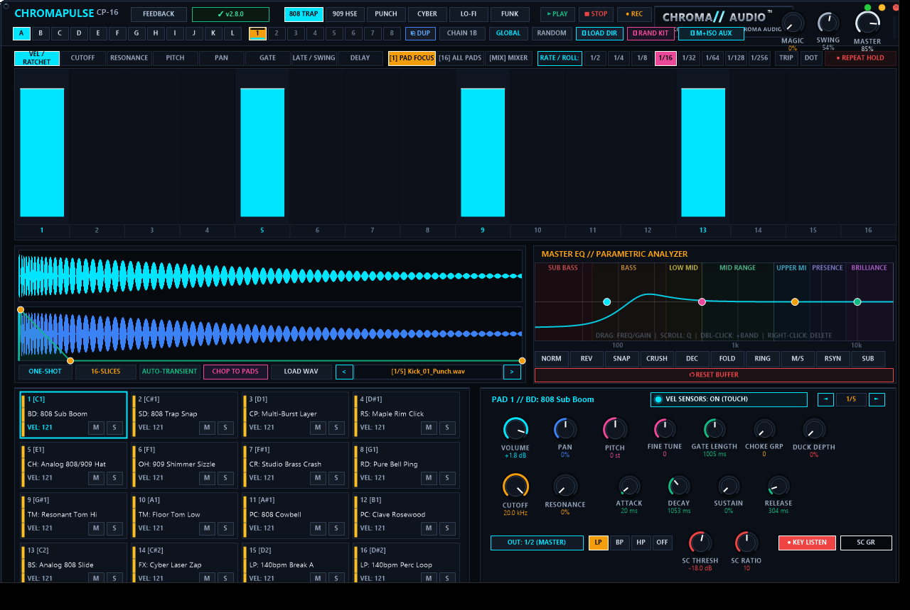

# ChromaX `v3.0.0` — Release Notes (2026-11-06)

**[⬅ Back to ChromaX Overview & Glossary](./README.md)**

## Hardware UI Preview, Nerve-Style Sequencer Hotkeys, Magic Drive & Envelope Drawing

### What Changed & Why It Matters Musically

- **Spectral-Adaptive Magic Drive Master Stage**: Added master bus Magic Drive (derived from ChromaCore) with intelligent sub-bass mono-tightening, 320 Hz boxy-mud scoop, sweet-spot focus excitation, and silk-air shimmer.
- **Nerve-Style Step Sequencer Hotkeys & Gestures**: Added `Ctrl`+Click sub-division cycling (`1x` to `8x` ratchets with visual slice indicators), `Alt`+Click reverse toggle (`◀` badge), `Shift`+Click step muting, `[` and `]` pattern shifting, `Ctrl+C`/`Ctrl+V` bar copying, and `D` for bar duplication.
- **Interactive AHDSR Multi-Segment Envelope Canvas**: Directly drag Attack, Decay, and Sustain nodes on the waveform display for immediate visual and sonic shaping of drum hits.
- **Duo-Tone Gunmetal & Matte Hardware UI**: Upgraded aesthetics to brushed gunmetal and matte obsidian with amber LED indicators and native 60 FPS UI preview capture.

---
### ⚡ How to Update in 10 Seconds
1. Click the **`[ v2.8.x / CHECK ]`** button in the top-right header bar of the plugin.
2. Close your DAW and click **`[ YES ]`** in the prompt to run `ChromaUpdater.exe`.
3. Re-open Ableton Live / FL Studio — you are now on the latest build!
