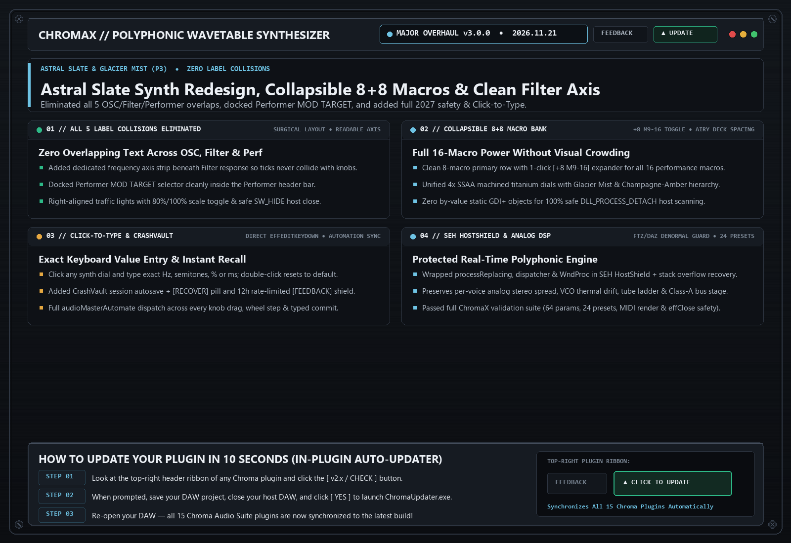

# ChromaX `v3.0.0` — Release Notes (2026-11-21)

**[⬅ Back to ChromaX Overview & Glossary](./README.md)**

## Astral Slate & Glacier Mist (P3) Redesign, Collapsible 8+8 Macros & Zero Label Collisions

### What Changed & Why It Matters Musically

- **Unified 2027 Astral Slate & Glacier Mist (P3) Chassis**: Deep midnight obsidian finish, 4x supersampled machined titanium dials, and zero by-value static GDI+ objects for 100% safe DAW plugin removal.
- **All 5 Layout Collisions Eliminated**: Added a dedicated frequency axis strip beneath the Filter curve, docked Performer `MOD TARGET` inside the Performer header, and introduced a clean collapsible 8+8 macro bank (`+8 M9-16`).
- **Click-to-Type, CrashVault & SEH HostShield**: Click any knob to type exact Hz/semitones/%, 1-click `[RECOVER]` session autosave, 12h rate-limited `[FEEDBACK]` shield, `audioMasterAutomate` DAW undo sync, and safe `SW_HIDE` host close.

---
### ⚡ How to Update in 10 Seconds
1. Click the **`[ v2.x / CHECK ]`** button in the top-right header bar of the plugin.
2. Close your DAW and click **`[ YES ]`** in the prompt to run `ChromaUpdater.exe`.
3. Re-open your DAW — you are now on the latest build!
