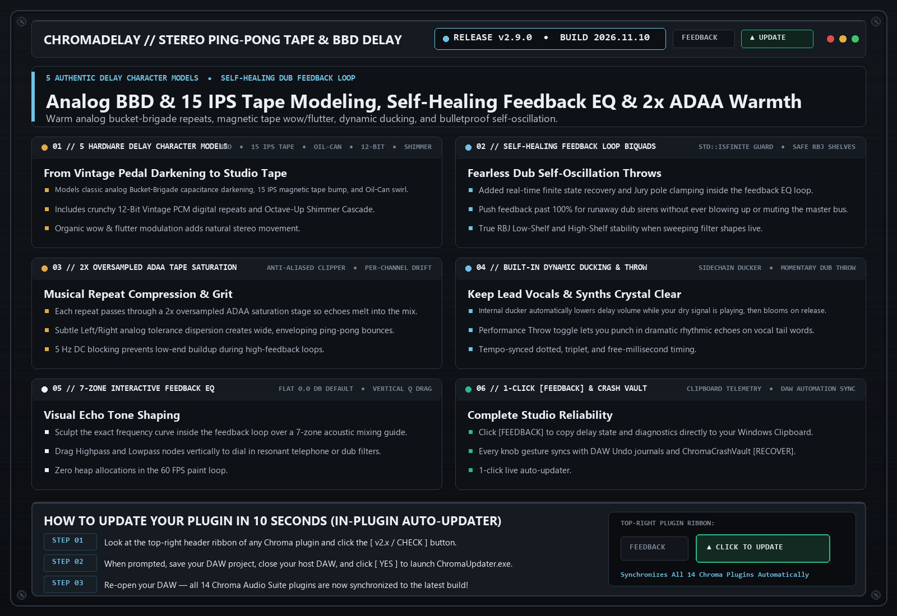

# ChromaDelay (`v2.9.0`)

> **Bouncing Stereo Ping-Pong Tape & BBD Delay**  
> Multi-character stereo delay modeling classic analog Bucket-Brigade chips, 15 IPS Studio Tape, Oil-Can Echo, Vintage 12-Bit Digital, and Shimmer Cascade.

---

## 📚 Tech-to-Music Translator (How It Actually Works in Plain English)

### 🔹 BBD (Bucket-Brigade Device) vs. 15 IPS Tape Delay
Before digital memory existed, analog pedals passed audio through a chain of thousands of tiny capacitors like firefighters passing buckets of water—each pass slightly darkened the treble and added warm clock warmth (BBD). Tape delay records your sound onto a moving loop of magnetic tape, adding natural compression ('tape bump') and gentle pitch wobble ('wow & flutter').

---

## 🗂️ Version & Patch History

- **[`v2.9.0` (2026-11-05) — Self-Healing Feedback Loop Biquads & Upgraded Clipboard [FEEDBACK]](./v2.9.0_2026-11-05.md)**
  - **Self-Healing Feedback EQ Biquads**: Added `std::isfinite` state recovery inside the delay feedback loop so aggressive self-oscillating dub throws never blow up or mute the bus.
  - **Upgraded 1-Click Clipboard [FEEDBACK] Shield**: Instant diagnostic snapshot and clipboard copy.

- **[`v2.8.0` (2026-10-21) — Flat 0.0 dB Default EQ Bands, 7 Mixing Zones & Zero Heap Allocations](./v2.8.0_2026-10-21.md)**
  - **5 Authentic Delay Character Models**: BBD Analog, 15 IPS Studio Tape, Vintage Oil-Can, 12-Bit Vintage PCM, and Shimmer Pitch Cascade.
  - **Interactive Feedback EQ & Ducking**: Built-in sidechain ducking keeps echoes out of the way while your lead vocal or synth is playing, then blooms when the phrase stops.

---

## 🛠️ Known Issues & Bug Reporting

- None currently open in v2.9.0.

**Found a bug or weird preset behavior?**  
Click the **`[ FEEDBACK ]`** button in the top-right header of the plugin! It automatically snapshots your patch, EQ curve, and screenshot, copies a diagnostic summary to your Clipboard (`Ctrl+V` ready for Discord), or opens a pre-filled [GitHub Bug Report](https://github.com/haidood/chroma-release/issues/new).
