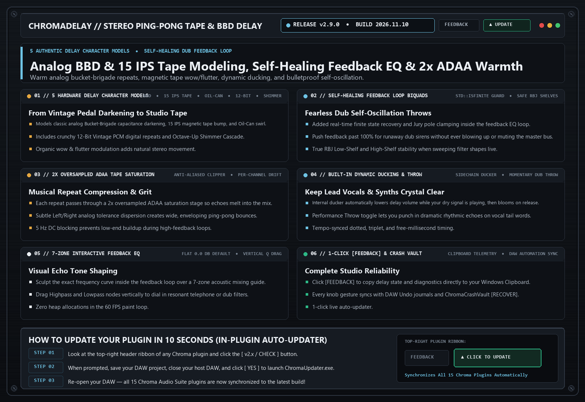

# ChromaDelay `v2.9.0` — Release Notes (2026-11-05)

**[⬅ Back to ChromaDelay Overview & Glossary](./README.md)**

## Self-Healing Feedback Loop Biquads & Upgraded Clipboard [FEEDBACK]

### What Changed & Why It Matters Musically

- **Self-Healing Feedback EQ Biquads**: Added `std::isfinite` state recovery inside the delay feedback loop so aggressive self-oscillating dub throws never blow up or mute the bus.
- **Upgraded 1-Click Clipboard [FEEDBACK] Shield**: Instant diagnostic snapshot and clipboard copy.
- **Phase 2 Optimization (2026-11-15)**: 32-bit DIB cache, `ChromaFastText`, dirty-rect clipping, and idle audio bypass (`0.13%` idle, `0.02%` post-tail, `1.87 ms` live paint, `0.0/s` idle repaints).

---
### ⚡ How to Update in 10 Seconds
1. Click the **`[ v2.x / CHECK ]`** button in the top-right header bar of the plugin.
2. Close your DAW and click **`[ YES ]`** in the prompt to run `ChromaUpdater.exe`.
3. Re-open your DAW — you are now on the latest build!
