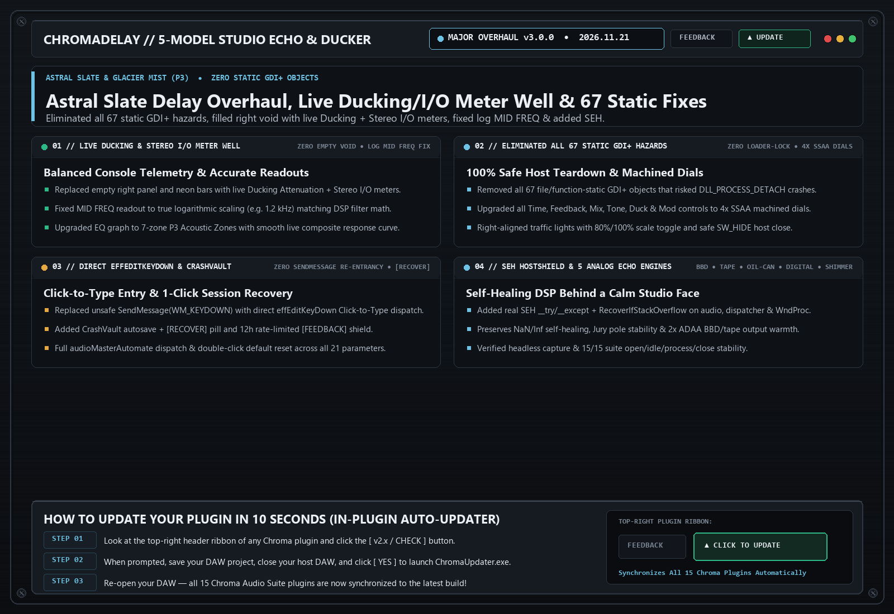

# ChromaDelay `v3.0.0` — Release Notes (2026-11-21)

**[⬅ Back to ChromaDelay Overview & Glossary](./README.md)**

## Astral Slate & Glacier Mist (P3) Overhaul, Live Ducking/I/O Meter Well & 67 Static GDI+ Fixes

### What Changed & Why It Matters Musically

- **Live Ducking Attenuation & Stereo I/O Meter Well**: Filled the empty right panel and retired solid neon bars with real-time ducking and stereo level telemetry, plus fixed logarithmic `MID FREQ` display (`1.2 kHz`).
- **Eliminated All 67 Static GDI+ Teardown Hazards**: Removed every file/function-static GDI+ object for 100% safe `DLL_PROCESS_DETACH` Ableton scanning, paired with 4x SSAA machined dials and 7-zone P3 Acoustic EQ.
- **Direct `effEditKeyDown`, SEH HostShield & CrashVault**: Replaced unsafe `SendMessage(WM_KEYDOWN)` with direct Click-to-Type entry, added real SEH fault isolation, `[RECOVER]` session autosave, and safe `SW_HIDE` close.

---
### ⚡ How to Update in 10 Seconds
1. Click the **`[ v2.x / CHECK ]`** button in the top-right header bar of the plugin.
2. Close your DAW and click **`[ YES ]`** in the prompt to run `ChromaUpdater.exe`.
3. Re-open your DAW — you are now on the latest build!
