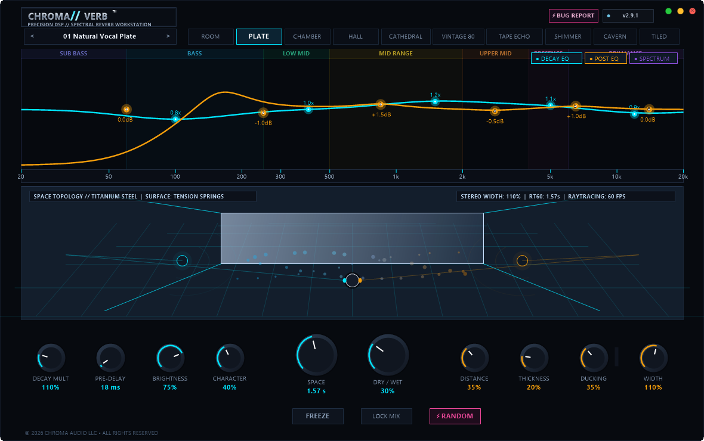
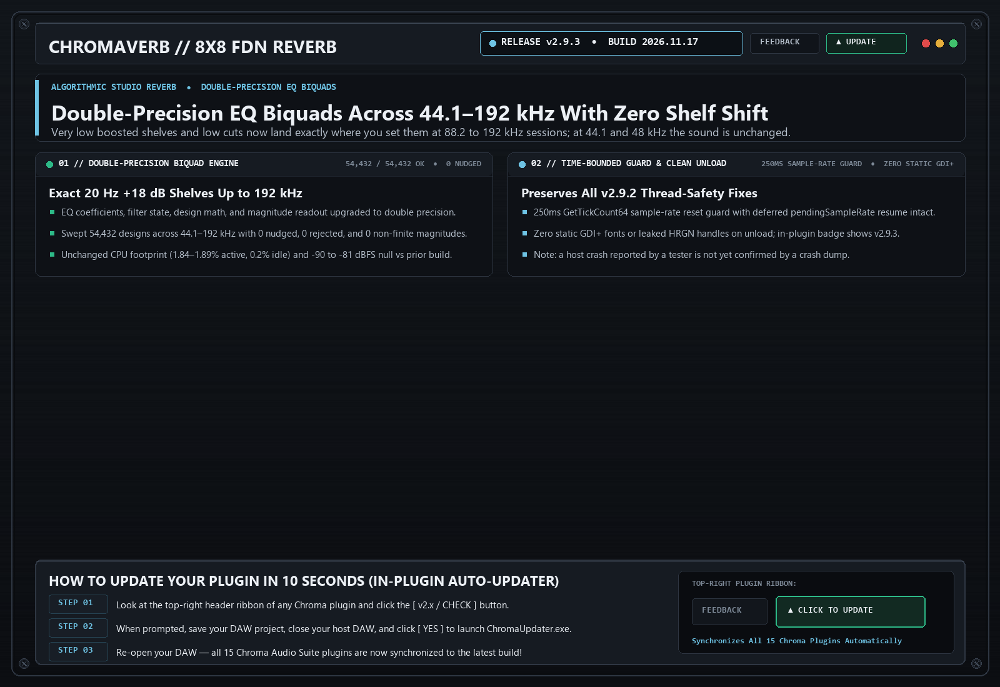

# ChromaVerb (`v2.9.3`)

> **Studio Algorithmic Multi-Room FDN Reverb & Shimmer**  
> Lush, zero-metallic algorithmic studio reverb powered by an 8x8 unitary Feedback Delay Network, orthogonal stereo taps, and forward octave-up shimmer.

### 🎛️ Plugin Interface (`v2.9.3`)

---

## 📚 Tech-to-Music Translator (How It Actually Works in Plain English)

### 🔹 8x8 Fast Walsh-Hadamard Unitary Matrix (FDN)
In a real concert hall, sound bounces off thousands of walls and blends into a smooth wash. Cheap digital reverbs only use a few echoes that sound like a ringing metal pipe. An 8x8 Hadamard Matrix takes 8 separate delay lines and cross-mixes every single echo into all 8 rooms simultaneously without losing or gaining a single decibel of energy—creating an endlessly dense, silky reverb tail.

### 🔹 C1 Continuous Polynomial Hann Shimmer Window
Shimmer reverb pitches your reverb tail up by +12 semitones (one octave) by slicing the audio into tiny overlapping grains. Using a smooth polynomial 'Hann window' fades the edges of every grain in and out seamlessly so the octave-up halo sounds like an angelic choir instead of a glitchy pitch-shifter.

---

## 🗂️ Version & Patch History

- **[`v2.9.3` (2026-11-17) — Double-Precision EQ Biquads Across 44.1–192 kHz (Zero Low-Shelf Shift)](./v2.9.3_2026-11-17.md)**
  - **Plain-English DSP Summary**: Very low boosted shelves and low cuts now land exactly where you set them at 88.2 to 192 kHz sessions; at 44.1 and 48 kHz the sound is unchanged.
  - **Double-Precision EQ Biquad Engine**: Upgraded EQ coefficients, filter state, design math, and magnitude display to `double` using the `1e-8` unit-circle sanitizer (`54,432/54,432` designs `Ok`, `0` nudged, `0` rejected; `20 Hz +18 dB` shelf settles at `0.0000 dB` error at `176.4/192 kHz`).
  - **Unchanged CPU & Verified Guard**: Active/idle CPU unchanged (`~1.85%` playing / `0.2%` idle), header version readout now displays `v2.9.3`, and the `250 ms` `TryApplySampleRate` guard remains verified.

- **[`v2.9.2` (2026-11-17) — 250ms Time-Bounded Sample-Rate Reset Guard, Deferred Resume & Static GDI+ Teardown Fix](./v2.9.2_2026-11-17.md)**
  - **250ms Time-Bounded `effSetSampleRate` Guard + Deferred Resume**: `TryApplySampleRate` waits up to `250 ms` (`GetTickCount64`) for `audioBusy` to drain, aborts the reset on timeout so delay lines are never reallocated while `Process` is active, stores `pendingSampleRate`, and applies it on the next `effMainsChanged` resume (`seq_cst` synchronized).
  - **Eliminated Static GDI+ Fonts & Leaked `HRGN` on Unload**: Replaced all 9 function-local `static Gdiplus::Font` objects and replaced the global `static HRGN s_updateRgn` in `HandleVerbPaint` with a stack `HRGN` + `DeleteObject`.
  - **Shield Hardening**: Rebuilt with `ChromaUpdateShield` `LifeGuard` mutex protection, module-pinned `ChromaFeedbackShield` threads, and non-static `ChromaFastText` matrices.

- **[`v2.9.1` (2026-11-05) — Jury-Stabilized Post-EQ Biquads, NaN Self-Healing & 1-Click Clipboard [FEEDBACK]](./v2.9.1_2026-11-05.md)**
  - **Jury Stability Triangle Pole Clamping**: Guaranteed z-plane pole stability across all 12 Post-EQ and Decay Rate EQ bands even under extreme `Q` and shelf sweeps.
  - **Automatic NaN/Inf Self-Healing**: Real-time biquad state protection ensures long shimmer/freeze tails never drop audio.
  - **Upgraded 1-Click Clipboard [FEEDBACK]**: Instant `Ctrl+V` diagnostic report copy for Discord and GitHub.
  - **Phase 2 Optimization (2026-11-15)**: 32-bit DIB backbuffer, `ChromaFastText`, clip culling, eased meters, and audio idle bypass (`0.25%` idle, `0.02%` post-tail, `4.73 ms` live paint, `0.0/s` idle repaints).

- **[`v2.9.0` (2026-10-22) — 8x8 Fast Walsh-Hadamard Unitary Matrix & Forward 2x Octave-Up Shimmer](./v2.9.0_2026-10-22.md)**
  - **8x8 Fast Walsh-Hadamard (FWHT_8) Unitary Matrix**: Replaced basic delay feedback with a true 8-channel unitary diffusion network with alternating sign injection and orthogonal stereo taps.
  - **Forward 2x Octave-Up Shimmer Loop**: Dual-grain pitch shifter with zero-transcendental C1 polynomial Hann windowing inside the tank.
  - **24-Band Parametric Post-EQ**: Sculpt the exact frequency curve of your reverb tail.

---

## 🛠️ Known Issues & Bug Reporting

- A host crash reported by a tester after loading ChromaVerb is not yet confirmed by a crash dump; if it recurs, please send %APPDATA%\ChromaAudio\CrashReports\host_shield_log.txt.

**Found a bug or weird preset behavior?**  
Click the **`[ FEEDBACK ]`** button in the top-right header of the plugin! It automatically snapshots your patch, EQ curve, and screenshot, copies a diagnostic summary to your Clipboard (`Ctrl+V` ready for Discord), or opens a pre-filled [GitHub Bug Report](https://github.com/haidood/chroma-release/issues/new).
