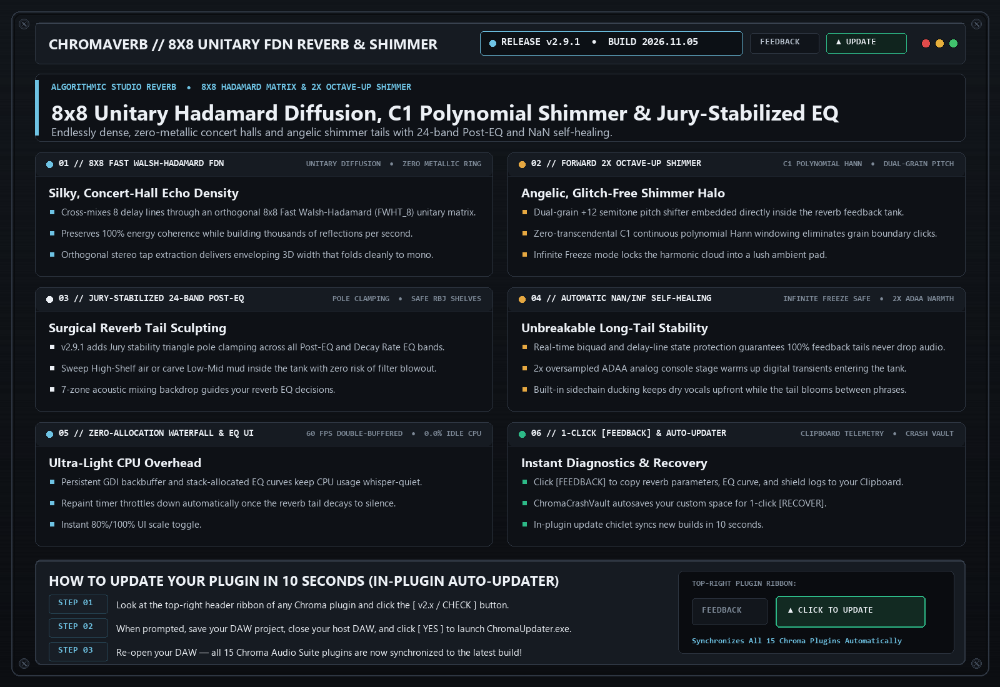

# ChromaVerb `v2.9.1` — Release Notes (2026-11-05)

**[⬅ Back to ChromaVerb Overview & Glossary](./README.md)**

## Jury-Stabilized Post-EQ Biquads, NaN Self-Healing & 1-Click Clipboard [FEEDBACK]

### What Changed & Why It Matters Musically

- **Jury Stability Triangle Pole Clamping**: Guaranteed z-plane pole stability across all 12 Post-EQ and Decay Rate EQ bands even under extreme `Q` and shelf sweeps.
- **Automatic NaN/Inf Self-Healing**: Real-time biquad state protection ensures long shimmer/freeze tails never drop audio.
- **Upgraded 1-Click Clipboard [FEEDBACK]**: Instant `Ctrl+V` diagnostic report copy for Discord and GitHub.
- **Phase 2 Optimization (2026-11-15)**: 32-bit DIB backbuffer, `ChromaFastText`, clip culling, eased meters, and audio idle bypass (`0.25%` idle, `0.02%` post-tail, `4.73 ms` live paint, `0.0/s` idle repaints).

---
### ⚡ How to Update in 10 Seconds
1. Click the **`[ v2.x / CHECK ]`** button in the top-right header bar of the plugin.
2. Close your DAW and click **`[ YES ]`** in the prompt to run `ChromaUpdater.exe`.
3. Re-open your DAW — you are now on the latest build!
