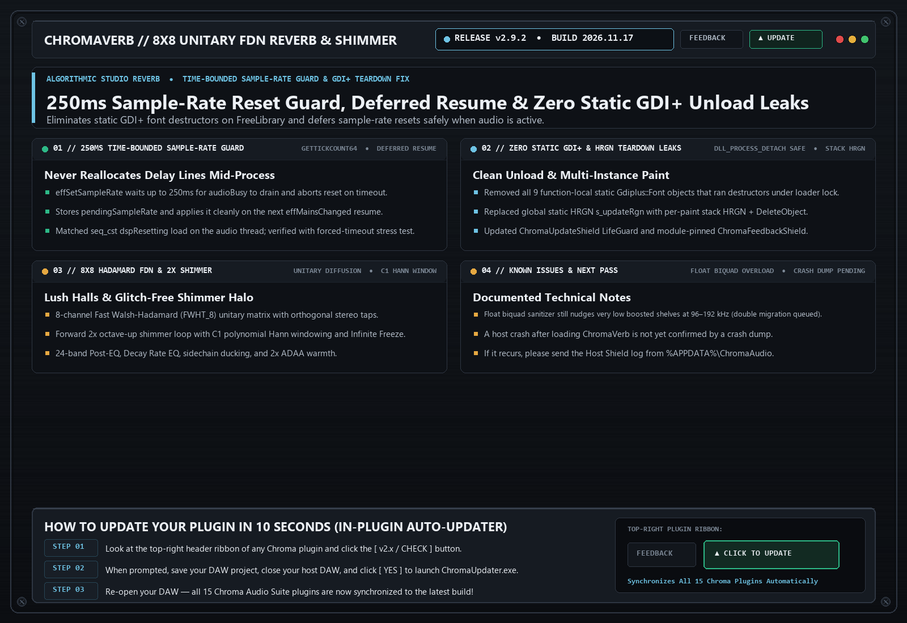

# ChromaVerb `v2.9.2` — Release Notes (2026-11-17)

**[⬅ Back to ChromaVerb Overview & Glossary](./README.md)**

## 250ms Time-Bounded Sample-Rate Reset Guard, Deferred Resume & Static GDI+ Teardown Fix

### What Changed & Why It Matters Musically

- **250ms Time-Bounded `effSetSampleRate` Guard + Deferred Resume**: `TryApplySampleRate` waits up to `250 ms` (`GetTickCount64`) for `audioBusy` to drain, aborts the reset on timeout so delay lines are never reallocated while `Process` is active, stores `pendingSampleRate`, and applies it on the next `effMainsChanged` resume (`seq_cst` synchronized).
- **Eliminated Static GDI+ Fonts & Leaked `HRGN` on Unload**: Replaced all 9 function-local `static Gdiplus::Font` objects and replaced the global `static HRGN s_updateRgn` in `HandleVerbPaint` with a stack `HRGN` + `DeleteObject`.
- **Shield Hardening**: Rebuilt with `ChromaUpdateShield` `LifeGuard` mutex protection, module-pinned `ChromaFeedbackShield` threads, and non-static `ChromaFastText` matrices.

---
### ⚡ How to Update in 10 Seconds
1. Click the **`[ v2.x / CHECK ]`** button in the top-right header bar of the plugin.
2. Close your DAW and click **`[ YES ]`** in the prompt to run `ChromaUpdater.exe`.
3. Re-open your DAW — you are now on the latest build!
