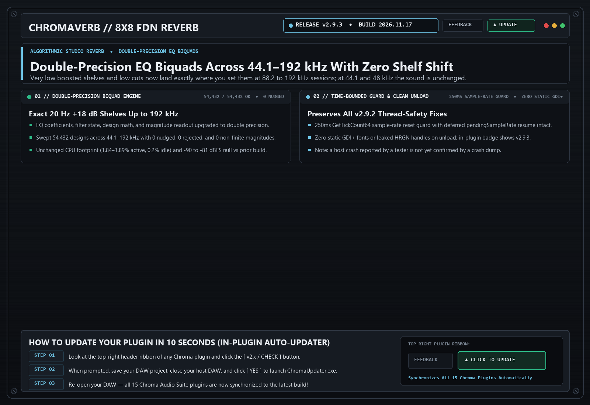

# ChromaVerb `v2.9.3` — Release Notes (2026-11-17)

**[⬅ Back to ChromaVerb Overview & Glossary](./README.md)**

## Double-Precision EQ Biquads Across 44.1–192 kHz (Zero Low-Shelf Shift)

### What Changed & Why It Matters Musically

- **Plain-English DSP Summary**: Very low boosted shelves and low cuts now land exactly where you set them at 88.2 to 192 kHz sessions; at 44.1 and 48 kHz the sound is unchanged.
- **Double-Precision EQ Biquad Engine**: Upgraded EQ coefficients, filter state, design math, and magnitude display to `double` using the `1e-8` unit-circle sanitizer (`54,432/54,432` designs `Ok`, `0` nudged, `0` rejected; `20 Hz +18 dB` shelf settles at `0.0000 dB` error at `176.4/192 kHz`).
- **Unchanged CPU & Verified Guard**: Active/idle CPU unchanged (`~1.85%` playing / `0.2%` idle), header version readout now displays `v2.9.3`, and the `250 ms` `TryApplySampleRate` guard remains verified.

---
### ⚡ How to Update in 10 Seconds
1. Click the **`[ v2.x / CHECK ]`** button in the top-right header bar of the plugin.
2. Close your DAW and click **`[ YES ]`** in the prompt to run `ChromaUpdater.exe`.
3. Re-open your DAW — you are now on the latest build!
