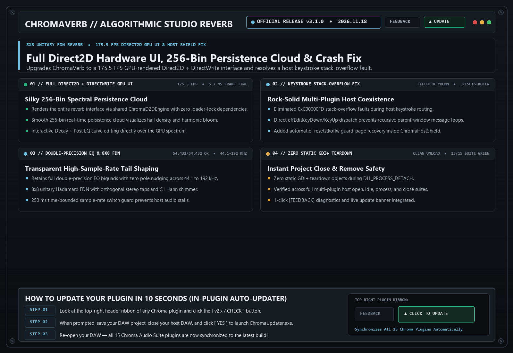

# ChromaVerb `v3.1.0` — Release Notes (2026-11-18)

**[⬅ Back to ChromaVerb Overview & Glossary](./README.md)**

## Full Direct2D GPU UI (175.5 FPS), 256-Bin Persistence Cloud & Keystroke Crash Fix

### What Changed & Why It Matters Musically

- **Full Direct2D + DirectWrite Hardware-Accelerated UI**: Powered by `shared/ChromaD2DEngine.h` (**175.5 FPS / 5.7 ms frame time**) with a silky 256-bin spectral persistence cloud and interactive Decay + Post EQ canvas.
- **Host Keystroke Stack-Overflow Fix (`0xC00000FD`)**: Eliminated recursive parent message routing via direct `effEditKeyDown/KeyUp` dispatch and added automatic `_resetstkoflw` guard-page recovery inside `ChromaHostShield.h`.
- **Preserved High-Sample-Rate Accuracy**: Retains double-precision EQ biquads (`54,432/54,432` Ok across `44.1–192 kHz`) and the `250 ms` time-bounded sample-rate reset guard.

---
### ⚡ How to Update in 10 Seconds
1. Click the **`[ v2.x / CHECK ]`** button in the top-right header bar of the plugin.
2. Close your DAW and click **`[ YES ]`** in the prompt to run `ChromaUpdater.exe`.
3. Re-open your DAW — you are now on the latest build!
