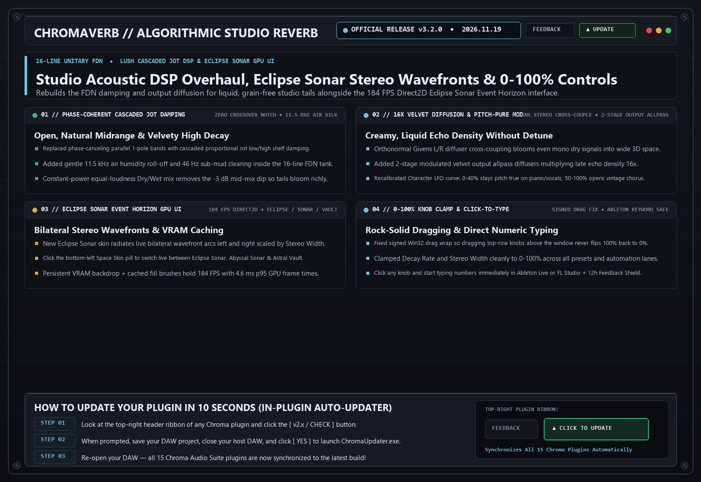

# ChromaVerb `v3.2.0` — Release Notes (2026-11-19)

**[⬅ Back to ChromaVerb Overview & Glossary](./README.md)**

## Lush Studio DSP Overhaul, Eclipse Sonar Event Horizon Stereo Wavefronts, 0-100% Knob Clamp & Click-to-Type

### What Changed & Why It Matters Musically

- **Phase-Coherent Cascaded Jot Damping + 11.5 kHz Air Silk**: Replaced parallel 1-pole band splitting inside the 16-line FDN with cascaded proportional low/high shelves, gentle 11.5 kHz air humidity absorption, and 46 Hz sub-mud control — eliminating boxy crossover notches for open, silky studio tails.
- **16x Velvet Echo Density & Pitch-Pure Modulation**: Added orthonormal Givens stereo cross-coupling in the input diffuser cascade plus 2-stage modulated velvet output allpasses (`191/317` L, `211/349` R) and recalibrated Character modulation so `0–40%` stays glass-pure on pianos/vocals while `50–100%` opens lush vintage chorus.
- **Constant-Power Equal-Loudness Dry/Wet Mix**: Replaced linear mix summing with smooth constant-power crossfading so turning up Mix preserves dry punch while tails bloom smoothly without a `-3 dB` mid-mix dip.
- **Eclipse Sonar Event Horizon GPU UI (184 FPS)**: Features a solar-gold Event Horizon center with bilateral stereo wavefront echoes scaled by Stereo Width, persistent VRAM backdrop caching, and instant Space Skin switching (`Eclipse Sonar`, `Abyssal Sonar`, `Astral Vault`).
- **0–100% Knob Clamp & Signed Drag Wrap Fix**: Fixed unsigned `HIWORD` coordinate wrap when dragging knobs above the window top, clamped `DECAY RATE` and `STEREO WIDTH` cleanly to `0%–100%`, enabled immediate first-digit Click-to-Type entry in Ableton Live (`effEditKeyDown`), and upgraded to the 12h rate-limited Feedback Shield.

### ⌨️ Hotkey & Gesture Quick Reference

| Key / Gesture | Action | Description |
|---|---|---|
| `Click Knob -> Type Number + Enter` | **Exact Numeric Value Entry** | Click any dial (Decay, Mix, Width, Pre-Delay, etc.) and immediately type a value + Enter to set exact % or ms. |
| `Click Bottom-Left Space Skin Pill` | **Switch 3 GPU Space Skins** | Cycle live between Eclipse Sonar, Abyssal Sonar, and Astral Vault with zero layout shift. |
| `Double-Click / Delete EQ Node` | **Sculpt Decay & Post EQ** | Add, drag, or delete interactive Post-EQ bands directly on the 256-bin GPU spectrum. |

---
### ⚡ How to Update in 10 Seconds
1. Click the **`[ v2.x / CHECK ]`** button in the top-right header bar of the plugin.
2. Close your DAW and click **`[ YES ]`** in the prompt to run `ChromaUpdater.exe`.
3. Re-open your DAW — you are now on the latest build!
