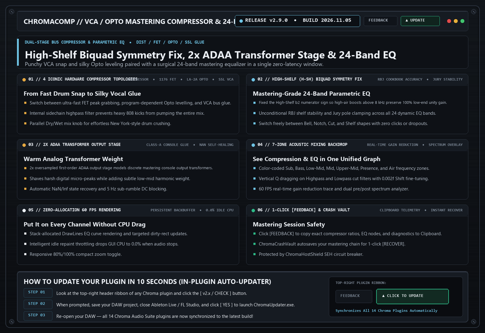

# ChromaComp (`v2.9.0`)

> **Analog VCA / Opto Bus & Mastering Compressor with 24-Band EQ**  
> Dual-stage studio compressor and 20-band parametric equalizer modeling Empirical Labs EL8 Distressor, 1176 FET, LA-2A Opto, and SSL VCA bus glue.

---

## 📚 Tech-to-Music Translator (How It Actually Works in Plain English)

### 🔹 VCA vs. Opto Compression
A VCA compressor uses fast electronic transistors to grab sharp drum peaks within milliseconds—perfect for punchy glue. An Opto (Optical) compressor shines an internal LED onto a light-sensitive resistor; because the light dims slowly, it has a natural, musical release that makes vocals and bass sound effortlessly smooth.

### 🔹 High-Shelf (H-SH) Biquad Symmetry & Jury Stability
In v2.9.0 we fixed a sign inversion in the High-Shelf EQ formula so boosting or cutting high air above 8 kHz preserves 100% unity gain in the low end and never destabilizes when switching filter shapes.

---

## 🗂️ Version & Patch History

- **[`v2.9.0` (2026-11-05) — High-Shelf (H-SH) Biquad Fix, Jury Pole Clamping & Self-Healing EQ](./v2.9.0_2026-11-05.md)**
  - **Fixed High-Shelf (`H-SH`) Biquad `b2` Sign Bug**: Corrected the RBJ Audio EQ Cookbook numerator sign in `setHighShelf` so high-shelf boosts and cuts have accurate DC/low-frequency unity gain.
  - **Jury Stability Clamping & `NaN` Self-Healing**: Protected all 20 dynamic EQ and sidechain detector filters against pole blowout.
  - **Upgraded 1-Click Clipboard [FEEDBACK]**: Instant diagnostic summary copied to Clipboard.

- **[`v2.8.0` (2026-10-21) — 7-Zone Mixing Backdrop, Stack-Allocated EQ Curves & Targeted Dirty-Rects](./v2.8.0_2026-10-21.md)**
  - **Integrated 24-Band Parametric EQ + Bus Compressor**: Shape tone and dynamics in a single zero-latency window.
  - **HP/LP Vertical Q Dragging & 0.002f Shift Precision**: Fast, surgical mastering workflow.

---

## 🛠️ Known Issues & Bug Reporting

- None currently open in v2.9.0.

**Found a bug or weird preset behavior?**  
Click the **`[ FEEDBACK ]`** button in the top-right header of the plugin! It automatically snapshots your patch, EQ curve, and screenshot, copies a diagnostic summary to your Clipboard (`Ctrl+V` ready for Discord), or opens a pre-filled [GitHub Bug Report](https://github.com/haidood/chroma-release/issues/new).
