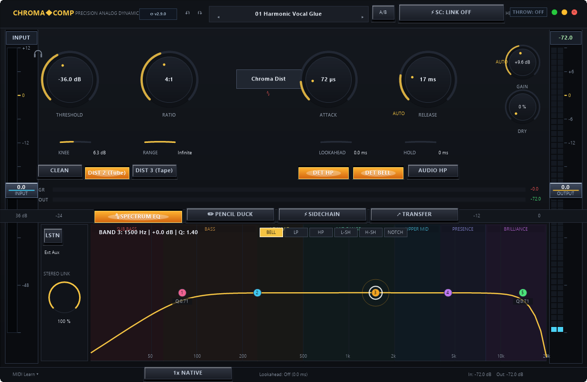
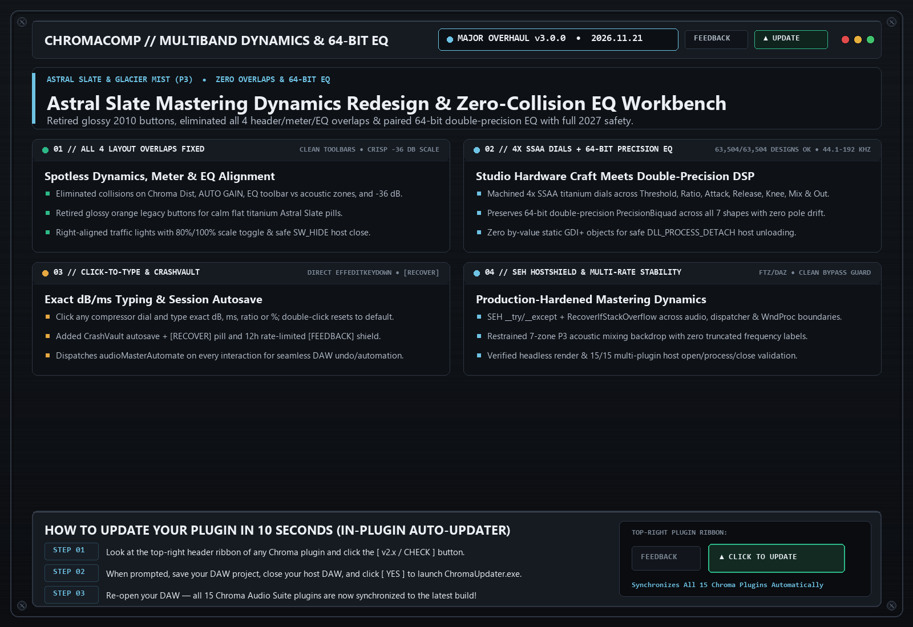

# ChromaComp (`v3.0.0`)

> **Analog VCA / Opto Bus & Mastering Compressor with 24-Band EQ**  
> Dual-stage studio compressor and 20-band parametric equalizer modeling Harmonic Knee Compression, Ultra-Fast FET Peak Limiting, Program-Dependent Optical Leveling, and Master Bus VCA Glue.

### 🎛️ Plugin Interface (`v3.0.0`)

---

## 📚 Tech-to-Music Translator (How It Actually Works in Plain English)

### 🔹 VCA vs. Opto Compression
A VCA compressor uses fast electronic transistors to grab sharp drum peaks within milliseconds—perfect for punchy glue. An Opto (Optical) compressor shines an internal LED onto a light-sensitive resistor; because the light dims slowly, it has a natural, musical release that makes vocals and bass sound effortlessly smooth.

### 🔹 High-Shelf (H-SH) Biquad Symmetry & Jury Stability
In v2.9.0 we fixed a sign inversion in the High-Shelf EQ formula so boosting or cutting high air above 8 kHz preserves 100% unity gain in the low end and never destabilizes when switching filter shapes.

---

## 🗂️ Version & Patch History

- **[`v3.0.0` (2026-11-21) — Astral Slate & Glacier Mist (P3) Overhaul, Zero-Collision EQ Workbench & 4x SSAA Dials](./v3.0.0_2026-11-21.md)**
  - **Eliminated All 4 Layout Overlaps**: Fixed collisions on `Chroma Dist`, `AUTO GAIN`, EQ toolbar vs acoustic zones, and `-36 dB`, and retired glossy 2010 orange buttons for flat titanium Astral Slate pills.
  - **4x SSAA Machined Dials + 64-Bit Double-Precision EQ**: Pairs studio hardware visuals (zero static GDI+ objects) with 64-bit `PrecisionBiquad` stability (`63,504/63,504` Ok across `44.1–192 kHz`).
  - **Click-to-Type, CrashVault & SEH HostShield**: Direct keyboard numeric entry on every dial, 1-click `[RECOVER]` session vault, `[FEEDBACK]` shield, `audioMasterAutomate` DAW sync, and safe `SW_HIDE` close.

- **[`v2.9.2` (2026-11-17) — Double-Precision EQ Biquads Across All 7 Filter Shapes & 44.1–192 kHz](./v2.9.2_2026-11-17.md)**
  - **Plain-English DSP Summary**: Very low boosted shelves and low cuts now land exactly where you set them at 88.2 to 192 kHz sessions; at 44.1 and 48 kHz the sound is unchanged.
  - **Double-Precision `PrecisionBiquad`**: Moved coefficients, filter state, design math, and magnitude display to `double`, with all 7 filter setters routed through the `1e-8` unit-circle sanitizer (`63,504/63,504` designs `Ok`, `0` nudged, `0` rejected).
  - **Verified Preset Parity & Header Version**: All 24 factory presets verified across 48/96 kHz renders (`<= 0.03 dB` RMS delta) and in-plugin version badge now displays `v2.9.2`.

- **[`v2.9.1` (2026-11-17) — 3-State BiquadSanitizeStatus Guard, LifeGuard Updater & Module-Pinned Diagnostics](./v2.9.1_2026-11-17.md)**
  - **3-State `BiquadSanitizeStatus` Coefficient Guard**: Upgraded `ChromaAnalogSuite::SanitizeBiquadCoefficients` with upfront non-finite (`NaN`/`Inf`) rejection to unity pass-through.
  - **`LifeGuard` Auto-Updater & Module-Pinned Feedback Shield**: Rebuilt with mutex-guarded `ChromaUpdateShield`, module-pinned `ChromaFeedbackShield` threads, and stack-only GDI+ fonts/matrices in `ChromaFastText`.

- **[`v2.9.0` (2026-11-05) — High-Shelf (H-SH) Biquad Fix, Jury Pole Clamping & Self-Healing EQ](./v2.9.0_2026-11-05.md)**
  - **Fixed High-Shelf (`H-SH`) Biquad `b2` Sign Bug**: Corrected the RBJ Audio EQ Cookbook numerator sign in `setHighShelf` so high-shelf boosts and cuts have accurate DC/low-frequency unity gain.
  - **Jury Stability Clamping & `NaN` Self-Healing**: Protected all 20 dynamic EQ and sidechain detector filters against pole blowout.
  - **Upgraded 1-Click Clipboard [FEEDBACK]**: Instant diagnostic summary copied to Clipboard.
  - **Phase 2 Optimization (2026-11-15)**: 32-bit DIB backbuffer & bkg cache, `ChromaFastText`, clip culling, eased meters, and idle bypass (`0.15%` idle, `4.83 ms` live paint, `0.0/s` idle repaints).

- **[`v2.8.0` (2026-10-21) — 7-Zone Mixing Backdrop, Stack-Allocated EQ Curves & Targeted Dirty-Rects](./v2.8.0_2026-10-21.md)**
  - **Integrated 24-Band Parametric EQ + Bus Compressor**: Shape tone and dynamics in a single zero-latency window.
  - **HP/LP Vertical Q Dragging & 0.002f Shift Precision**: Fast, surgical mastering workflow.

---

## 🛠️ Known Issues & Bug Reporting

- None currently open in v2.9.2.

**Found a bug or weird preset behavior?**  
Click the **`[ FEEDBACK ]`** button in the top-right header of the plugin! It automatically snapshots your patch, EQ curve, and screenshot, copies a diagnostic summary to your Clipboard (`Ctrl+V` ready for Discord), or opens a pre-filled [GitHub Bug Report](https://github.com/haidood/chroma-release/issues/new).
