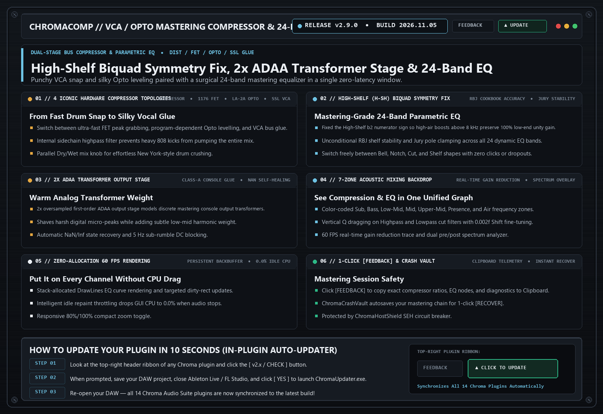

# ChromaComp `v2.9.0` — Release Notes (2026-11-05)

**[⬅ Back to ChromaComp Overview & Glossary](./README.md)**

## High-Shelf (H-SH) Biquad Fix, Jury Pole Clamping & Self-Healing EQ

### What Changed & Why It Matters Musically

- **Fixed High-Shelf (`H-SH`) Biquad `b2` Sign Bug**: Corrected the RBJ Audio EQ Cookbook numerator sign in `setHighShelf` so high-shelf boosts and cuts have accurate DC/low-frequency unity gain.
- **Jury Stability Clamping & `NaN` Self-Healing**: Protected all 20 dynamic EQ and sidechain detector filters against pole blowout.
- **Upgraded 1-Click Clipboard [FEEDBACK]**: Instant diagnostic summary copied to Clipboard.

---
### ⚡ How to Update in 10 Seconds
1. Click the **`[ v2.8.x / CHECK ]`** button in the top-right header bar of the plugin.
2. Close your DAW and click **`[ YES ]`** in the prompt to run `ChromaUpdater.exe`.
3. Re-open Ableton Live / FL Studio — you are now on the latest build!
