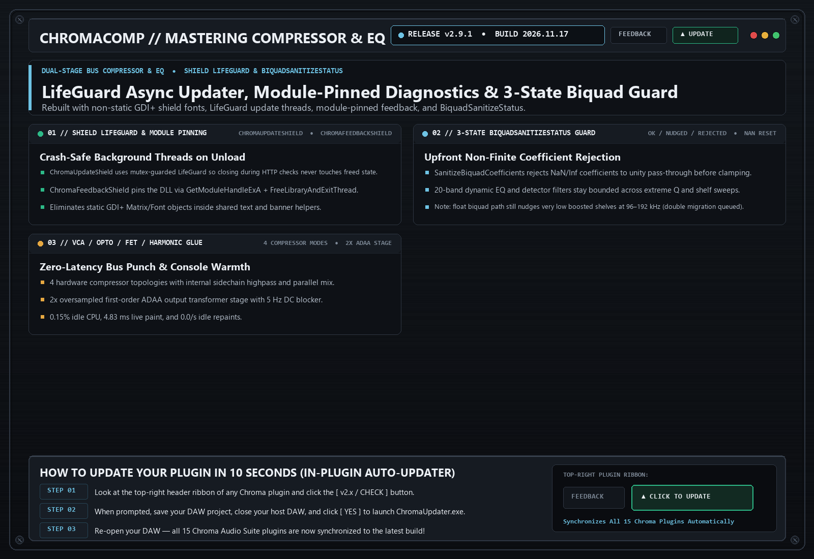

# ChromaComp `v2.9.1` — Release Notes (2026-11-17)

**[⬅ Back to ChromaComp Overview & Glossary](./README.md)**

## 3-State BiquadSanitizeStatus Guard, LifeGuard Updater & Module-Pinned Diagnostics

### What Changed & Why It Matters Musically

- **3-State `BiquadSanitizeStatus` Coefficient Guard**: Upgraded `ChromaAnalogSuite::SanitizeBiquadCoefficients` with upfront non-finite (`NaN`/`Inf`) rejection to unity pass-through.
- **`LifeGuard` Auto-Updater & Module-Pinned Feedback Shield**: Rebuilt with mutex-guarded `ChromaUpdateShield`, module-pinned `ChromaFeedbackShield` threads, and stack-only GDI+ fonts/matrices in `ChromaFastText`.

---
### ⚡ How to Update in 10 Seconds
1. Click the **`[ v2.x / CHECK ]`** button in the top-right header bar of the plugin.
2. Close your DAW and click **`[ YES ]`** in the prompt to run `ChromaUpdater.exe`.
3. Re-open your DAW — you are now on the latest build!
