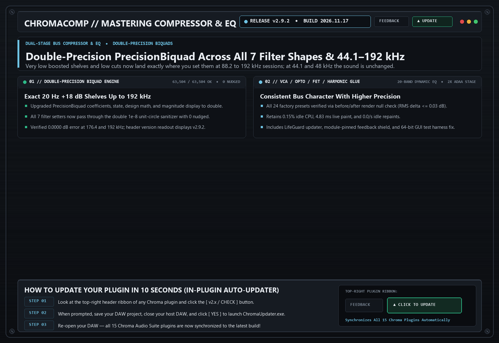

# ChromaComp `v2.9.2` — Release Notes (2026-11-17)

**[⬅ Back to ChromaComp Overview & Glossary](./README.md)**

## Double-Precision EQ Biquads Across All 7 Filter Shapes & 44.1–192 kHz

### What Changed & Why It Matters Musically

- **Plain-English DSP Summary**: Very low boosted shelves and low cuts now land exactly where you set them at 88.2 to 192 kHz sessions; at 44.1 and 48 kHz the sound is unchanged.
- **Double-Precision `PrecisionBiquad`**: Moved coefficients, filter state, design math, and magnitude display to `double`, with all 7 filter setters routed through the `1e-8` unit-circle sanitizer (`63,504/63,504` designs `Ok`, `0` nudged, `0` rejected).
- **Verified Preset Parity & Header Version**: All 24 factory presets verified across 48/96 kHz renders (`<= 0.03 dB` RMS delta) and in-plugin version badge now displays `v2.9.2`.

---
### ⚡ How to Update in 10 Seconds
1. Click the **`[ v2.x / CHECK ]`** button in the top-right header bar of the plugin.
2. Close your DAW and click **`[ YES ]`** in the prompt to run `ChromaUpdater.exe`.
3. Re-open your DAW — you are now on the latest build!
