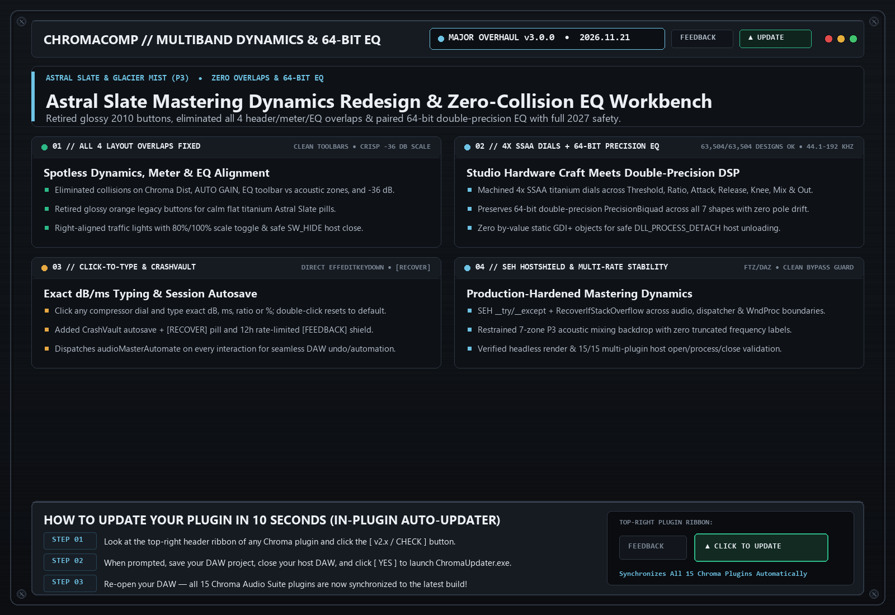

# ChromaComp `v3.0.0` — Release Notes (2026-11-21)

**[⬅ Back to ChromaComp Overview & Glossary](./README.md)**

## Astral Slate & Glacier Mist (P3) Overhaul, Zero-Collision EQ Workbench & 4x SSAA Dials

### What Changed & Why It Matters Musically

- **Eliminated All 4 Layout Overlaps**: Fixed collisions on `Chroma Dist`, `AUTO GAIN`, EQ toolbar vs acoustic zones, and `-36 dB`, and retired glossy 2010 orange buttons for flat titanium Astral Slate pills.
- **4x SSAA Machined Dials + 64-Bit Double-Precision EQ**: Pairs studio hardware visuals (zero static GDI+ objects) with 64-bit `PrecisionBiquad` stability (`63,504/63,504` Ok across `44.1–192 kHz`).
- **Click-to-Type, CrashVault & SEH HostShield**: Direct keyboard numeric entry on every dial, 1-click `[RECOVER]` session vault, `[FEEDBACK]` shield, `audioMasterAutomate` DAW sync, and safe `SW_HIDE` close.

---
### ⚡ How to Update in 10 Seconds
1. Click the **`[ v2.x / CHECK ]`** button in the top-right header bar of the plugin.
2. Close your DAW and click **`[ YES ]`** in the prompt to run `ChromaUpdater.exe`.
3. Re-open your DAW — you are now on the latest build!
