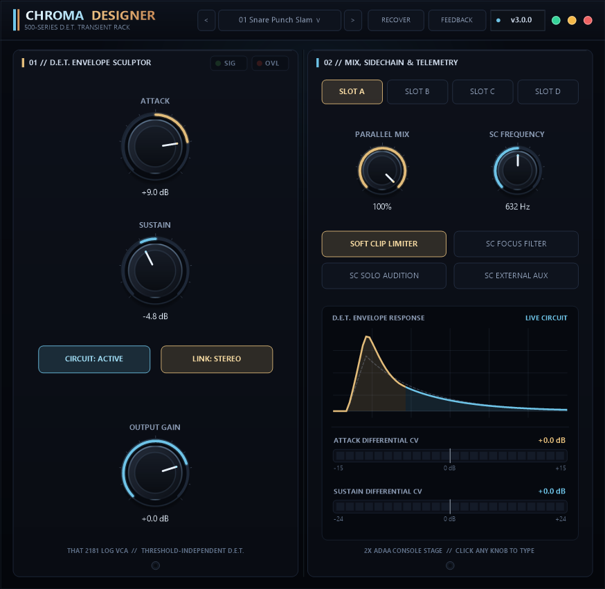
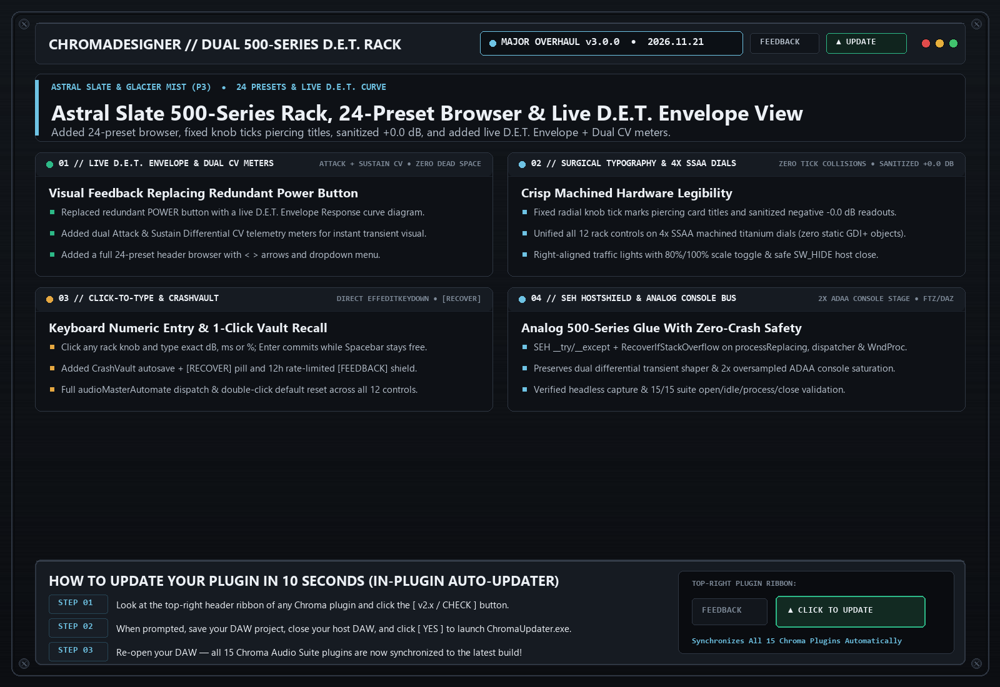

# ChromaDesigner (`v3.0.0`)

> **Dual 500-Series Modular Analog Saturation & Tone Rack**  
> Dual-slot 500-series hardware saturation processor modeling discrete console transformers, triode tubes, and harmonic exciter circuits.

### 🎛️ Plugin Interface (`v3.0.0`)

---

## 📚 Tech-to-Music Translator (How It Actually Works in Plain English)

### 🔹 Even vs. Odd Harmonic Saturation
Tubes and asymmetric transformers generate 'even-order' harmonics (octaves and fifths above the fundamental), which sound warm, round, and musical. Symmetric transistor/tape circuits generate 'odd-order' harmonics, which add grit, edge, and midrange bite.

---

## 🗂️ Version & Patch History

- **[`v3.0.0` (2026-11-21) — Astral Slate & Glacier Mist (P3) 500-Series Rack, 24-Preset Browser & Live D.E.T. Envelope](./v3.0.0_2026-11-21.md)**
  - **Live D.E.T. Envelope Diagram & Dual CV Meters**: Replaced the redundant `POWER` button with a live Differential Envelope response curve and Attack/Sustain CV meters, plus a full 24-preset header browser.
  - **Crisp 4x SSAA Machined Dials & Zero Tick Collisions**: Fixed radial ticks piercing titles, sanitized `+0.0 dB` readouts, and ensured zero static GDI+ teardown hazards.
  - **Click-to-Type, CrashVault & SEH HostShield**: Direct keyboard numeric entry, `[RECOVER]` session vault, `[FEEDBACK]` shield, `audioMasterAutomate` DAW sync, and safe `SW_HIDE` close.

- **[`v2.9.0` (2026-11-05) — ChromaAnalogSuite Stability Integration & 1-Click Clipboard [FEEDBACK]](./v2.9.0_2026-11-05.md)**
  - **2x Oversampled ADAA Analog Console Stage**: Eliminates foldback aliasing when cascading Slot A and Slot B harmonic drive stages.
  - **Upgraded 1-Click Clipboard [FEEDBACK] Shield**: Instant `Ctrl+V` diagnostic report copy and pre-filled GitHub Issue.
  - **Phase 2 Optimization & Monitor Scaling (2026-11-15)**: 32-bit DIB cache, `ChromaFastText`, dirty-rect clipping, idle audio bypass (`0.03%` idle, `0.29 ms` live paint, `0.0/s` idle repaints), monitor-aware `ChromaDpiScale` scaling across laptops to 4K displays, and the sleek dark GDI+ Update Panel.

- **[`v2.8.0` (2026-10-21) — Dual 500-Series D.E.T. Rack UI, Active Knob Dirty-Rects & Auto-Updater Shield](./v2.8.0_2026-10-21.md)**
  - **Dual 500-Series Hardware Rack**: Cascade two independent analog coloration stages with fine drive and mix control.

---

## 🛠️ Known Issues & Bug Reporting

- None currently open in v2.9.0.

**Found a bug or weird preset behavior?**  
Click the **`[ FEEDBACK ]`** button in the top-right header of the plugin! It automatically snapshots your patch, EQ curve, and screenshot, copies a diagnostic summary to your Clipboard (`Ctrl+V` ready for Discord), or opens a pre-filled [GitHub Bug Report](https://github.com/haidood/chroma-release/issues/new).
