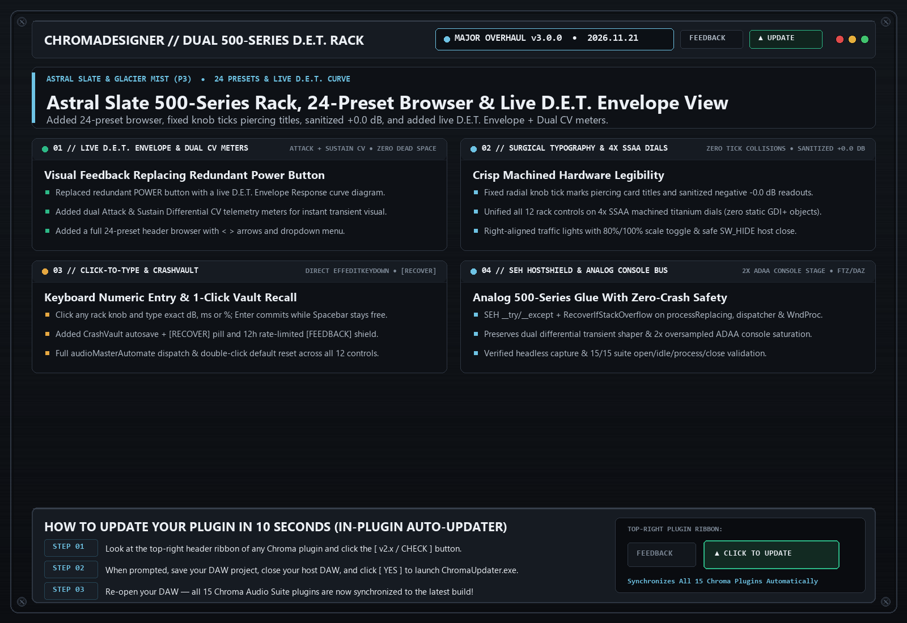

# ChromaDesigner `v3.0.0` — Release Notes (2026-11-21)

**[⬅ Back to ChromaDesigner Overview & Glossary](./README.md)**

## Astral Slate & Glacier Mist (P3) 500-Series Rack, 24-Preset Browser & Live D.E.T. Envelope

### What Changed & Why It Matters Musically

- **Live D.E.T. Envelope Diagram & Dual CV Meters**: Replaced the redundant `POWER` button with a live Differential Envelope response curve and Attack/Sustain CV meters, plus a full 24-preset header browser.
- **Crisp 4x SSAA Machined Dials & Zero Tick Collisions**: Fixed radial ticks piercing titles, sanitized `+0.0 dB` readouts, and ensured zero static GDI+ teardown hazards.
- **Click-to-Type, CrashVault & SEH HostShield**: Direct keyboard numeric entry, `[RECOVER]` session vault, `[FEEDBACK]` shield, `audioMasterAutomate` DAW sync, and safe `SW_HIDE` close.

---
### ⚡ How to Update in 10 Seconds
1. Click the **`[ v2.x / CHECK ]`** button in the top-right header bar of the plugin.
2. Close your DAW and click **`[ YES ]`** in the prompt to run `ChromaUpdater.exe`.
3. Re-open your DAW — you are now on the latest build!
