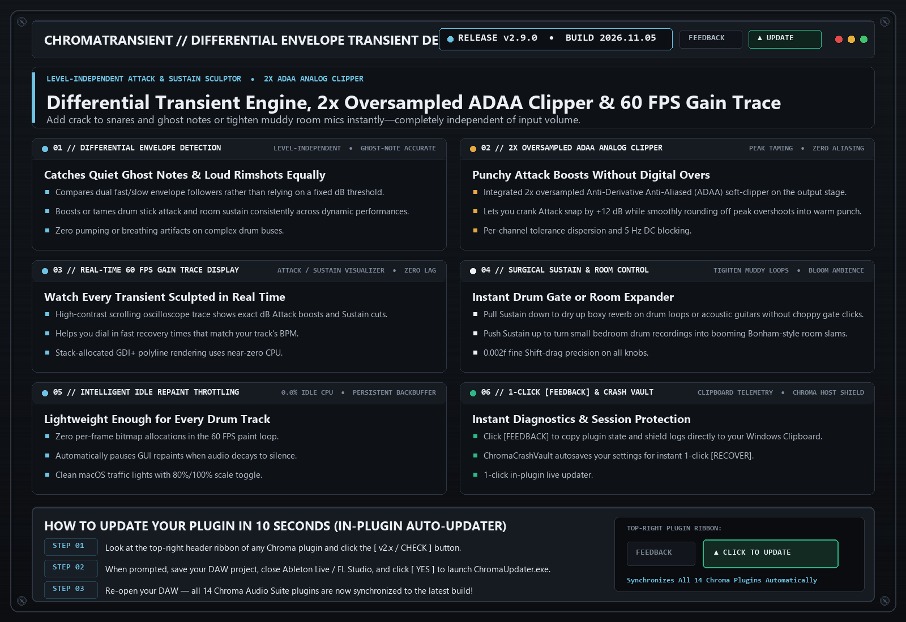

# ChromaTransientShaper (`v2.9.0`)

> **Differential Envelope Transient Designer**  
> Level-independent transient shaper that lets you boost or tame drum attack snap and room sustain regardless of how loud or quiet the incoming hit is.

---

## 📚 Tech-to-Music Translator (How It Actually Works in Plain English)

### 🔹 Differential Envelope Detection
Instead of using a fixed volume threshold (which misses quiet ghost notes on a snare), a Differential Envelope compares a fast volume tracker against a slow volume tracker. Whenever the fast tracker jumps above the slow one, it knows a drum stick just hit the skin—letting you add crack to both quiet ghost notes and loud rimshots equally.

---

## 🗂️ Version & Patch History

- **[`v2.9.0` (2026-11-05) — ChromaAnalogSuite Stability Integration & 1-Click Clipboard [FEEDBACK]](./v2.9.0_2026-11-05.md)**
  - **2x Oversampled ADAA Analog Clipper Stage**: Lets you boost drum Attack snap cleanly while smoothly rounding off peak overshoots into warm analog punch.
  - **Upgraded 1-Click Clipboard [FEEDBACK] Shield**: Captures plugin state, screenshot, and `host_shield_log.txt` directly to your Windows Clipboard (`Ctrl+V` ready).

- **[`v2.8.0` (2026-10-21) — Differential Transient Engine, Targeted Dirty-Rects & 0.002f Precision](./v2.8.0_2026-10-21.md)**
  - **Level-Independent Attack & Sustain Shaping**: Punch up kicks and snares or tighten muddy room mics in seconds.
  - **Zero-Lag Real-Time Gain Trace Display**: Watch exact attack and sustain gain changes at 60 FPS.

---

## 🛠️ Known Issues & Bug Reporting

- None currently open in v2.9.0.

**Found a bug or weird preset behavior?**  
Click the **`[ FEEDBACK ]`** button in the top-right header of the plugin! It automatically snapshots your patch, EQ curve, and screenshot, copies a diagnostic summary to your Clipboard (`Ctrl+V` ready for Discord), or opens a pre-filled [GitHub Bug Report](https://github.com/haidood/chroma-release/issues/new).
