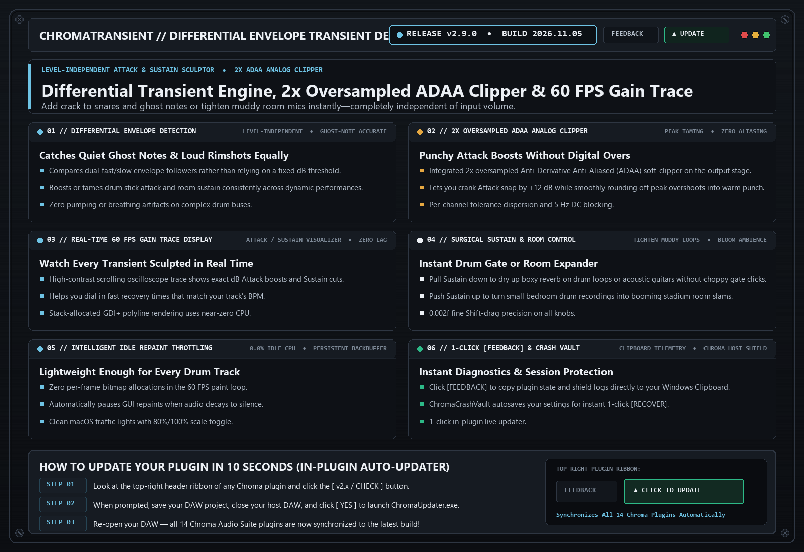

# ChromaTransientShaper `v2.9.0` — Release Notes (2026-11-05)

**[⬅ Back to ChromaTransientShaper Overview & Glossary](./README.md)**

## ChromaAnalogSuite Stability Integration & 1-Click Clipboard [FEEDBACK]

### What Changed & Why It Matters Musically

- **2x Oversampled ADAA Analog Clipper Stage**: Lets you boost drum Attack snap cleanly while smoothly rounding off peak overshoots into warm analog punch.
- **Upgraded 1-Click Clipboard [FEEDBACK] Shield**: Captures plugin state, screenshot, and `host_shield_log.txt` directly to your Windows Clipboard (`Ctrl+V` ready).

---
### ⚡ How to Update in 10 Seconds
1. Click the **`[ v2.x / CHECK ]`** button in the top-right header bar of the plugin.
2. Close your DAW and click **`[ YES ]`** in the prompt to run `ChromaUpdater.exe`.
3. Re-open your DAW — you are now on the latest build!
