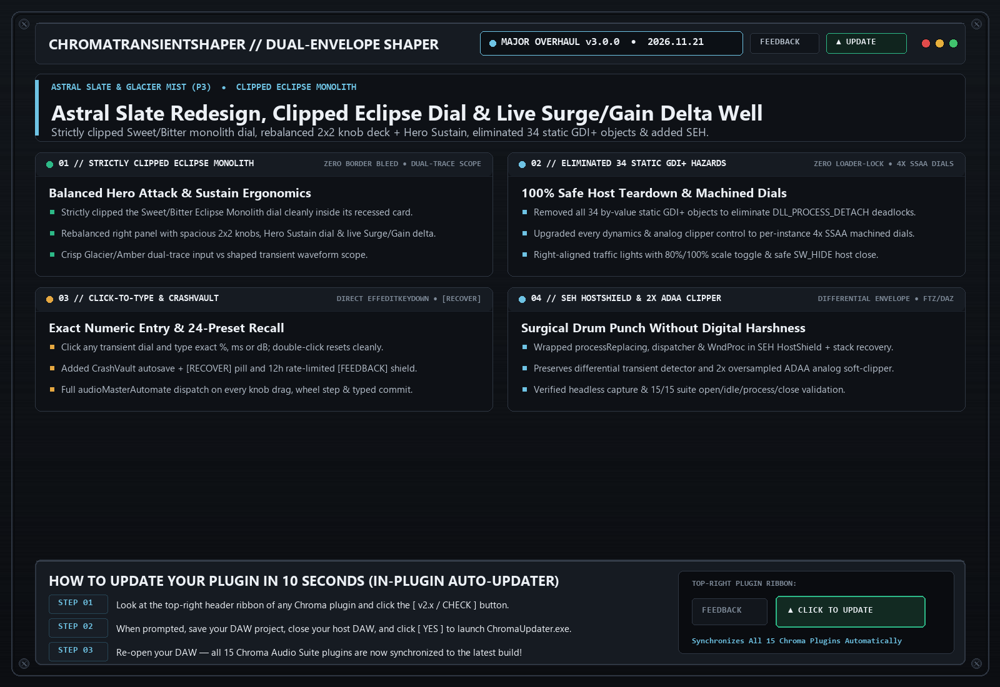

# ChromaTransientShaper `v3.0.0` — Release Notes (2026-11-21)

**[⬅ Back to ChromaTransientShaper Overview & Glossary](./README.md)**

## Astral Slate & Glacier Mist (P3) Redesign, Clipped Eclipse Dial & 34 Static GDI+ Fixes

### What Changed & Why It Matters Musically

- **Strictly Clipped Eclipse Monolith & Balanced 2x2 Right Deck**: Clipped the Sweet/Bitter monolith dial cleanly inside its card, paired with a balanced 2x2 knob grid, Hero Sustain dial, dual-trace scope, and live Surge/Gain delta well.
- **Eliminated All 34 Static GDI+ Objects**: Zero loader-lock teardown hazards on host plugin removal, upgraded to per-instance 4x SSAA machined titanium dials.
- **Click-to-Type, CrashVault & SEH HostShield**: Direct `effEditKeyDown` numeric entry, `[RECOVER]` session autosave, `[FEEDBACK]` shield, `audioMasterAutomate` sync, and safe `SW_HIDE` close.

---
### ⚡ How to Update in 10 Seconds
1. Click the **`[ v2.x / CHECK ]`** button in the top-right header bar of the plugin.
2. Close your DAW and click **`[ YES ]`** in the prompt to run `ChromaUpdater.exe`.
3. Re-open your DAW — you are now on the latest build!
