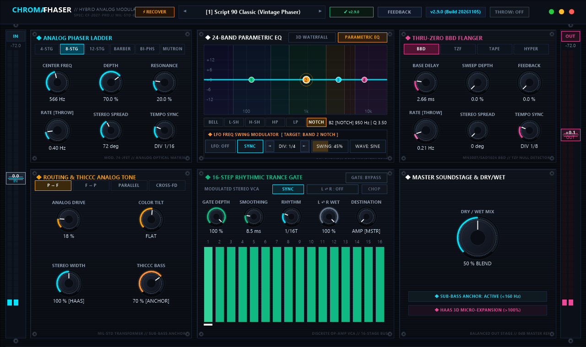
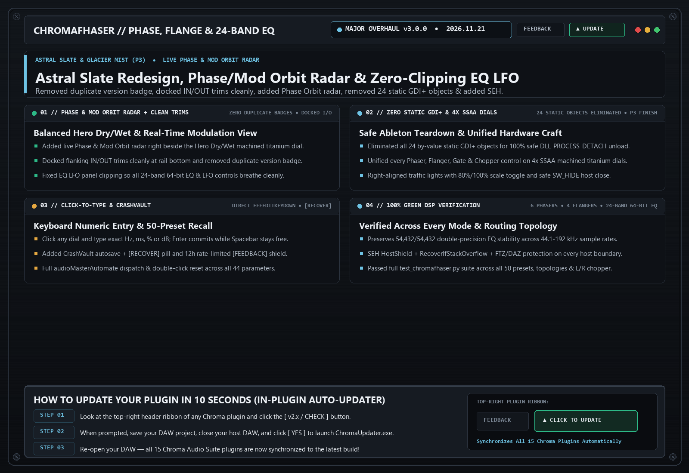

# ChromaFhaser (`v3.0.0`)

> **40-Stage Dual Harmonic Phase Processor**  
> Deep analog-modeled phaser with up to 40 all-pass stages, thru-zero flanger, 3D waterfall spectrum display, and 24-band parametric EQ sculpting.

### 🎛️ Plugin Interface (`v3.0.0`)

---

## 📚 Tech-to-Music Translator (How It Actually Works in Plain English)

### 🔹 All-Pass Phase Cancellation Stages
A phaser doesn't delay the whole sound like a flanger; instead, it pushes specific frequencies out of phase using 'all-pass filters'. When mixed back with your dry signal, those frequencies cancel out into deep, sweeping notches. More stages = more notches sweeping across your spectrum at once.

---

## 🗂️ Version & Patch History

- **[`v3.0.0` (2026-11-21) — Astral Slate & Glacier Mist (P3) Overhaul, Phase/Mod Orbit Radar & 24 Static GDI+ Fixes](./v3.0.0_2026-11-21.md)**
  - **Live Phase & Mod Orbit Radar + Clean Flanking Trims**: Added a real-time Phase & Modulation Orbit display beside the Hero Dry/Wet dial, docked IN/OUT trims cleanly, removed duplicate version badge, and fixed EQ LFO clipping.
  - **Eliminated All 24 Static GDI+ Hazards + 64-Bit EQ**: Zero `DLL_PROCESS_DETACH` teardown risk while preserving 54,432/54,432 double-precision 24-band EQ stability across `44.1–192 kHz`.
  - **Click-to-Type, CrashVault & SEH HostShield**: Direct `effEditKeyDown` numeric entry, `[RECOVER]` autosave, `[FEEDBACK]` shield, `audioMasterAutomate` sync, and safe `SW_HIDE` close.

- **[`v2.9.2` (2026-11-17) — Double-Precision 24-Band EQ Biquads Across 44.1–192 kHz](./v2.9.2_2026-11-17.md)**
  - **Plain-English DSP Summary**: Very low boosted shelves and low cuts now land exactly where you set them at 88.2 to 192 kHz sessions; at 44.1 and 48 kHz the sound is unchanged.
  - **Double-Precision EQ `Biquad`**: Moved coefficients, filter state, design math, and magnitude display to `double` with `1e-8` unit-circle sanitization (`54,432/54,432` designs `Ok`, `0` nudged, `0` rejected).
  - **Verified 50-Preset Null & Header Version**: All 50 factory presets null to `-84 dBFS` (`48 kHz`) and `-90 dBFS` (`96 kHz`), and the in-plugin header now renders `v2.9.2`.

- **[`v2.9.1` (2026-11-17) — LifeGuard Startup Update Check, Module-Pinned Diagnostics & 3-State Biquad Guard](./v2.9.1_2026-11-17.md)**
  - **`LifeGuard`-Protected Startup Update Check**: Secures `CheckForUpdateAsync()` on editor open with mutex-guarded lifetime checks so closing or removing the plugin mid-request never touches freed memory.
  - **3-State `BiquadSanitizeStatus` & Module-Pinned Feedback Shield**: Upgraded biquad coefficient sanitization and pinned background diagnostic threads against `FreeLibrary` unload races.

- **[`v2.9.0` (2026-11-05) — High-Shelf (H-SH) Biquad Fix, Jury Pole Clamping & Clipboard [FEEDBACK]](./v2.9.0_2026-11-05.md)**
  - **Fixed High-Shelf (`H-SH`) Biquad `b2` Sign Bug**: Corrected the high-shelf numerator coefficient in `Biquad::Setup` so shelf boosts/cuts maintain accurate low-end unity gain.
  - **Jury Stability Triangle Clamping**: Protected all 24 parametric EQ bands against extreme `Q` / shelf transitions.
  - **Upgraded 1-Click Clipboard [FEEDBACK]**: Instant `Ctrl+V` diagnostic report copy.
  - **Phase 2 Optimization (2026-11-15)**: Fixed linear-RMS timer trap, added 32-bit DIB backbuffer, `ChromaFastText`, clip culling, and idle audio bypass (`0.16%` idle, `0.02%` post-tail, `4.81 ms` live paint, `0.0/s` idle repaints).

- **[`v2.8.0` (2026-10-21) — 7-Zone Mixing Backdrop, DrawLines Waterfall Slices & Auto-Updater Shield](./v2.8.0_2026-10-21.md)**
  - **Up to 40 All-Pass Stages**: Go from vintage 4-stage guitar swirl to deep 40-stage sci-fi talking dispersion.
  - **Zero-Lag Waterfall Visualizer**: High-speed `DrawLines` 3D spectral waterfall.

---

## 🛠️ Known Issues & Bug Reporting

- None currently open in v2.9.2.

**Found a bug or weird preset behavior?**  
Click the **`[ FEEDBACK ]`** button in the top-right header of the plugin! It automatically snapshots your patch, EQ curve, and screenshot, copies a diagnostic summary to your Clipboard (`Ctrl+V` ready for Discord), or opens a pre-filled [GitHub Bug Report](https://github.com/haidood/chroma-release/issues/new).
