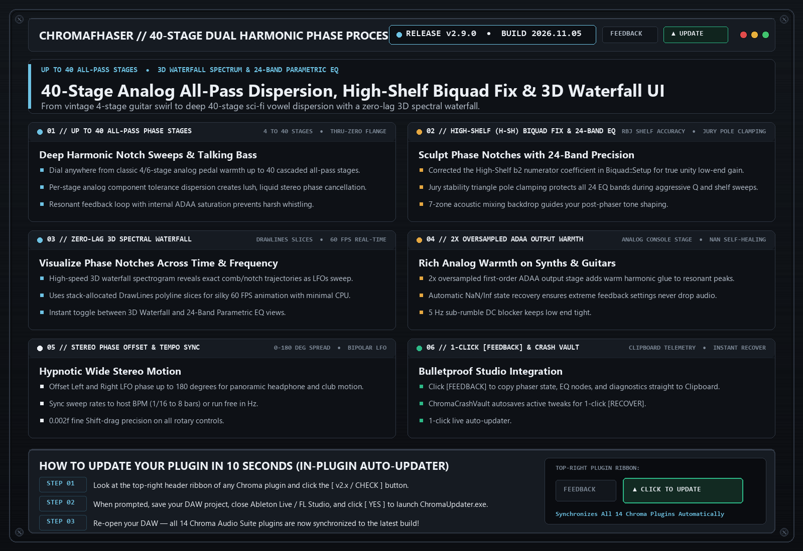

# ChromaFhaser (`v2.9.0`)

> **40-Stage Dual Harmonic Phase Processor**  
> Deep analog-modeled phaser with up to 40 all-pass stages, thru-zero flanger, 3D waterfall spectrum display, and 24-band parametric EQ sculpting.

---

## 📚 Tech-to-Music Translator (How It Actually Works in Plain English)

### 🔹 All-Pass Phase Cancellation Stages
A phaser doesn't delay the whole sound like a flanger; instead, it pushes specific frequencies out of phase using 'all-pass filters'. When mixed back with your dry signal, those frequencies cancel out into deep, sweeping notches. More stages = more notches sweeping across your spectrum at once.

---

## 🗂️ Version & Patch History

- **[`v2.9.0` (2026-11-05) — High-Shelf (H-SH) Biquad Fix, Jury Pole Clamping & Clipboard [FEEDBACK]](./v2.9.0_2026-11-05.md)**
  - **Fixed High-Shelf (`H-SH`) Biquad `b2` Sign Bug**: Corrected the high-shelf numerator coefficient in `Biquad::Setup` so shelf boosts/cuts maintain accurate low-end unity gain.
  - **Jury Stability Triangle Clamping**: Protected all 24 parametric EQ bands against extreme `Q` / shelf transitions.
  - **Upgraded 1-Click Clipboard [FEEDBACK]**: Instant `Ctrl+V` diagnostic report copy.

- **[`v2.8.0` (2026-10-21) — 7-Zone Mixing Backdrop, DrawLines Waterfall Slices & Auto-Updater Shield](./v2.8.0_2026-10-21.md)**
  - **Up to 40 All-Pass Stages**: Go from vintage 4-stage guitar swirl to deep 40-stage sci-fi talking dispersion.
  - **Zero-Lag Waterfall Visualizer**: High-speed `DrawLines` 3D spectral waterfall.

---

## 🛠️ Known Issues & Bug Reporting

- None currently open in v2.9.0.

**Found a bug or weird preset behavior?**  
Click the **`[ FEEDBACK ]`** button in the top-right header of the plugin! It automatically snapshots your patch, EQ curve, and screenshot, copies a diagnostic summary to your Clipboard (`Ctrl+V` ready for Discord), or opens a pre-filled [GitHub Bug Report](https://github.com/haidood/chroma-release/issues/new).
