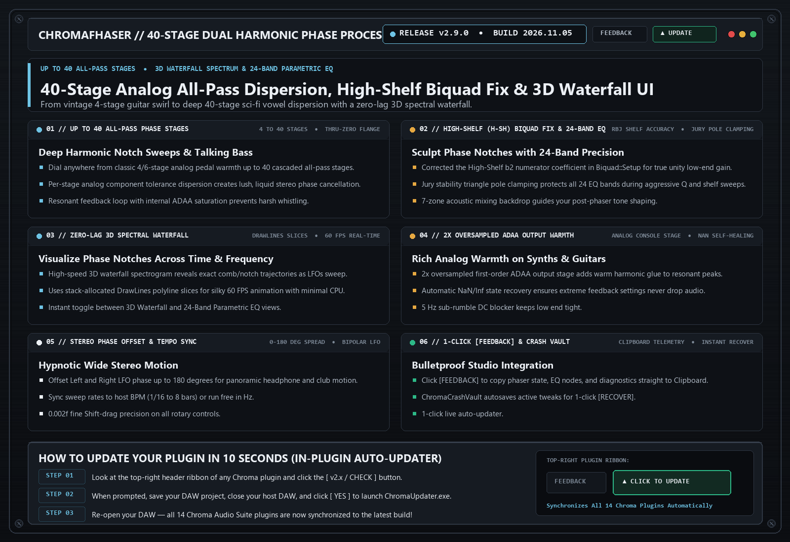

# ChromaFhaser `v2.9.0` — Release Notes (2026-11-05)

**[⬅ Back to ChromaFhaser Overview & Glossary](./README.md)**

## High-Shelf (H-SH) Biquad Fix, Jury Pole Clamping & Clipboard [FEEDBACK]

### What Changed & Why It Matters Musically

- **Fixed High-Shelf (`H-SH`) Biquad `b2` Sign Bug**: Corrected the high-shelf numerator coefficient in `Biquad::Setup` so shelf boosts/cuts maintain accurate low-end unity gain.
- **Jury Stability Triangle Clamping**: Protected all 24 parametric EQ bands against extreme `Q` / shelf transitions.
- **Upgraded 1-Click Clipboard [FEEDBACK]**: Instant `Ctrl+V` diagnostic report copy.

---
### ⚡ How to Update in 10 Seconds
1. Click the **`[ v2.x / CHECK ]`** button in the top-right header bar of the plugin.
2. Close your DAW and click **`[ YES ]`** in the prompt to run `ChromaUpdater.exe`.
3. Re-open your DAW — you are now on the latest build!
